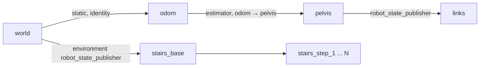

# Legged Robot MPC Controller

[`ros2_control`](https://control.ros.org/rolling/index.html) implementation for legged robot MPC using [`ocs2_ros2`](https://github.com/wei-hsuan-cheng/ocs2_ros2.git) and [`pinocchio`](https://github.com/stack-of-tasks/pinocchio.git).  Tested in [`ros2 jazzy`](https://docs.ros.org/en/jazzy/index.html) and [`mujoco`](https://mujoco.readthedocs.io/en/stable/overview.html) simulation environment.


## Interactive Velocity and Base Height Control via GUI & Joystick

<p align="center">
  
</p>


## MPC Formulations

This repository contains examples for two MPC formulations: **whole-body inverse dynamics vs. centroidal dynamics (hierarchical)**.


### Whole-Body Inverse Dynamics MPC
The **whole-body inverse dynamics MPC** jointly optimizes floating-base and joint configurations and velocities, contact wrenches, generalized accelerations, and joint torques. Full rigid-body dynamics are imposed through the recursive Newton-Euler algorithm (RNEA): floating-base dynamics are enforced throughout the prediction horizon, while actuated-joint inverse dynamics and torque limits are enforced within a configurable initial torque window. The implementation adapts the formulations in [(RA-L2024) Khazoom et al., Tailoring Solution Accuracy for Fast Whole-body Model Predictive Control of Legged Robots](https://arxiv.org/abs/2407.10789) and [(RA-L2025) Molnar et al., Whole-Body Inverse Dynamics MPC for Legged Loco-Manipulation](https://arxiv.org/abs/2511.19709) to OCS2's SQP solver and the G1 humanoid.

See [WB-ID MPC Formulation and Signal Flow](./docs/humanoid_whole_body_inverse_dynamics_mpc.md) for equations and control diagrams, and [WB-ID MPC Implementation Guide](./docs/humanoid_whole_body_inverse_dynamics_mpc_impl.md) for code-line references and parameter mappings.


### Centroidal Dynamics MPC
The centroidal MPC optimizes over the **whole-body kinematics** and the center of mass dynamics, with a choice to either use a single rigid body model or the full centroidal dynamics. This specific approach builds up on the centroidal model in ocs2 by generalizing costs and constraints to a 6-DoF contact among others. A conscise explanation of the ocs2 centroidal model can be found in [(RA-L2021) Sleiman et. al., A Unified MPC Framework for Whole-Body Dynamic Locomotion and Manipulation](https://arxiv.org/abs/2103.00946).


## Build and Install

- Clone this repo
  ```bash
  git clone https://github.com/wei-hsuan-cheng/legged_robot_mpc_controller.git
  ```

- Clone all sub-repo with vcs
  ```bash
  cd <workspace_dir>/src
  mkdir legged_robot_mpc_controller_dependencies
  vcs import < legged_robot_mpc_controller/legged_robot_mpc_controller.repos
  ```

- First install by `rosdep`
  ```bash
  # rosdep install
  cd <workspace_dir>
  sudo rosdep init # if you never did this
  rosdep update
  rosdep install --ignore-src --from-paths src -y -r
  ```

- Build pkgs up-to `legged_robot_mpc_controller`
  ```bash
  cd <workspace_dir>
  NUM_JOBS=2 && \
  export CMAKE_BUILD_PARALLEL_LEVEL=${NUM_JOBS} && \
  export MAKEFLAGS=-j${NUM_JOBS} && \
  export NINJAFLAGS=-j${NUM_JOBS} && \
  colcon build --symlink-install \
    --packages-up-to legged_robot_mpc_controller \
    --executor sequential --parallel-workers ${NUM_JOBS} \
    --cmake-force-configure \
    --cmake-args -DBUILD_TESTING=OFF -DCMAKE_BUILD_TYPE=Release && \
    . install/setup.bash
  ```


## Run MuJoCo Example

Two MPC controllers are available, selected with `mpcControllerName`. Both walk with the same gait, references, estimator and bring-up; they differ in the model the MPC plans with.

| `mpcControllerName` | MPC | state / input |
|---|---|---|
| `humanoid_whole_body_inverse_dynamics_mpc_controller` | whole-body inverse dynamics + whole-body kinematics | `[q, v]` / `[W, a, tau_j]` |
| `humanoid_centroidal_mpc_controller` (default) | centroidal dynamics + whole-body kinematics | `[h/m, q]` / `[W, qd_j]` |

**Launch the humanoid robot MPC**:
```bash
cd <workspace_dir>
ros2 launch legged_robot_mpc_controller g1.launch.py \
  mpcControllerName:=humanoid_whole_body_inverse_dynamics_mpc_controller \
  mpcFreq:=90 \
  mrtFreq:=1000 \
  rviz:=true \
  mujoco_headless:=false \
  baseCommandGui:=true

# mpcControllerName:=humanoid_whole_body_inverse_dynamics_mpc_controller | humanoid_centroidal_mpc_controller
```

The first launch of each controller generates and compiles its CppAD libraries (several minutes); later launches load them from the cache.


**Useful launch args:**

```bash
baseCommandGui:=true | false
spawnMpcController:=true | false         # false is only for environment smoke tests; the robot will not balance
mpcControllerName:=humanoid_whole_body_inverse_dynamics_mpc_controller | humanoid_centroidal_mpc_controller
use_mujoco_sim:=true | false             # false: plain ros2_control_node (fake hardware)
use_fake_hardware:=false | true          # mock_components/GenericSystem when not using MuJoCo
ros2ControlCommandInterface:=effort | effort_pd | position
mujocoEffortCommandMode:=actuator | qfrc_applied
initialPoseFile:=<...>/initial_pose.yaml # initial joint state (config/g1/initial_pose.yaml)
rviz:=true | false
mujoco_headless:=false | true
mujoco_wait_to_start:=true | false       # paused start + /mujoco_ros2_control/start service
mujoco_real_time_factor:=1.0             # double
mujoco_publish_rate:=100.0               # double
gt_enabled:=true | false                 # floating-base ground-truth odometry for visualization / ROS consumers
gt_body_frame:=pelvis                    # MuJoCo body published as ground truth
mpcFreq:=100                             # integer
mrtFreq:=1000                            # integer
libFolder:=auto_generated/g1             # CppAD codegen output (wb_id_mpc_g1/, centroidal_mpc_g1/ inside)
mujocoModelFile:=scene.xml               # swap scene: boxes / stairs / slope in description/mujoco
stairClimbingFile:=<pkg_share>/config/terrains/stair_climbing/g1.yaml
terrainWalkingFile:=<pkg_share>/config/terrains/terrain_walking/g1.yaml
```


### Unitree H2 (WB-ID Only)

H2 has its own [launch file](./launch/h2.launch.py), [controller parameters](./config/h2/ros2_controllers.yaml) and [official-model provenance](./description/urdf/robots/h2/MODEL_SOURCE.md).
Its controller YAML contains no centroidal MPC configuration; the existing WB-ID controller optimizes 25 joints, including both head joints, while the six wrist joints are held at zero.
The head uses the existing Cartesian frame-tracking cost, and torso stabilization uses `torsoTiltCost` rather than another torso frame tracker.
See [H2 Integration and Validation](./docs/h2_wb_id_mpc.md) for the model corrections, tuning evidence and tested operating range.

```bash
ros2 launch legged_robot_mpc_controller h2.launch.py \
  mujocoModelFile:=scene_h2_flat.xml \
  environmentDescription:="" \
  mpcFreq:=100 mrtFreq:=1000 \
  rviz:=true mujoco_headless:=false baseCommandGui:=true
```

The default H2 floating-base feedback is `humanoid_linear_kf`, as in the current G1 WB-ID setup.
H2's nominal pelvis height is 1.02 m, not G1's height; generated libraries are stored separately under `auto_generated/h2/wb_id_mpc_h2/`.
Use `scene_h2.xml` or `scene_h2_ramp.xml` for the shared staircase or ramp environment, but these scenes do not imply that H2 terrain walking has been validated.
Both launches select their own planner variant from shared [`config/terrains/`](./config/terrains/README.md); H2 uses `h2.yaml`, while G1 uses `g1.yaml`.


### Scripted trajectory tests (figure-eight)

`launch/figure_eight_command.py` walks a closed figure-eight (Gerono lemniscate) at **constant speed** with a **sinusoidal pelvis height**, publishing the same `WalkingVelocityCommand` topic the GUI uses. Make sure first launch robot with `baseCommandGui:=false`.

```bash
cd <workspace_dir>
source install/setup.bash
ros2 run legged_robot_mpc_controller figure_eight_command.py
```

### Base targets

**Base twist command**:
```bash
# Select twist tracking
ros2 topic pub --once /humanoid/target_mode \
  std_msgs/msg/String "{data: base_pose}"

# Publish twist command
ros2 topic pub -r 50 /humanoid/walking_velocity_command \
  ocs2_msgs/msg/WalkingVelocityCommand \
  "{linear_velocity_x: 0.25, linear_velocity_y: 0.0,
    desired_pelvis_height: 0.7925, angular_velocity_z: 0.0}"
```

<!-- **Base pose command**:

> WORK IN PROGRESS

```bash
# Select pose tracking
ros2 topic pub --once /humanoid/target_mode \
  std_msgs/msg/String "{data: base_pose}"

# Publish pose command
ros2 topic pub --once /humanoid/base_pose_command \
  geometry_msgs/msg/PoseStamped \
  "{header: {frame_id: world},
    pose: {
      position: {x: 0.0, y: 0.0, z: 0.7925},
      orientation: {x: 0.0, y: 0.0, z: 0.0, w: 1.0}
    }}"
``` -->


### Arm joint / frame-relation targets (`/humanoid/mpc_targets`)

Arm `joint` and `default` commands are implemented for both MPC controllers.
`frame_relation` and `joint_frame_relation` are currently implemented for the centroidal controller only; WB-ID does not declare frame pairs or register their tracking costs.

| `command_type` | Meaning |
|---|---|
| `joint` | Track arm joint positions. One trajectory; states cover exactly the tracked arm joints (shoulder + elbow), ordered by `joint_names`. Overrides the built-in gait arm swing. |
| `frame_relation` | Track the relative pose of a leaf frame expressed in a reference frame. Convention (matching `mpc_controllers`): `source_frames[i]` is the reference (root) frame — a robot frame such as `pelvis`, or a global frame (`world`) — and `target_frames[i]` is the tracked leaf frame (a hand). One trajectory per pair; states are `[position xyz, quaternion xyzw]` of target expressed in source. Optional `frame_relation_tracking_weights` (6 per pair: position xyz, orientation xyz) override the configured defaults. |
| `joint_frame_relation` | Both at once: the joint trajectory first in `target_trajectories`, then one per frame pair. |
| `default` | Clear all external targets and revert to the built-in posture + gait arm swing. |


Sample target publishers in [`launch/command/mpc_targets/`](./launch/command/mpc_targets/):

```bash
# Sine arm-joint swing (command_type: joint)
ros2 run legged_robot_mpc_controller joint_tracking_target.py

# Hold both hands at pelvis-relative poses (command_type: frame_relation)
ros2 run legged_robot_mpc_controller frame_relation_tracking_target.py

# Fixed arm posture + left-hand pose target together (command_type: joint_frame_relation)
ros2 run legged_robot_mpc_controller joint_frame_relation_tracking_target.py

# Switch back to the built-in arm-swing reference
ros2 topic pub --once /humanoid/mpc_targets ocs2_msgs/msg/MpcTargets "{command_type: 'default'}"
```

Minimal one-shot CLI examples:

```bash
# Hold both arms at a raised posture (command_type: joint)
ros2 topic pub --once /humanoid/mpc_targets ocs2_msgs/msg/MpcTargets "{
  command_type: 'joint',
  joint_names: [left_shoulder_pitch_joint, left_shoulder_roll_joint, left_shoulder_yaw_joint, left_elbow_joint,
                right_shoulder_pitch_joint, right_shoulder_roll_joint, right_shoulder_yaw_joint, right_elbow_joint],
  target_trajectories: [{time_trajectory: [0.0],
                         state_trajectory: [{value: [0.3, 0.0, 0.0, 0.6, 0.3, 0.0, 0.0, 0.6]}],
                         input_trajectory: [{value: []}]}]}"

# Move the left hand to a pelvis-relative pose (command_type: frame_relation;
# source = reference frame, target = tracked leaf frame)
ros2 topic pub --once /humanoid/mpc_targets ocs2_msgs/msg/MpcTargets "{
  command_type: 'frame_relation',
  source_frames: [pelvis],
  target_frames: [left_rubber_hand],
  target_trajectories: [{time_trajectory: [0.0],
                         state_trajectory: [{value: [0.32, 0.15, 0.20, 0.0, 0.0, 0.0, 1.0]}],
                         input_trajectory: [{value: []}]}]}"
```

Supported target channels are soft costs balanced against the rest of the MPC; raise the command weights to track tighter.


## Robot Description and Frames

Descriptions are grouped by format: `description/meshes/robots/g1/`, `description/mujoco/robots/g1/` and `description/urdf/robots/g1/` contain the G1 assets.
Scene entry points and shared simulation environments live under `description/mujoco/`, while RViz environment descriptions live under `description/urdf/terrains/`.
See the [description layout](./description/README.md) and [MuJoCo scene composition guide](./description/mujoco/README.md).

There is one robot URDF, [`description/urdf/robots/g1/g1_29dof.urdf`](./description/urdf/robots/g1/g1_29dof.urdf), rooted at the pelvis with **no `world` link and no floating joint**. The MPC and the estimators add the floating base themselves (Pinocchio), MuJoCo owns its free joint in the MJCF, and the base pose reaches the TF tree from the estimator. [`g1.ros2_control.xacro`](./description/urdf/robots/g1/g1.ros2_control.xacro) includes that URDF and adds the `<ros2_control>` block; the result is the single `/robot_description`, used by the controller manager and robot_state_publisher.

The environment is not part of the robot: [`stairs.urdf.xacro`](./description/urdf/terrains/stairs.urdf.xacro), rooted at `world` and driven by the same [`stairs_params.yaml`](./config/terrains/stairs_params.yaml) as the MuJoCo stairs, is published by a second robot_state_publisher as `/environment/robot_description` (the "Environment" display in rviz). Pass `environmentDescription:=""` with a scene that has no stairs, e.g. `scene_flat.xml`.



- `odom → pelvis` is the estimate, published as TF by the estimator controller next to `/humanoid/state_estimate/odom`. It appears once the bring-up initialises the estimator.
- `world → odom` is identity until something localises the robot, so estimator drift (x, y, yaw) shows as the robot moving relative to the stairs. A localisation source such as lidar or markers would replace the static transform.

For simulation debugging, `floatingBaseSource:=ground_truth_state` can replace estimator feedback with GT, but this bypass is not available for real-world deployment.


## Acknowledgements

- Reference implementation for the whole-body inverse dynamics MPC formulation: [`lukasmolnar/wb-mpc-locoman`](https://github.com/lukasmolnar/wb-mpc-locoman)
- The original code implementation of humanoid centroidal MPC: [`manumerous/wb_humanoid_mpc`](https://github.com/manumerous/wb_humanoid_mpc)


## Contact

- **Author**: Wei-Hsuan Cheng [(johnathancheng0125@gmail.com)](mailto:johnathancheng0125@gmail.com)
- **Homepage**: [wei-hsuan-cheng](https://wei-hsuan-cheng.github.io)
- **GitHub**: [wei-hsuan-cheng](https://github.com/wei-hsuan-cheng)
