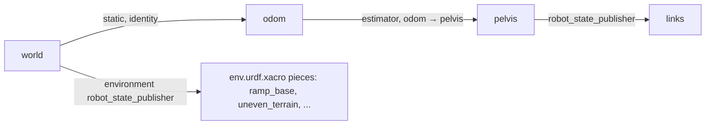

# Legged Robot MPC Controller

[`ros2_control`](https://control.ros.org/rolling/index.html) implementation for legged robot MPC using [`ocs2_ros2`](https://github.com/wei-hsuan-cheng/ocs2_ros2.git) and [`pinocchio`](https://github.com/stack-of-tasks/pinocchio.git).  Tested in [`ros2 jazzy`](https://docs.ros.org/en/jazzy/index.html) and [`mujoco`](https://mujoco.readthedocs.io/en/stable/overview.html) simulation environment.


## Demos

<table align="center">
  <tr>
    <td align="center" width="50%">
      
    </td>
    <td align="center" width="50%">
      
    </td>
  </tr>
  <tr>
    <td align="center"><b>Unitree G1</b><br />Velocity and base-height control</td>
    <td align="center"><b>Unitree H2</b><br />Visualization of MPC future robot trajectory</td>
  </tr>
</table>

<p align="center">
  
  <br />
  <b>Unitree H2</b><br />Runs, stops, stumbles, and regains balance
</p>

<p align="center">
  
  <br />
  <b>Unitree H2</b><br />Uneven terrain locomotion with proprioception only
</p>

<p align="center">
  
  <br />
  <b>Wheeled-Biped <a href="https://github.com/upkie/upkie">Upkie</a> (with rolling-contact conditions)</b><br />Swings itself up, balances, and drives through uneven terrains with steps and ramps
</p>

<table align="center">
  <tr>
    <td align="center" width="50%">
      
    </td>
    <td align="center" width="50%">
      
    </td>
  </tr>
  <tr>
    <td align="center"><b>Wheel-Legged Pineapple</b><br />Planned stand-up from sitting, then drives off</td>
    <td align="center"><b>Wheel-Legged Pineapple</b><br />Stepping gaits over rough tiles, steps and ramps, ending on a one-wheel ramp, without a terrain map</td>
  </tr>
</table>


## MPC Formulation

This repository implements **whole-body inverse dynamics MPC** using OCS2's SQP backend.
DDP/SLQ/iLQR are not supported by this package.


### Whole-Body Inverse Dynamics MPC
The **whole-body inverse dynamics MPC** jointly optimizes floating-base and joint configurations and velocities, contact wrenches, generalized accelerations, and joint torques. Full rigid-body dynamics are imposed through the recursive Newton-Euler algorithm (RNEA): floating-base dynamics are enforced throughout the prediction horizon, while actuated-joint inverse dynamics and torque limits are enforced within a configurable initial torque window. The implementation adapts the formulations in [(RA-L2024) Khazoom et al., Tailoring Solution Accuracy for Fast Whole-body Model Predictive Control of Legged Robots](https://arxiv.org/abs/2407.10789) and [(RA-L2025) Molnar et al., Whole-Body Inverse Dynamics MPC for Legged Loco-Manipulation](https://arxiv.org/abs/2511.19709) to OCS2's SQP solver and the G1 humanoid.

See [WB-ID MPC Formulation and Signal Flow](./docs/humanoid_whole_body_inverse_dynamics_mpc.md) for equations and control diagrams, and [WB-ID MPC Implementation Guide](./docs/humanoid_whole_body_inverse_dynamics_mpc_impl.md) for code-line references and parameter mappings.


## Code Layout

Public headers live under `include/legged_robot_mpc_controller/`, matching the modules in `src/`.

| Module | Responsibility |
| --- | --- |
| `controller/` | ROS controller, configuration builder, and generated-parameter schema (`src/controller/parameters.yaml`) |
| `common/` | ROS command adapters and configuration helpers |
| `mpc/common/` | Robot models, costs, constraints, contacts, gaits, and reference generation |
| `mpc/wb_id/` | Whole-body dynamics, inverse-dynamics constraints, initialization, and OCP assembly |
| `visualization/` | Trajectories, robot ghosts, and collision markers |

See [layout regression results](./docs/results/wb_id_layout_regression.md) for the matched before/after simulation tests and the remaining G1 timing caveat.
See [package health scan](./docs/results/package_health_scan.md) for the subsequent dead-code cleanup, joint/contact index fixes, and build checks.


## Supported Robots

| Robot | `robotName` | Physical Actuated DoFs | MPC-Active Joint DoFs | MPC Formulations | Nominal Pelvis Height |
| --- | --- | --- | --- | --- | --- |
| Unitree G1 | `g1` | 29 | 23 | WB-ID | 0.795 m |
| Unitree H2 | `h2` | 31 | 25 | WB-ID | 1.02 m |
| Upkie (wheeled biped) | `upkie` | 6 | 6 | WB-ID, rolling wheels | 0.245 m (base) |
| Pineapple (wheel-legged, stowed arm) | `pineapple` | 14 | 8 | WB-ID, rolling wheels | 0.36 m (base) |

For G1 and H2, the six wrist joints are fixed in each reduced MPC model and held by the joint servos; the floating base adds six configuration and six velocity coordinates, separate from the actuated-joint DoFs above.
Pineapple's six arm joints are fixed (stowed) in its MPC model.
H2's two head joints remain active and use the existing orientation/angular-velocity frame cost; torso stabilization uses `torsoTiltCost`.
See [H2 Integration and Validation](./docs/h2_wb_id_mpc.md) and [official model provenance](./description/urdf/robots/h2/MODEL_SOURCE.md) for its model corrections and tested range.


## Build and Install

The floating-base estimator plugins are provided by the shared [`legged_robot_state_estimator`](https://github.com/wei-hsuan-cheng/legged_robot_state_estimator) package, also used by TurboMPC.
The shared estimator package owns its internal dependency manifest, imported separately below.
Robot-specific estimator settings remain in `config/<robot>/ros2_controllers.yaml`.
Do not add a duplicate checkout of a package already in the workspace.

- Clone this repo
  ```bash
  git clone https://github.com/wei-hsuan-cheng/legged_robot_mpc_controller.git
  ```

- Clone all sub-repo with vcs
  ```bash
  cd <workspace_dir>/src
  mkdir legged_robot_mpc_controller_dependencies
  vcs import < legged_robot_mpc_controller/legged_robot_mpc_controller.repos
  vcs import < legged_robot_mpc_controller_dependencies/legged_robot_state_estimator/legged_robot_state_estimator.repos
  ```

- First install by `rosdep`
  ```bash
  # rosdep install
  cd <workspace_dir>
  sudo rosdep init # if you never did this
  rosdep update
  rosdep install --ignore-src --from-paths src -y -r
  ```

- Build pkgs up-to `legged_robot_mpc_controller`
  ```bash
  cd <workspace_dir>
  NUM_JOBS=2 && \
  export CMAKE_BUILD_PARALLEL_LEVEL=${NUM_JOBS} && \
  export MAKEFLAGS=-j${NUM_JOBS} && \
  export NINJAFLAGS=-j${NUM_JOBS} && \
  colcon build --symlink-install \
    --packages-up-to legged_robot_mpc_controller \
    --executor sequential --parallel-workers ${NUM_JOBS} \
    --cmake-force-configure \
    --cmake-args -DBUILD_TESTING=OFF -DCMAKE_BUILD_TYPE=Release && \
    . install/setup.bash
  ```


## Run MuJoCo Example

The WB-ID controller uses whole-body kinematics and inverse dynamics, with the robot selected by `robotName`.

| `mpcControllerName` | MPC | state / input |
|---|---|---|
| `humanoid_whole_body_inverse_dynamics_mpc_controller` (default) | whole-body inverse dynamics + whole-body kinematics | `[q, v]` / `[W, a, tau_j]` |

**Launch the humanoid robot MPC**:

```bash
cd <workspace_dir>
ros2 launch legged_robot_mpc_controller robot.launch.py \
  robotName:=g1 \
  mpcControllerName:=humanoid_whole_body_inverse_dynamics_mpc_controller \
  mpcFreq:=90 \
  mrtFreq:=1000 \
  rviz:=true \
  mujoco_headless:=false \
  baseCommandDevice:=gui

# robotName:=g1 | h2
# mpcControllerName:=humanoid_whole_body_inverse_dynamics_mpc_controller
```

The first launch for each robot generates and compiles its CppAD libraries (several minutes); later launches load them from the cache.


**Useful launch args:**

```bash
baseCommandDevice:=gui | joystick | none # one input source; none for scripted targets
robotName:=g1 | h2
spawnMpcController:=true | false         # false is only for environment smoke tests; the robot will not balance
mpcControllerName:=humanoid_whole_body_inverse_dynamics_mpc_controller
use_mujoco_sim:=true | false             # false: plain ros2_control_node (fake hardware)
use_fake_hardware:=false | true          # mock_components/GenericSystem when not using MuJoCo
ros2ControlCommandInterface:=effort | effort_pd | position
mujocoEffortCommandMode:=actuator | qfrc_applied
initialPoseFile:=<...>/initial_pose.yaml # default: config/<robotName>/initial_pose.yaml (Upkie: kneeling)
refBaseHeight:=<height_m>               # optional; default height is read from controller YAML
rviz:=true | false
mujoco_headless:=false | true
mujoco_wait_to_start:=true | false       # paused start + /mujoco_ros2_control/start service
mujoco_real_time_factor:=1.0             # double
mujoco_publish_rate:=100.0               # double
gt_enabled:=true | false                 # floating-base ground-truth odometry for visualization / ROS consumers
gt_body_frame:=pelvis                    # MuJoCo body published as ground truth
mpcFreq:=100                             # integer
mrtFreq:=1000                            # integer
libFolder:=auto_generated/g1             # default: auto_generated/<robotName>
mujocoModelFile:=scene.xml               # robot-local filename or absolute custom scene path
stairClimbingFile:=<pkg_share>/config/terrains/stair_climbing/g1.yaml
terrainWalkingFile:=<pkg_share>/config/terrains/terrain_walking/g1.yaml
```


### Uneven terrain

Include `../../terrains/uneven_terrain.xml` in either robot's `scene.xml` to use the shared configurable field center, footprint, grid, rolling profile, random seed and adjacent height-difference distribution.
Edit [`uneven_terrain_params.yaml`](./config/terrains/uneven_terrain_params.yaml), then run `python3 description/mujoco/terrains/generate_uneven_terrain.py` to regenerate matching MuJoCo and RViz geometry.
The default edge-neighbor height differences are bounded to 2-5 cm; see [parameters and launch example](./config/terrains/README.md#uneven-terrain), including the exceptions at floor/clear-patch boundaries.
This only changes the environment and supplies no terrain map to ordinary `base_twist` control.


### Wheeled-Biped

Upkie uses the WB-ID controller with six actuated joints and continuous rolling support.
Use **200 Hz MPC**, 1 kHz MRT and the default 2 kHz physics/PD loop:

```bash
ros2 launch legged_robot_mpc_controller robot.launch.py robotName:=upkie mpcFreq:=200
```

By default Upkie spawns kneeling and waits in idle.
Press **Stand Up** in the GUI, or **Square** on the joystick with L2 released and sticks centered.
The wheel-aware linear KF initialises in the supported idle pose, then the planned stand-up hands control to MPC.
The 80 mm-wheel example uses a 3.9 s [contact-aware stand-up](./docs/upkie_stand_up_optimization.md) with knee and wheel contacts modeled offline.
Press **Sit Down**, or Square again with L2 released, to brake, crouch and kneel; another stand-up can then be requested.
L2 still enables joystick driving; it does not request stand-up.
Falls latch a damping state and block stand-up/sit-down; automatic fall recovery is not implemented.
See [posture controls and test commands](./docs/upkie_posture_control.md).
The wheel and knee contact geometry shared by the MPC, the estimator and the offline generators is in one [geometry file](./docs/upkie_geometry.md).
No ground truth is used in control; a wheeled-biped cannot stand still on a joint hold while its estimator initialises, so there is no standing spawn.

The GUI height range comes from the controller YAML (currently 0.225-0.355 m); forward speed, yaw rate and height are supported, not independent sideways driving.
Height is a soft base-origin target, not a hard equality or a terrain-relative clearance command.
See the [Upkie model](./docs/wheeled_biped_whole_body_inverse_dynamics_mpc.md) and [handoff/test commands](./docs/wheeled_biped_handoff.md) for tested limits and remaining work.
The stand-up and terrain-course demo, recorded as one video with RViz (estimate, MPC plan, future ghosts) over MuJoCo, is reproduced with `tests/upkie_demo_video.sh record|render`; see the handoff's [demo video pipeline](./docs/wheeled_biped_handoff.md#demo-video-pipeline-2026-11-15-claude).

Pineapple (wheel-legged, hip ab/ad per leg, a stowed 6-DOF arm) runs the same controller with eight MPC joints and the same bring-up: it spawns seated on its base, stands up with a planned contact-aware trajectory and sits back down with the same plan reversed (`scene_course.xml` is the Upkie course):

```bash
ros2 launch legged_robot_mpc_controller robot.launch.py robotName:=pineapple mpcFreq:=200
```

Besides rolling (`wheel_drive`) it has Upkie's `jump`, `walk` and `trot` gaits (`/humanoid/gait_command`, or the DualSense Circle and Triangle buttons), and moves sideways: a vy command switches it to `trot`, which steps with the hip ab/ad.
Its estimator and MPC keep a ground height per tire. Together with higher lifts, this lets `walk` step onto a 40 mm step and `walk` or `trot` cross a rough field of 34 mm tiles, without a terrain map.
See [Pineapple](./docs/pineapple.md) for the model, the configuration, the robustness suite (`tests/tuning/pineapple_suite.py`) and the headless tests.
`scene_gauntlet.xml` runs gentle (the Upkie course), hard and brutal terrain in one scene (`mujocoModelFile:=scene_gauntlet.xml`); see [Pineapple](./docs/pineapple.md#gauntlet-gentle-to-brutal-in-one-scene) for how far each gait gets.
In Pineapple's scenes the MuJoCo viewer follows the robot's centre of mass (**T** toggles the free camera); RViz follows the robot's base.
The [small-wheel terrain profiles](./config/terrains/upkie/README.md) leave the existing humanoid terrains unchanged and provide no terrain map to MPC.


### DualSense Gamepad

The separate [`legged_robot_teleop`](https://github.com/wei-hsuan-cheng/legged_robot_teleop) package is included in the VCS dependency manifest and publishes the same base velocity/height command as the GUI.
Launch the robot with `baseCommandDevice:=joystick` to use the gamepad instead of the GUI:

```bash
ros2 launch legged_robot_mpc_controller robot.launch.py \
  robotName:=h2 mpcFreq:=80 baseCommandDevice:=joystick
```

Release L2 and center both sticks, then hold L2 to drive.
`baseCommandDevice` selects exactly one frontend: `gui` (default), `joystick`, or `none` for external commands.
The selected controller YAML and effective nominal height are passed to teleop automatically.
Stop any separately running `joy` driver or standalone teleop launch before using the integrated launch.
The left stick controls forward/sideways motion, the right stick controls yaw, and D-pad up/down changes height while L2 is held.
Release L2 to stop velocity commands; L1 acts as Center only with L2 released, zeroing velocity/yaw and restoring nominal height.
On Upkie and Pineapple, Circle cycles `walk` -> `trot` -> `wheel_drive` and Triangle jumps while held (in locomotion); Circle is unassigned on G1 and H2.
L1 presses while driving are ignored rather than queued; release L1 before re-enabling L2.
L2 engages at 50% of its ROS trigger range and releases at 20%; the mapping and thresholds are configurable in the teleop package.
Upkie ignores sideways input; on Pineapple a sideways command switches to `trot`, which steps sideways.
Start with the [isolated topic check](https://github.com/wei-hsuan-cheng/legged_robot_teleop/blob/main/docs/testing.md) before controlling the robot.
Do not run the GUI, scripted command examples, and teleop on the same command topic together.


### WB-ID running

In `base_twist` mode, G1 and H2 use `[stance, walk, trot, run]`, with overlapping speed bands.
Running is requested at a forward command of 0.75 m/s or higher, subject to the speed, dwell and scheduling guards.
G1's revised sequence has not been simulation-tested; the earlier running tests used `[stance, slow_walk, walk, run]`.
H2 runs up to a 2.0 m/s command (full GUI stick) with a swing-foot target that lands each step about v·T_stance/2 ahead of the body; the result is grounded running rather than an aerial run.
Start with only the robot and background includes in `scene.xml` for flat ground, and try 0.75-1.0 m/s (G1) or up to 2.0 m/s (H2); the running schedule includes intervals with both feet in swing.
See [Running Checkpoint](./docs/wb_id_running.md) for timing, automated tests and the difference between scheduled and actual flight.
Speeds above 1.0 m/s still select `run` when permitted by the command limits, but have not been validated.


### Scripted trajectory tests (figure-eight)

`launch/figure_eight_command.py` walks a closed figure-eight (Gerono lemniscate) at **constant speed** with a **sinusoidal pelvis height**, publishing the same `WalkingVelocityCommand` topic the GUI uses. Make sure first launch robot with `baseCommandDevice:=none`.

```bash
cd <workspace_dir>
source install/setup.bash
ros2 run legged_robot_mpc_controller figure_eight_command.py
```


### Push recovery test (MuJoCo only)

Start the robot first, wait for MPC takeover, then run this in another terminal.

```bash
source install/setup.bash
ros2 run legged_robot_mpc_controller push_recovery_test.py
```

Edit [config/tests/push_recovery.yaml](config/tests/push_recovery.yaml) to change the applied push sequence.
Each entry specifies a MuJoCo `link`, `frame` (`world` or `body`), `force` [N], `torque` [Nm], `duration` [s] and `wait_after` [s].


### Base targets

**Base twist command**:
```bash
# Select twist tracking
ros2 topic pub --once /humanoid/target_mode \
  std_msgs/msg/String "{data: base_pose}"

# Publish twist command
ros2 topic pub -r 50 /humanoid/walking_velocity_command \
  ocs2_msgs/msg/WalkingVelocityCommand \
  "{linear_velocity_x: 0.25, linear_velocity_y: 0.0,
    desired_pelvis_height: 0.7925, angular_velocity_z: 0.0}"
```

<!-- **Base pose command**:

> WORK IN PROGRESS

```bash
# Select pose tracking
ros2 topic pub --once /humanoid/target_mode \
  std_msgs/msg/String "{data: base_pose}"

# Publish pose command
ros2 topic pub --once /humanoid/base_pose_command \
  geometry_msgs/msg/PoseStamped \
  "{header: {frame_id: world},
    pose: {
      position: {x: 0.0, y: 0.0, z: 0.7925},
      orientation: {x: 0.0, y: 0.0, z: 0.0, w: 1.0}
    }}"
``` -->


### Arm Joint Targets (`/humanoid/mpc_targets`)

Arm `joint` and `default` commands are supported.
WB-ID also has an optional `ocs2.constraints.armSelfCollision` sphere penalty for arms versus torso, pelvis and head, enabled in the G1/H2 YAMLs.
It does not add arm-arm or arm-leg checks, and it is a soft safeguard, not a collision-free guarantee.
See [arm/body collision margins](./docs/humanoid_whole_body_inverse_dynamics_mpc.md#58-arm-versus-body-sphere-margins) for geometry and penalty tuning.
For WB-ID, `visualization.collisionSpheres.activate` shows the enabled collision spheres in RViz's **Collision Spheres** display: green legs, orange arms and blue body.
`alpha` controls transparency; geometry comes directly from the MPC collision settings, not another sphere list.
See [collision sphere visualization](./docs/humanoid_whole_body_inverse_dynamics_mpc_impl.md#13-collision-spheres) for details.

| `command_type` | Meaning |
|---|---|
| `joint` | Track arm joint positions. One trajectory; states cover exactly the tracked arm joints (shoulder + elbow), ordered by `joint_names`. Overrides the built-in gait arm swing. |
| `default` | Clear all external targets and revert to the built-in posture + gait arm swing. |


Sample target publishers in [`launch/command/mpc_targets/`](./launch/command/mpc_targets/):

```bash
# Sine arm-joint swing (command_type: joint)
ros2 run legged_robot_mpc_controller joint_tracking_target.py

# Switch back to the built-in arm-swing reference
ros2 topic pub --once /humanoid/mpc_targets ocs2_msgs/msg/MpcTargets "{command_type: 'default'}"
```

Minimal one-shot CLI examples:

```bash
# Hold both arms at a raised posture (command_type: joint)
ros2 topic pub --once /humanoid/mpc_targets ocs2_msgs/msg/MpcTargets "{
  command_type: 'joint',
  joint_names: [left_shoulder_pitch_joint, left_shoulder_roll_joint, left_shoulder_yaw_joint, left_elbow_joint,
                right_shoulder_pitch_joint, right_shoulder_roll_joint, right_shoulder_yaw_joint, right_elbow_joint],
  target_trajectories: [{time_trajectory: [0.0],
                         state_trajectory: [{value: [0.3, 0.0, 0.0, 0.6, 0.3, 0.0, 0.0, 0.6]}],
                         input_trajectory: [{value: []}]}]}"

```

Supported target channels are soft costs balanced against the rest of the MPC; raise the command weights to track tighter.


## Robot Description and Frames

Descriptions are grouped by format: `description/meshes/robots/g1/`, `description/mujoco/robots/g1/` and `description/urdf/robots/g1/` contain the G1 assets.
Scene entry points and shared simulation environments live under `description/mujoco/`, while the RViz environment is [`description/urdf/env.urdf.xacro`](./description/urdf/env.urdf.xacro), which includes pieces from `description/urdf/terrains/` and `description/urdf/objects/`.
See the [description layout](./description/README.md) and [MuJoCo scene composition guide](./description/mujoco/README.md).

There is one robot URDF, [`description/urdf/robots/g1/g1_29dof.urdf`](./description/urdf/robots/g1/g1_29dof.urdf), rooted at the pelvis with **no `world` link and no floating joint**. The MPC and the estimators add the floating base themselves (Pinocchio), MuJoCo owns its free joint in the MJCF, and the base pose reaches the TF tree from the estimator. [`g1.ros2_control.xacro`](./description/urdf/robots/g1/g1.ros2_control.xacro) includes that URDF and adds the `<ros2_control>` block; the result is the single `/robot_description`, used by the controller manager and robot_state_publisher.

The environment is not part of the robot. The launch always publishes [`description/urdf/env.urdf.xacro`](./description/urdf/env.urdf.xacro) as `/environment/robot_description` (the "Environment" display in RViz), rooted at `world`.
Like a robot's `scene.xml`, it includes terrain and object pieces, `terrains/stairs.urdf.xacro`, `terrains/ramp.urdf.xacro`, `terrains/uneven_terrain.urdf.xacro` and `objects/boxes.urdf.xacro`; comment or uncomment them to match the scene (default: uneven terrain and ramp, as in H2's scene).
Each piece reads its own params file under `config/`, the same one its MuJoCo module uses, for example [`stairs_params.yaml`](./config/terrains/stairs_params.yaml).
This file is visualization only; MuJoCo physics comes from the robot's `scene.xml` or a custom `mujocoModelFile`, so keep the two in step.



- `odom → pelvis` is the estimate, published as TF by the estimator controller next to `/humanoid/state_estimate/odom`. It appears once the bring-up initialises the estimator.
- `world → odom` is identity until something localises the robot, so estimator drift (x, y, yaw) shows as the robot moving relative to the stairs. A localisation source such as lidar or markers would replace the static transform.

For simulation debugging, `floatingBaseSource:=ground_truth_state` can replace estimator feedback with GT, but this bypass is not available for real-world deployment.


## Acknowledgements

- Reference implementation for the whole-body inverse dynamics MPC formulation: [`lukasmolnar/wb-mpc-locoman`](https://github.com/lukasmolnar/wb-mpc-locoman)
- Shared humanoid control components: [`manumerous/wb_humanoid_mpc`](https://github.com/manumerous/wb_humanoid_mpc)


## Contact

- **Author**: Wei-Hsuan Cheng [(johnathancheng0125@gmail.com)](mailto:johnathancheng0125@gmail.com)
- **Homepage**: [wei-hsuan-cheng](https://wei-hsuan-cheng.github.io)
- **GitHub**: [wei-hsuan-cheng](https://github.com/wei-hsuan-cheng)
