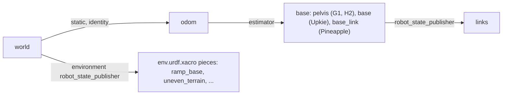

# Legged Robot MPC Controller

[`ros2_control`](https://control.ros.org/rolling/index.html) implementation for legged robot MPC using [`ocs2_ros2`](https://github.com/wei-hsuan-cheng/ocs2_ros2.git) and [`pinocchio`](https://github.com/stack-of-tasks/pinocchio.git).  Tested in [`ros2 jazzy`](https://docs.ros.org/en/jazzy/index.html) and [`mujoco`](https://mujoco.readthedocs.io/en/stable/overview.html) simulation environment.


## Demos

### Humanoid

<table align="center">
  <tr>
    <td align="center" width="17%">
      
    </td>
    <td align="center" width="58%">
      
    </td>
    <td align="center" width="25%">
      
    </td>
  </tr>
  <tr>
    <td align="center"><b>Unitree H2</b><br />Visualization of MPC future robot trajectory</td>
    <td align="center"><b>Unitree H2</b><br />Runs, stops, stumbles, and regains balance</td>
    <td align="center"><b>Unitree H2</b><br />Uneven terrain locomotion with proprioception only</td>
  </tr>
</table>

### Wheeled-Biped (with rolling-contact conditions)

<table align="center">
  <tr>
    <td align="center" width="50%">
      
    </td>
    <td align="center" width="50%">
      
    </td>
  </tr>
  <tr>
    <td align="center"><b><a href="https://github.com/upkie/upkie">Upkie</a></b><br />Swings itself up, balances, and drives through uneven terrains with steps and ramps</td>
    <td align="center"><b>Wheel-Legged Pineapple</b><br />Stand-up, driving and stepping through the gauntlet<br />RViz above MuJoCo (2x playback)</td>
  </tr>
</table>


## MPC Formulation

This repository implements **whole-body inverse dynamics (WB-ID) MPC** on OCS2's SQP solver (DDP/SLQ/iLQR are not supported).
It jointly optimizes floating-base and joint configurations and velocities, contact wrenches, generalized accelerations and joint torques (state `[q, v]`, input `[W, a, tau_j]`).
Floating-base dynamics (RNEA) are enforced over the whole horizon; actuated-joint inverse dynamics and torque limits within a configurable initial torque window.
Wheeled robots add rolling-contact conditions at the tires.
The formulation adapts [(RA-L2024) Khazoom et al., Tailoring Solution Accuracy for Fast Whole-body Model Predictive Control of Legged Robots](https://arxiv.org/abs/2407.10789) and [(RA-L2025) Molnar et al., Whole-Body Inverse Dynamics MPC for Legged Loco-Manipulation](https://arxiv.org/abs/2511.19709).

See [formulation and signal flow](./docs/humanoid_whole_body_inverse_dynamics_mpc.md) and the [implementation guide](./docs/humanoid_whole_body_inverse_dynamics_mpc_impl.md) (code lines and parameters).


## Build and Install

The floating-base estimators come from the shared [`legged_robot_state_estimator`](https://github.com/wei-hsuan-cheng/legged_robot_state_estimator) package; robot-specific estimator settings stay in `config/<robot>/ros2_controllers.yaml`.
Do not add a duplicate checkout of a package already in the workspace.

```bash
# Clone this repo and its dependencies
cd <workspace_dir>/src
git clone https://github.com/wei-hsuan-cheng/legged_robot_mpc_controller.git
mkdir legged_robot_mpc_controller_dependencies
vcs import < legged_robot_mpc_controller/legged_robot_mpc_controller.repos
vcs import < legged_robot_mpc_controller_dependencies/legged_robot_state_estimator/legged_robot_state_estimator.repos

# Install dependencies
cd <workspace_dir>
sudo rosdep init # if you never did this
rosdep update
rosdep install --ignore-src --from-paths src -y -r

# Build
NUM_JOBS=2 && \
export CMAKE_BUILD_PARALLEL_LEVEL=${NUM_JOBS} && \
export MAKEFLAGS=-j${NUM_JOBS} && \
export NINJAFLAGS=-j${NUM_JOBS} && \
colcon build --symlink-install \
  --packages-up-to legged_robot_mpc_controller \
  --executor sequential --parallel-workers ${NUM_JOBS} \
  --cmake-force-configure \
  --cmake-args -DBUILD_TESTING=OFF -DCMAKE_BUILD_TYPE=Release && \
  . install/setup.bash
```


## Robots and Launch

| Robot | `robot_name` | Actuated / MPC joints | Nominal base height | Details |
| --- | --- | --- | --- | --- |
| Unitree G1 | `g1` | 29 / 23 (wrists fixed) | 0.795 m (pelvis) | [WB-ID MPC](./docs/humanoid_whole_body_inverse_dynamics_mpc.md), [running](./docs/wb_id_running.md) |
| Unitree H2 | `h2` | 31 / 25 (wrists fixed) | 1.02 m (pelvis) | [H2 integration](./docs/h2_wb_id_mpc.md), [model source](./description/urdf/robots/h2/MODEL_SOURCE.md) |
| Upkie (wheeled biped) | `upkie` | 6 / 6 | 0.245 m (base) | [Upkie model](./docs/wheeled_biped_whole_body_inverse_dynamics_mpc.md), [posture control](./docs/upkie_posture_control.md), [handoff](./docs/wheeled_biped_handoff.md) |
| Pineapple (wheel-legged, no arm) | `pineapple` | 8 / 8 | 0.36 m (base) | [Pineapple family](./docs/pineapple.md) |
| Pineapple with manipulator | `pineapple_manipulator` | 14 / 8 (arm stowed) | 0.36 m (base) | [Pineapple family](./docs/pineapple.md) |

```bash
ros2 launch legged_robot_mpc_controller robot.launch.py robot_name:=g1 mpc_freq:=90
ros2 launch legged_robot_mpc_controller robot.launch.py robot_name:=h2 mpc_freq:=80
ros2 launch legged_robot_mpc_controller robot.launch.py robot_name:=upkie mpc_freq:=200
ros2 launch legged_robot_mpc_controller robot.launch.py robot_name:=pineapple mpc_freq:=200
ros2 launch legged_robot_mpc_controller robot.launch.py robot_name:=pineapple_manipulator mpc_freq:=200
```

The first launch of each robot generates and compiles its CppAD libraries (several minutes); later launches load them from the cache.

- **G1 and H2** walk in `base_twist` mode on a gait ladder (G1 `[stance, walk, trot, run]`, H2 `[stance, trot, run]`); a forward command of 0.75 m/s or more requests running. H2 runs up to 2.0 m/s (grounded running); G1's revised ladder is not yet simulation-tested. H2's two head joints stay active in its MPC.
- **Upkie** spawns kneeling. Press **Stand Up** in the GUI (or **Square** on the gamepad, L2 released) for the planned [contact-aware stand-up](./docs/upkie_stand_up_optimization.md); **Sit Down** brakes and kneels again. The wheel-aware linear KF drives the MPC (no ground truth in control). Falls latch a damping state; there is no automatic recovery. Forward speed, yaw rate and height are commanded; it does not drive sideways. Contact geometry is shared through one [geometry file](./docs/upkie_geometry.md).
- **Pineapple family** spawns seated and uses the same bring-up. Besides rolling (`wheel_drive`) it has `jump`, `walk` and `trot` (`/humanoid/gait_command` or the gamepad), and a sideways command switches it to `trot`. The arm-equipped `pineapple_manipulator` is the original tested baseline (including 40 mm steps without a terrain map); the lighter `pineapple` has its own contact-aware stand-up/sit-down plan and retains the original locomotion tuning. Both share scene settings and offer `scene_course.xml` and `scene_gauntlet.xml`. See [variant scope and testing](./docs/pineapple.md). The MuJoCo viewer follows the robot (**T** toggles the free camera).

### Launch arguments

Common to every robot; defaults follow `robot_name`, and file paths are relative to the package share.

```bash
# Robot and control
robot_name:=g1 | h2 | upkie | pineapple | pineapple_manipulator
mpc_freq:=100                               # MPC rate [Hz], integer
mrt_freq:=1000                              # MRT rate [Hz], integer
ref_base_height:=<m>                        # empty: ocs2.reference.defaultBaseHeight from the controller YAML
base_command_device:=gui | joystick | none  # one command source; none for scripted commands
floating_base_source:=state_estimator | ground_truth_state  # ground truth: simulation debugging only
floating_base_estimator:=humanoid_linear_kf | humanoid_inekf | none
mpc_controller_name:=humanoid_whole_body_inverse_dynamics_mpc_controller  # the only controller
spawn_mpc_controller:=true | false          # false: environment smoke test; the robot will not balance

# Files
controllers_file:=config/<robot_name>/ros2_controllers.yaml
initial_pose_file:=config/<robot_name>/initial_pose.yaml  # Upkie kneels, Pineapple sits
urdf_file:=description/urdf/robots/<robot_name>/<model>.urdf
lib_folder:=auto_generated/<robot_name>     # CppAD cache, relative to the launch directory
stair_climbing_file:=config/terrains/stair_climbing/<robot_name>.yaml
terrain_walking_file:=config/terrains/terrain_walking/<robot_name>.yaml

# Simulation
mujoco_model_file:=scene.xml                # a scene in description/mujoco/robots/<robot_name>/, or an absolute path
mujoco_headless:=false | true
mujoco_wait_to_start:=true | false          # paused start + /mujoco_ros2_control/start service
mujoco_real_time_factor:=1.0
mujoco_publish_rate:=100.0
use_mujoco_sim:=true | false                # false: plain ros2_control_node
use_fake_hardware:=false | true             # mock_components/GenericSystem when not using MuJoCo
ros2_control_command_interface:=effort_pd | effort | position  # position: G1 and H2 only
mujoco_effort_command_mode:=actuator | qfrc_applied  # qfrc_applied bypasses actuator force limits
gt_enabled:=true | false                    # ground-truth base odometry for visualization and logging
gt_body_frame:=<body>                       # pelvis (G1, H2), base (Upkie), base_link (Pineapple)
enable_lidar:=false | true                  # simulated Livox Mid-360 on /livox/lidar (G1 only)
model_error_file:=<name or path>            # plant modeling error YAML, e.g. template.yaml in config/model_error/
model_error_seed:=-1                        # >= 0 overrides the file's seed
model_error_report:=<path>                  # JSON of the realized errors

# Visualization
rviz:=true | false
rviz_config:=config/rviz/humanoid.rviz
```

The model-error arguments perturb only the simulated plant (inertia, friction, ground patches, delays); see the [robustness study](./docs/mpc_robustness.md).


## Commands

### GUI and DualSense gamepad

The GUI (`base_command_device:=gui`, default) and the separate [`legged_robot_teleop`](https://github.com/wei-hsuan-cheng/legged_robot_teleop) package (`base_command_device:=joystick`) publish the same base velocity and height command; run only one of them.

- Release L2 and center both sticks, then hold L2 to drive: left stick forward/sideways, right stick horizontal yaw.
- Right stick forward/back raises/lowers height, with a 30% deadband (`height_axis_threshold` in the teleop YAML)
  to avoid accidental changes while turning. Recenter the stick to hold height.
- Release L2 to stop; L1 with L2 released centers (zero velocity, nominal height, level trunk).
- Upkie and Pineapple: Circle cycles `walk` -> `trot` -> `wheel_drive`, Triangle jumps while held, Square stands up or sits down.
- Upkie and Pineapple: D-pad left/right (with L2 held) leans the trunk left/right, up to `ocs2.reference.maxBaseRoll`
  (0.25 / 0.3 rad); the roll holds when L2 is released and levels on L1, a stand-up, sit-down or fall. Each leg takes
  the posture of its own hip height, so the wheels stay on the ground. Other publishers: `geometry_msgs/Vector3` on
  `/humanoid/base_orientation_command` (x roll, y pitch [rad], command frame).
- Upkie and Pineapple: D-pad up/down with L2 held leans forward/back up to `ocs2.reference.maxBasePitch`
  (0.2 rad). Releasing the buttons holds the angle; release L2 and press L1 to level roll and pitch
  ([details](./docs/base_orientation_control.md)).
- Start with the teleop package's [isolated topic check](https://github.com/wei-hsuan-cheng/legged_robot_teleop/blob/main/docs/testing.md), and stop any separately running `joy` driver first.

### Scripted commands

Launch with `base_command_device:=none`, then:

```bash
# Base twist (desired_pelvis_height is G1's)
ros2 topic pub --once /humanoid/target_mode std_msgs/msg/String "{data: base_twist}"
ros2 topic pub -r 50 /humanoid/walking_velocity_command ocs2_msgs/msg/WalkingVelocityCommand \
  "{linear_velocity_x: 0.25, linear_velocity_y: 0.0, desired_pelvis_height: 0.7925, angular_velocity_z: 0.0}"

# Figure-eight at constant speed with a sinusoidal pelvis height
ros2 run legged_robot_mpc_controller figure_eight_command.py

# Push recovery (MuJoCo only, after the MPC takeover); pushes in config/tests/push_recovery.yaml
ros2 run legged_robot_mpc_controller push_recovery_test.py
```

### Arm joint targets (G1, H2)

`/humanoid/mpc_targets` takes `command_type: joint` (track the shoulder and elbow joints named in `joint_names`, overriding the gait arm swing) or `default` (back to the built-in posture and arm swing).
Targets are soft costs; an optional arm-versus-body sphere penalty (`ocs2.constraints.armSelfCollision`, [margins](./docs/humanoid_whole_body_inverse_dynamics_mpc.md#58-arm-versus-body-sphere-margins), [RViz spheres](./docs/humanoid_whole_body_inverse_dynamics_mpc_impl.md#13-collision-spheres)) is a safeguard, not a collision-free guarantee.

```bash
ros2 run legged_robot_mpc_controller joint_tracking_target.py   # sine arm swing
ros2 topic pub --once /humanoid/mpc_targets ocs2_msgs/msg/MpcTargets "{command_type: 'default'}"
```


## Scenes and Terrains

Each robot's `scene.xml` is flat ground; pick another scene with `mujoco_model_file`.
The shared uneven terrain is generated from [`uneven_terrain_params.yaml`](./config/terrains/uneven_terrain_params.yaml) by `description/mujoco/terrains/generate_uneven_terrain.py` (MuJoCo and RViz geometry; [details](./config/terrains/README.md#uneven-terrain)).
Wheeled robots use the [small-wheel terrain profiles](./config/terrains/upkie/README.md).
Terrain is environment only: no terrain map is given to the MPC.
See the [description layout](./description/README.md) and [scene composition guide](./description/mujoco/README.md).


## Code Layout

Public headers live under `include/legged_robot_mpc_controller/`, matching `src/`.

| Module | Responsibility |
| --- | --- |
| `controller/` | ROS controller, configuration builder, generated-parameter schema (`src/controller/parameters.yaml`) |
| `common/` | ROS command adapters and configuration helpers |
| `mpc/common/` | Robot models, costs, constraints, contacts, gaits and reference generation |
| `mpc/wb_id/` | Whole-body dynamics, inverse-dynamics constraints, initialization and OCP assembly |
| `visualization/` | Trajectories, robot ghosts and collision markers |


## Robot Description and Frames

Each robot has one URDF under `description/urdf/robots/<robot>/`, rooted at its base with no `world` link or floating joint: the MPC and estimators add the floating base (Pinocchio), MuJoCo owns the free joint, and the estimator publishes the base pose as TF.
The robot's `<robot>.ros2_control.xacro` adds the `<ros2_control>` block and becomes `/robot_description`.
The environment is separate: [`env.urdf.xacro`](./description/urdf/env.urdf.xacro) is published as `/environment/robot_description` for RViz only, so keep its terrain pieces in step with the MuJoCo scene.



`world → odom` stays identity until something localizes the robot, so estimator drift shows as the robot moving relative to the terrain.


## Acknowledgements

- Reference implementation for the whole-body inverse dynamics MPC formulation: [`lukasmolnar/wb-mpc-locoman`](https://github.com/lukasmolnar/wb-mpc-locoman)
- Shared humanoid control components: [`manumerous/wb_humanoid_mpc`](https://github.com/manumerous/wb_humanoid_mpc)


## Contact

- **Author**: Wei-Hsuan Cheng [(johnathancheng0125@gmail.com)](mailto:johnathancheng0125@gmail.com)
- **Homepage**: [wei-hsuan-cheng](https://wei-hsuan-cheng.github.io)
- **GitHub**: [wei-hsuan-cheng](https://github.com/wei-hsuan-cheng)
