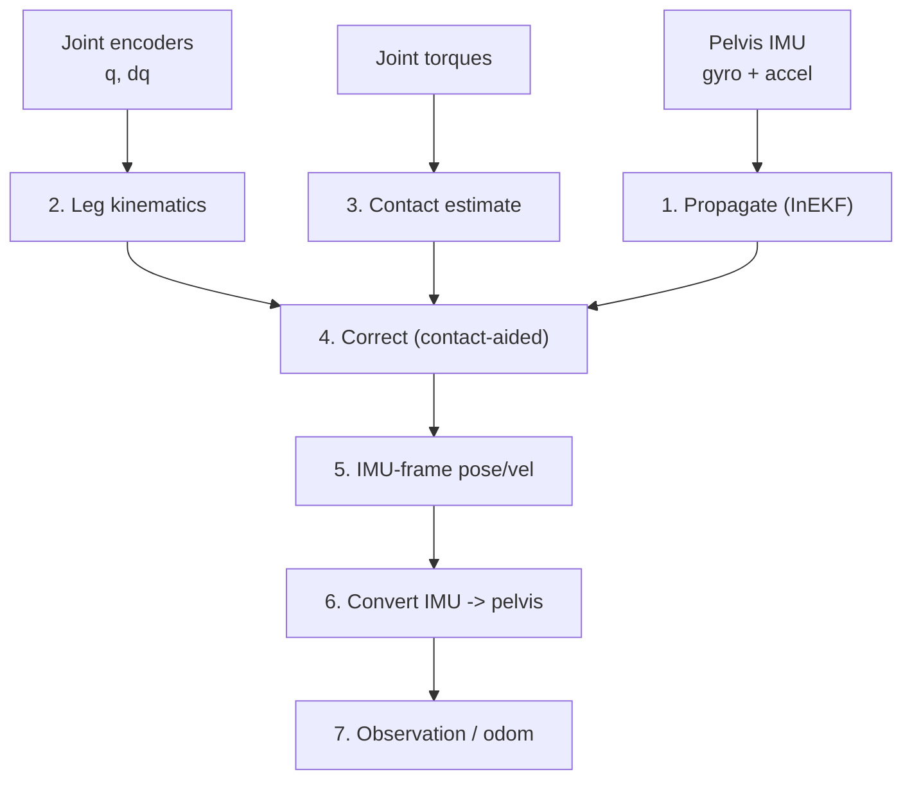

# Humanoid Floating-Base State Estimation (InEKF)

This document describes the proprioceptive floating-base state estimator used by the G1 centroidal MPC controller.
It fuses the pelvis IMU with leg kinematics and contact information through a **contact-aided Invariant Extended Kalman Filter (InEKF)** to estimate the base pose and velocity.
For simulation debugging, `floatingBaseSource:=ground_truth_state` can replace estimator feedback with ground truth (GT), but this bypass is not available for real-world deployment.

The InEKF follows Hartley et al., *Contact-Aided Invariant EKF for Legged Robot State Estimation*, RSS 2018; backend dependencies are owned by the shared estimator package.
The shared [`legged_robot_state_estimator`](https://github.com/wei-hsuan-cheng/legged_robot_state_estimator) package owns both ROS estimator plugins, sensor plumbing, joint remapping, frame handling, initialization, publishing, and state-interface definitions.
The plugins are `legged_robot_state_estimator/HumanoidInEkfController` and `legged_robot_state_estimator/HumanoidLinearKfController`; their instances are configured in this repository's `config/<robot>/ros2_controllers.yaml`.
TurboMPC consumes the same estimator package and interface.

## What is observable, and why the rest does not matter

A proprioceptive estimator (IMU + encoders + contacts, no exteroception) observes a strict subset of the base state:

- **Observable — and what the controller needs:** roll/pitch (the accelerometer pins the gravity direction absolutely), base **height** (the stance foot is a fixed height reference through the leg kinematics), and base **linear velocity** in the body frame.
- **Unobservable — and it does not matter here:** absolute world $x,y$ position and yaw $\psi$. These lie in the filter's unobservable subspace and drift without bound.

The drift is harmless because the walking command is a **body-frame twist** and the centroidal MPC tracks base velocity, height, and orientation — never absolute world pose. Concretely, the momentum/base cost consumes the observation built in [`build_observation()`](../src/humanoid_centroidal_mpc/humanoid_centroidal_mpc_controller.cpp#L650-L722), whose base linear velocity is world-frame but whose *tracking target* is generated from the body-frame command; the absolute $x,y,\psi$ of the base never enter a cost. Tuning therefore optimizes roll/pitch, height, and body velocity and ignores $x,y,\psi$ drift.

## Runtime Pipeline (High Level)

<table>
<tr>
<td width="38%" valign="top">



</td>
<td width="62%" valign="top">

Each estimator-controller tick, [`update_and_write_commands()`](https://github.com/wei-hsuan-cheng/legged_robot_state_estimator/blob/main/src/humanoid_state_estimator_controller.cpp#L220):

1. Propagates the InEKF state with the raw pelvis gyro + accelerometer.
2. Updates the leg forward kinematics from the joint encoders.
3. Uses scheduled contacts, torque-based contact estimates, or contact sensors according to `contact.source`.
4. Corrects the filter with the "stance contact is world-fixed" measurement.
5. Reads back the estimated **IMU-frame** pose and velocity.
6. Converts the IMU-frame estimate to the **pelvis** (floating-base) frame.
7. Exports the estimate through state interfaces and publishes odometry for evaluation; the MPC reads the interfaces to build its observation.

</td>
</tr>
</table>

The estimator is a separate chainable ROS controller configured by [`HumanoidStateEstimatorController::on_configure()`](https://github.com/wei-hsuan-cheng/legged_robot_state_estimator/blob/main/src/humanoid_state_estimator_controller.cpp#L78).
The MPC selects its feedback through `floatingBase.source: state_estimator` and claims the estimator's exported interfaces.

## Filter Model

### Propagation

The InEKF state is the pose and velocity of the **IMU frame** together with the IMU biases,
$$
X=\big(\mathbf R,\ \mathbf p,\ \mathbf v\big)\in SE_2(3),\qquad
\mathbf b=\big(\mathbf b_g,\ \mathbf b_a\big),
$$
where $\mathbf R,\mathbf p,\mathbf v$ are the orientation, position and velocity of the IMU frame in the world. Given the bias-corrected gyro $\tilde{\boldsymbol\omega}=\boldsymbol\omega-\mathbf b_g$ and accelerometer $\tilde{\mathbf a}=\mathbf a-\mathbf b_a$, the continuous dynamics are
$$
\dot{\mathbf R}=\mathbf R\,(\tilde{\boldsymbol\omega})_\times,\qquad
\dot{\mathbf v}=\mathbf R\,\tilde{\mathbf a}+\mathbf g,\qquad
\dot{\mathbf p}=\mathbf v,
$$
with $\mathbf g=(0,0,-9.81)^{\mathsf T}$. The "invariant" property is that the estimation-error dynamics are (to first order) independent of the state, giving strong convergence. This step consumes the raw pelvis IMU measurements passed to [`estimator_->update()`](https://github.com/wei-hsuan-cheng/legged_robot_state_estimator/blob/main/src/inekf_floating_base_estimator.cpp#L188).

### Contact-aided correction

While foot $i$ is in stance, the InEKF assumes its contact point is **fixed in the world**. The forward-kinematic contact position relative to the base, $\mathbf f_i(\mathbf q)$, provides a measurement whose residual constrains base position, velocity, and (together with gravity) the full pose. Crucially the filter does **not** assume flat ground: a foot re-anchors at whatever height it lands, so stairs and uneven terrain are handled natively without any terrain model — the terrain model remains a *planner-only* concern.

Contact state per foot may come from the joint torques (logistic regression inside the library) or, as configured by default, from the **MPC gait schedule** (`contact.source: scheduled` in the estimator's parameter block), which is deterministic and matches the MIT Humanoid approach.

The InEKF requires exactly **four point contacts**, so each flat foot contributes a **heel and a toe** point (as in the MIT Humanoid whole-body work). These are added to the URDF at the sole, offset from the ankle-roll link, with names distinct from the MPC's own contact frames to avoid a Pinocchio frame-name collision: [`foot_l_heel_est` … `foot_r_toe_est`](../description/urdf/robots/g1/g1_29dof.urdf#L1003-L1026).

## IMU ↔ Pelvis Frame Conversion

The single most important integration detail: **the InEKF estimates the IMU frame, but the MPC uses the pelvis** (the URDF floating-base root).
On the G1 the IMU sits at $\mathbf t_{PI}=(0.04525,\,0,\,-0.08339)\,\text{m}$ below the pelvis, so a naive comparison shows an $\approx 8.3\,\text{cm}$ height offset.
The wrapper removes this with the fixed transform $X_{PI}=(\mathbf R_{PI},\mathbf t_{PI})$ of the IMU frame in the pelvis frame, computed once from the model at construction: [constructor FK](https://github.com/wei-hsuan-cheng/legged_robot_state_estimator/blob/main/src/inekf_floating_base_estimator.cpp#L96-L107).

At initialization, the incoming **pelvis** pose is converted to the **IMU** frame before seeding the filter,
$$
\mathbf R_I=\mathbf R_P\,\mathbf R_{PI},\qquad
\mathbf p_I=\mathbf p_P+\mathbf R_P\,\mathbf t_{PI},
$$
in [`initialize()`](https://github.com/wei-hsuan-cheng/legged_robot_state_estimator/blob/main/src/inekf_floating_base_estimator.cpp#L150-L170). On output, the estimated IMU pose is converted back to the pelvis, with a rigid-body lever-arm correction for the linear velocity,
$$
\mathbf R_P=\mathbf R_I\,\mathbf R_{PI}^{\mathsf T},\qquad
\mathbf p_P=\mathbf p_I-\mathbf R_P\,\mathbf t_{PI},
$$
$$
\boldsymbol\omega_{P}^{\text{world}}=\mathbf R_I\,\boldsymbol\omega_I^{\text{local}},\qquad
\mathbf v_P^{\text{world}}=\mathbf v_I^{\text{world}}+\boldsymbol\omega_P^{\text{world}}\times(\mathbf p_P-\mathbf p_I),
$$
in [`update()`](https://github.com/wei-hsuan-cheng/legged_robot_state_estimator/blob/main/src/inekf_floating_base_estimator.cpp#L192-L209). (For the G1 $\mathbf R_{PI}=\mathbf I$, but the transform is computed generally.)

The four contact landmarks are seeded at their **true world heights** from FK at the initial pose, so the filter is consistent with the actual foot geometry and with per-foot start heights on stairs: [`contactGroundHeights()`](https://github.com/wei-hsuan-cheng/legged_robot_state_estimator/blob/main/src/inekf_floating_base_estimator.cpp#L129-L148).

## Joint Ordering

The controller provides joint values in its own `robot.jointNames` order (23 actuated joints), while the estimator's URDF model orders 29 joints by the Pinocchio tree. The wrapper builds a name→index map once and remaps every joint vector (position, velocity, torque), zero-filling URDF joints the controller does not actuate (e.g. wrists): [constructor map](https://github.com/wei-hsuan-cheng/legged_robot_state_estimator/blob/main/src/inekf_floating_base_estimator.cpp#L72-L85) and [`remapToEstimatorOrder()`](https://github.com/wei-hsuan-cheng/legged_robot_state_estimator/blob/main/src/inekf_floating_base_estimator.cpp#L117-L127).

## Sensor Plumbing (Simulation)

The estimator inputs come from `ros2_control` state interfaces exposed by `mujoco_ros2_control`:

- **Pelvis IMU** — a `<sensor name="pelvis_imu">` in [`g1.ros2_control_macro.xacro`](../description/urdf/robots/g1/g1.ros2_control_macro.xacro#L126-L141) maps the MuJoCo `imu-pelvis-*` sensors to `orientation.*`, `angular_velocity.*`, and `linear_acceleration.*`. The MuJoCo model already has the gyro/accelerometer on the `imu_in_pelvis` site; a [`framequat`](../description/mujoco/robots/g1/g1_29dof.xml#L297) was added because the IMU mapping requires a quaternion sensor. The IMU site pose matches the URDF `imu_in_pelvis` frame exactly.
- **Joint torque** — the joint macro already exposes an `effort` state interface, read for the torque-based contact estimator.

These are claimed by the estimator's [`state_interface_configuration()`](https://github.com/wei-hsuan-cheng/legged_robot_state_estimator/blob/main/src/humanoid_state_estimator_controller.cpp#L46).
The same wiring applies on hardware: real IMU, encoders, and joint-torque sensing replace the MuJoCo sources with no controller change.

## Bootstrapping and Selection

The current bring-up requests estimator initialization after the robot has settled on its feet, then waits for the estimator's matching initialization epoch and readiness before starting MPC.
The deployed control path uses `floatingBase.source: state_estimator` and reads the estimator controller's exported state interfaces.
See the current [settling/convergence phases](../src/humanoid_centroidal_mpc/humanoid_centroidal_mpc_controller.cpp#L1006) and [initialization epoch check](../src/humanoid_centroidal_mpc/humanoid_centroidal_mpc_controller.cpp#L1257).

## Configuration and Tuning

Estimator parameters live under `humanoid_inekf.ros__parameters` or `humanoid_linear_kf.ros__parameters` in [config/g1/ros2_controllers.yaml](../config/g1/ros2_controllers.yaml).
The most important tuning finding on the G1:

> The pelvis accelerometer swings **±5 m/s²** while merely standing (stiff PD + contact vibration). The library default `accelerometer_noise = 0.1` makes the filter over-trust it, which pulls the estimated height down by ~4 cm. Raising `noise.accelerometer` to `1.5` and hard low-passing the accelerometer (`lpf.linAccelCutoff` `250 → 30 Hz`), while trusting the contact height-anchor more (`noise.contact`, `noise.contactPosition`), removes the droop **and** cuts body-velocity error ~3×.

## Verification (MuJoCo, GT drives control, InEKF in parallel)

With the tuned configuration, the InEKF estimate tracks GT on exactly the states that matter for locomotion:

| state | standing | walking (vx = 0.25 m/s) |
|---|---|---|
| roll error | 0.09–0.16° | 0.07–0.18° |
| pitch error | 0.13–0.14° | 0.02–0.04° |
| **height error** | 17–28 mm | 17–28 mm |
| **body-frame velocity error** | ~0.03 m/s | ~0.03 m/s |
| yaw drift / xy drift (unobservable, unused) | ~0° / ~10 mm | ~0° / ~17 mm |

Roll/pitch stay well under a quarter degree and body velocity within ~3 cm/s consistently; the height sits 1.4–2.8 cm low (run-to-run, from contact-estimation noise).

### Status: closed-loop WORKING

- **Open-loop (`floatingBaseSource:=ground_truth_state`):** GT drives control, InEKF runs alongside. ✅
- **Closed-loop (`floatingBaseSource:=state_estimator`):** the estimate drives the MPC; the robot walks. `state_estimator_closed_loop_test.sh` reports **VERDICT: SUCCESS** — 2.18 m of directional progress, final pelvis height 0.778 m, GT minimum height 0.764 m (no sag), gait progressing `stance -> slow_walk -> walk -> stance`, MPC at ~95 Hz / ~55 % utilization. ✅

Closed-loop estimate accuracy vs GT (2154 samples): roll 0.22° mean / 0.66° max, pitch 0.47° / 1.90°, **height 1.8 mm mean / 6.6 mm max**, body velocity 0.025 m/s mean, yaw drift 0.05°.

### Why base height was the failure channel

Channel-isolation testing (feeding one estimated channel at a time, the rest from GT) showed linear velocity, orientation, and x/y all **pass**, while **height alone fails** — with a height error of only 6.6 mm mean / 33.6 mm max. The mechanism is in
[`adaptToCurrentGroundHeight()`](../src/core/humanoid_common_mpc/src/reference_manager/SwitchedModelReferenceManager.cpp#L86-L96):

```cpp
scalar_t terrainHeight = computeGroundHeightEstimate(...);
terrainHeight = 0.0;   // terrain assumed flat at ABSOLUTE z = 0
```

Swing and stance foot targets are referenced to an **absolute** ground plane, but the MPC computes foot positions by forward kinematics **from the estimated base**. A base-height error $\delta$ therefore shifts every foot height by $\delta$ relative to that plane, one-for-one:

$$
z^{\text{foot}}_{\text{MPC}} = z^{\text{base}}_{\text{est}} + \big(z^{\text{foot}} - z^{\text{base}}\big)_{\text{FK}}
= z^{\text{foot}}_{\text{true}} + \delta .
$$

With `swingHeight` = 0.08 m and `touchDownHeightOffset` = −0.001 m, a 33 mm error is ~40 % of the swing height and 33× the touchdown offset, so touchdown timing and stance penetration go wrong and contact breaks. By contrast $x,y$ errors are harmless (footholds are planned relative to the base, with no absolute $x,y$ reference) and velocity errors are damped. **Height is the only channel rigidly coupled to the absolute ground plane.**

### Fix: kinematic height fusion

Rather than filtering the symptom, the estimated height is made consistent with the same plane the MPC assumes. From the stance contact frames and joint angles, the base height that places the stance feet on the ground plane is

$$
z^{\text{base}}_{\text{kin}}
= \frac{1}{|\mathcal{S}|}\sum_{i \in \mathcal{S}}
\Big( z_{\text{ground}} - \big[\,{}^{B}\!p_{C_i}(\theta, q_J)\,\big]_z \Big),
$$

where $\mathcal{S}$ are the **stance** contacts (swing feet carry no ground information) and ${}^{B}p_{C_i}$ is the contact position from FK with the base at the origin. It is fused with the filter height as

$$
z^{\text{base}} = (1-w)\, z^{\text{base}}_{\text{InEKF}} + w\, z^{\text{base}}_{\text{kin}} .
$$

See [`kinematicBaseHeight()`](https://github.com/wei-hsuan-cheng/legged_robot_state_estimator/blob/main/src/inekf_floating_base_estimator.cpp#L206-L243) and the fusion in [`updateImpl()`](https://github.com/wei-hsuan-cheng/legged_robot_state_estimator/blob/main/src/inekf_floating_base_estimator.cpp#L300-L318).
Configure `height.source` (`inekf` | `kinematic` | `blend` | `anchored`), `height.kinematicWeight`, and `height.groundZ` in the estimator's parameter block.
The G1 configuration selects `kinematic`; the schema default is `anchored`.
This is purely proprioceptive and reduced the recorded closed-loop height error from ~6.6 mm/33.6 mm to **1.8 mm/6.6 mm**.

### The warm-up window (why the estimate must not drive control immediately)

The original closed-loop failure was a **filter initialization transient**, not tuning and not the height bias. The InEKF is seeded with zero velocity and unknown IMU biases, so its first ~2 s carry roughly **±0.15 m/s of phantom base velocity**. Because the centroidal state is normalized momentum $h = A(q)\,v/m$, that velocity error enters the *dominant* state directly; the MPC fights a base it believes is sliding, and the robot fell at t ≈ 2 s while standing, before any walking command — with the height estimate still accurate to 3–14 mm at the moment of the fall.

`readiness.minSeconds` (5.0 s in the G1 configuration) gates estimator readiness together with roll/pitch, height, and velocity standard-deviation limits.
The MPC waits for the matching initialization epoch and readiness before starting locomotion.
On hardware this corresponds to holding the robot in a settled stance while the filter warms up.

## Terrain limitation of the kinematic height anchor

The kinematic term assumes the stance feet rest on a **flat plane at `height.groundZ`** (0 by default), which matches the controller's own `terrainHeight = 0.0`. That holds for flat-ground walking but **not** on stairs or sloped terrain: standing on a riser of height $h$, the formula reports the base as $h$ too low, because it credits the leg extension to a plane at 0 rather than at $h$. With `kinematicWeight = 0.9`, a 0.17 m riser yields roughly 0.15 m of height error — far worse than the 33 mm that destabilizes flat walking.

Options on non-flat terrain:

| setting | flat ground | stairs (measured) |
|---|---|---|
| `height.source: blend` | ✅ walks, 1.8 mm height error | ❌ falls at the first riser (x = 0.84): the anchor insists the base is a step-height too low |
| `height.source: inekf` | ❌ too noisy (~6.6 mm mean, 33 mm peak) — this is what broke closed-loop walking originally | ❌ falls on the flat approach (x = 0.34), before reaching the stairs |

Measured stair/terrain behaviour with the InEKF driving the MPC (ground truth shown for reference):

| scenario | ground truth | InEKF (`blend`) |
|---|---|---|
| stair climb | ✅ SUCCESS, reaches z = 1.205 m | ❌ FALL at x = 0.837, pitch 34.7° |
| terrain walk | ❌ FALL after ~4.9 treads (pre-existing, estimator not involved) | ❌ FALL at x = 0.783, 0 treads |

So **flat-ground closed-loop walking works, stairs do not**, and terrain walking is additionally limited by a pre-existing issue visible on ground truth alone.

A per-contact, time-varying ground height is available as `height.source: anchored`. Each contact records the estimated world height at which it touched down and holds it through stance, so the kinematic term enforces consistency *within* a stance phase without fighting a real terrain change, and no terrain map is needed:

$$
z^{\text{base}}_{\text{kin}} = \frac{1}{|\mathcal S|}\sum_{i\in\mathcal S}\Big(z_{\text{anchor},i} - \big[{}^{B}p_{C_i}\big]_z\Big),
\qquad
z_{\text{anchor},i} \leftarrow z^{\text{base}}_{\text{InEKF}} + \big[{}^{B}p_{C_i}\big]_z
\ \text{ at touchdown.}
$$

Re-anchoring at *every* touchdown folds the filter's own height noise into the reference and destroys the noise rejection this term exists to provide (measured: flat-ground height error 1.8 mm → 6.9 mm, and the robot fell). A deadband therefore gates the update: a contact re-anchors only when the measured landing height differs from its current anchor by more than `height.anchorUpdateThreshold` (default 0.05 m — above the ~0.03 m filter noise, well below a 0.17 m riser). See [`kinematicBaseHeight()`](https://github.com/wei-hsuan-cheng/legged_robot_state_estimator/blob/main/src/inekf_floating_base_estimator.cpp).

**Measured outcome — this does not yet make stairs work:**

| test (InEKF driving) | `blend` (default) | `anchored` + deadband |
|---|---|---|
| flat closed-loop | ✅ 2.12 m, height 1.8 mm mean / 6.6 mm max | ✅ 2.11 m, 3.5 mm mean / 45.6 mm max |
| stair climb | ❌ FALL at x = 0.837 | ❌ FALL at x = 0.558 |
| terrain walk | ❌ 0 treads (GT: ~4.9) | ❌ 1.2 treads |

The anchor *value* is correct; the problem is that it changes **discontinuously**. When a foot lands on a riser the reported height steps ~0.17 m within one control tick, and the centroidal MPC receives that as a step input to its dominant momentum state. The same effect shows up on flat ground as the 45.6 mm peak against a 3.5 mm mean. `anchored` is the default (it is the terrain-aware formulation and still passes flat ground); `blend` remains available and is marginally more accurate on guaranteed-flat ground.

The next step is to introduce the terrain correction **continuously** — ramping the anchor change across the stance phase or slew-limiting the fused height — so the correct value is reached without the transient. Option (a), per-contact heights from `TerrainFootholdPlanner::heightAt(x, y)`, remains the alternative where a trustworthy terrain map exists.

Note also that height is tracked **incrementally**: each anchor inherits the filter's estimate at touchdown, so absolute error accumulates across steps, and terrain changes smaller than the deadband are treated as flat.

### Hardware notes

All inputs are proprioceptive — IMU (roll/pitch), joint encoders, and contact state — so the method transfers directly to hardware; this is classic kinematic leg odometry. Expect a few mm more error than in simulation: the G1's 10 mm urethane foot pad compresses under load, plus joint backlash, link flex and encoder offsets, so ~5–10 mm rather than 1.8 mm. `height.groundZ` must be set to the height of the plane the robot actually stands on.

## Files

| Concern | Location |
|---|---|
| Estimate struct | [`floating_base_estimate.hpp`](https://github.com/wei-hsuan-cheng/legged_robot_state_estimator/blob/main/include/legged_robot_state_estimator/floating_base_estimate.hpp) |
| InEKF wrapper | [`inekf_floating_base_estimator.cpp`](https://github.com/wei-hsuan-cheng/legged_robot_state_estimator/blob/main/src/inekf_floating_base_estimator.cpp) |
| Estimator ROS controller | [`humanoid_state_estimator_controller.cpp`](https://github.com/wei-hsuan-cheng/legged_robot_state_estimator/blob/main/src/humanoid_state_estimator_controller.cpp) |
| Controller integration | [`humanoid_centroidal_mpc_controller.cpp`](../src/humanoid_centroidal_mpc/humanoid_centroidal_mpc_controller.cpp) |
| Estimator parameter schemas | [`humanoid_inekf_parameter.yaml`](https://github.com/wei-hsuan-cheng/legged_robot_state_estimator/blob/main/config/humanoid_inekf_parameter.yaml), [`humanoid_linear_kf_parameter.yaml`](https://github.com/wei-hsuan-cheng/legged_robot_state_estimator/blob/main/config/humanoid_linear_kf_parameter.yaml) |
| IMU / contact frames | [`g1_29dof.urdf`](../description/urdf/robots/g1/g1_29dof.urdf), [`g1.ros2_control_macro.xacro`](../description/urdf/robots/g1/g1.ros2_control_macro.xacro), [`g1_29dof.xml`](../description/mujoco/robots/g1/g1_29dof.xml) |
