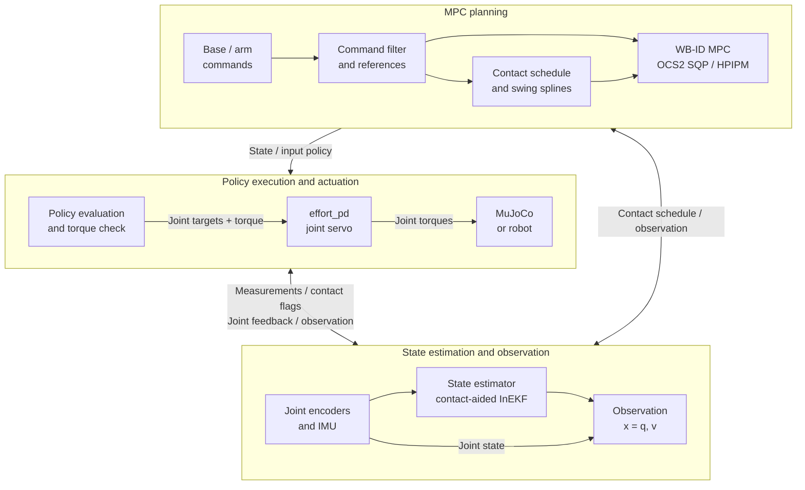
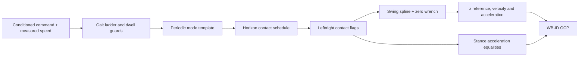
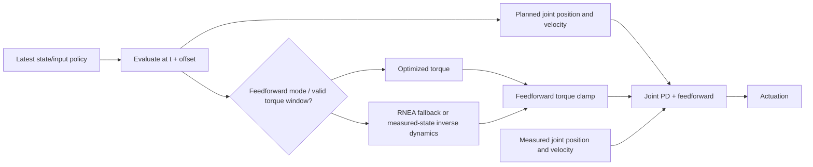

# Humanoid Whole-Body Inverse Dynamics MPC

This note describes the formulation implemented by `humanoid_whole_body_inverse_dynamics_mpc_controller` for the G1.
The MPC plans whole-body motion, contact wrenches, accelerations and joint torques, while an inner joint servo executes the policy.
It adapts [Khazoom et al., Tailoring Solution Accuracy for Fast Whole-body Model Predictive Control of Legged Robots](https://arxiv.org/abs/2407.10789) and [Molnar et al., Whole-Body Inverse Dynamics MPC for Legged Loco-Manipulation](https://arxiv.org/abs/2511.19709) to OCS2 and flat-foot humanoid contacts.
The implementation choices below describe the repository rather than claiming an exact reproduction of either paper.
Code locations and parameter mappings are collected in [Implementation Guide](./humanoid_whole_body_inverse_dynamics_mpc_impl.md).

## 1. Architecture and Signal Flow

The solver runs asynchronously at the requested MPC frequency, while ros2_control evaluates the latest policy at the MRT/control frequency.
The body-state feedback comes from the contact-aided InEKF estimate.
For simulation debugging, `floatingBaseSource:=ground_truth_state` can replace estimator feedback with GT, but this bypass is not available for real-world deployment.
The WB-ID execution path does not call the centroidal controller's weighted WBC QP.
Requested rates are scheduling targets, so policy age matters when a solve runs slowly.
During startup, valid observations continue to reach MPC while the joint servo holds the standing posture.
Handover requires a policy whose timestamps cover the evaluation time; an expired startup horizon is reset on the solver worker and retried rather than evaluated outside its interval.
After estimator-driven locomotion has begun, losing a valid policy latches the bring-up fault instead of automatically restarting the walking motion.

## 2. State, Input and Observation

### 2.1 Configuration and velocity

Let $n_j$ be the number of MPC joints and $n_v=6+n_j$.
The generalized configuration and velocity are:

$$
q=\begin{bmatrix}p_{WB}^{W}\\\eta\\q_j\end{bmatrix},
\qquad
v=\dot q=\begin{bmatrix}v_{WB}^{W}\\\dot\eta\\\dot q_j\end{bmatrix},
\qquad
\eta=\begin{bmatrix}\psi&\theta&\phi\end{bmatrix}^{\mathsf T}.
$$

$\psi,\theta,\phi$ are yaw, pitch and roll in ZYX order, with $R_{WB}=R_z(\psi)R_y(\theta)R_x(\phi)$.
Pinocchio uses a Translation + SphericalZYX composite base joint, so $n_q=n_v$ and $v=\dot q$ in these coordinates.
The angular entries of $v$ are Euler rates, not the body angular velocity measured by the IMU.
The implementation uses Euler coordinates rather than quaternion or SE(3) integration, and the Euler singularity near pitch $\pm\pi/2$ remains.

### 2.2 Optimization variables

$$
x=\begin{bmatrix}q\\v\end{bmatrix}\in\mathbb R^{2n_v},
\qquad
u=\begin{bmatrix}W_L\\W_R\\a\\\tau_j\end{bmatrix},
\qquad a=\dot v.
$$

Each $W_c=[f_c^{\mathsf T},m_c^{\mathsf T}]^{\mathsf T}\in\mathbb R^6$ is a contact wrench expressed in world-aligned axes about the contact-frame origin.
For the current 23-joint MPC model, $n_v=29$, $\dim x=58$ and $\dim u=12+29+23=64$.
There is no centroidal-momentum state or momentum-to-velocity reconstruction in this controller.

### 2.3 Initial state from sensors

The controller combines joint interfaces with the estimator's exported body state:

$$
q_0=\begin{bmatrix}\hat p_{WB}^{W}\\\operatorname{EulerZYX}(\hat R_{WB})\\q_{j,\mathrm{meas}}\end{bmatrix},
\qquad
v_{0,\mathrm{raw}}=\begin{bmatrix}\hat v_{WB}^{W}\\E_{\mathrm{ZYX}}(\eta)\hat\omega_{WB}^{B}\\\dot q_{j,\mathrm{meas}}\end{bmatrix}.
$$

$E_{\mathrm{ZYX}}$ converts body angular velocity into Euler rates, and yaw is unwrapped before constructing the state.
When enabled, the observation filter applies to the entire generalized velocity vector:

$$
\bar v_k=\alpha_v v_{k,\mathrm{raw}}+(1-\alpha_v)\bar v_{k-1},
\qquad
\alpha_v=1-\exp(-2\pi f_v\Delta t_{\mathrm{control}}).
$$

The MPC initial condition is then $x(t_0)=[q_0^{\mathsf T},\bar v_0^{\mathsf T}]^{\mathsf T}$.
The observation input is zero-initialized, rather than populated with measured wrenches, accelerations or torques.
Joint velocities already belong to the WB-ID state and must not be inserted into its observation input.

## 3. Dynamics and Optimal Control Problem

### 3.1 State propagation

OCS2 receives a double-integrator flow map:

$$
\dot x=\begin{bmatrix}v\\a\end{bmatrix}.
$$

For constant input over $\Delta t_k$, the exact flow is:

$$
q_{k+1}=q_k+\Delta t_kv_k+\tfrac12\Delta t_k^2a_k,
\qquad v_{k+1}=v_k+\Delta t_ka_k.
$$

The configured SQP integrator is RK4, which reproduces this constant-input double-integrator flow.
Rigid-body physics enters through separate state-input equalities rather than through forward-dynamics state propagation.

### 3.2 RNEA equalities

Define the generalized inverse-dynamics residual:

$$
r(q,v,a,W)=\operatorname{RNEA}(q,v,a)-\sum_cJ_c(q)^{\mathsf T}W_c
=M(q)a+b(q,v)-\sum_cJ_c(q)^{\mathsf T}W_c.
$$

With `ocs2.constraints.inverseDynamics.activate: true`, the base selector $S_b$ extracts the six unactuated rows, which are constrained throughout the horizon:

$$
S_br=0.
$$

The joint selector $S_j$ extracts the actuated rows, constrained inside an initial torque window:

$$
S_jr-\tau_j=0,\qquad t<t_0+T_\tau.
$$

For positive `ocs2.constraints.inverseDynamics.torqueConstraintNodes` $N_\tau$, $T_\tau=(N_\tau-\tfrac12)\Delta t_{\mathrm{SQP}}$.
A nonpositive setting enables the joint equations and torque-limit penalties over the entire horizon.
With the current $N_\tau=3$ and $\Delta t_{\mathrm{SQP}}=0.02$ s, the window is 0.05 s.
Activation is time-based, so event-adjusted grid spacing can affect the number of knots inside the window.
Outside it, the explicit torque input is not tied to inverse dynamics and cannot be treated as an executable physical torque.
Base dynamics still constrain the planned motion there, but full-horizon actuator feasibility is not guaranteed.

### 3.3 Objective and solver

$$
\min_{x(\cdot),u(\cdot)}\ \Phi(x(t_f))+\int_{t_0}^{t_f}
\left(\ell_{\mathrm{generic}}+\ell_{\mathrm{base}}+\ell_{\mathrm{arm}}+
\ell_{\mathrm{feet}}+\ell_{\mathrm{task}}+\ell_{\mathrm{load}}+\ell_{\mathrm{soft}}\right)dt.
$$

This is subject to the initial condition, state propagation, RNEA and phase-dependent foot equalities.
OCS2 uses multiple shooting, SQP and HPIPM with state-input equality projection.
The current YAML specifies a 1.0 s horizon, nominal 0.02 s SQP spacing and one SQP iteration per update.
One SQP iteration is an online computation choice, not a guarantee that every returned policy is fully converged.

## 4. Implemented Costs

### 4.1 One configured Q/R, separate evaluators

The state and input weights have the structure:

$$
Q=\operatorname{diag}(Q_{\mathrm{pose}},Q_{q_j},Q_{v_B},Q_{\dot q_j}),
\qquad R=\operatorname{diag}(R_W,R_{a_B},R_{a_j},R_{\tau_j}).
$$

`qScaling`, `rScaling` and `terminalCostScaling` supply the configured global scaling.
The builder transfers base and tracked-arm position weights from the generic state matrix to dedicated evaluators without double counting.
The remaining generic term is:

$$
\ell_{\mathrm{generic}}=\tfrac12\|x-x_{\mathrm{nom}}\|_{Q_{\mathrm{generic}}}^2
+\tfrac12\|u-u_{\mathrm{nom}}\|_R^2.
$$

The input reference distributes weight equally among the $N_s$ scheduled stance contacts:

$$
f_{c,\mathrm{nom}}=\begin{cases}[0,0,mg/N_s]^{\mathsf T},&c\text{ in stance},\\0,&c\text{ in swing},\end{cases}
\qquad m_{c,\mathrm{nom}}=0,\quad a_{\mathrm{nom}}=0,\quad\tau_{j,\mathrm{nom}}=0.
$$

This zero torque cost reference differs from the initializer, which seeds joint torques through inverse dynamics.
The acceleration and torque regularizers penalize magnitudes rather than consecutive-input differences.
No first-node cost on $\tau_0-\tau_{\mathrm{previous}}$ is registered in this OCP.

### 4.2 Relative base-motion tracking

In `base_twist` mode, the dedicated base cost sets horizontal position and yaw errors to zero:

$$
e_{\mathrm{pose}}=\begin{bmatrix}0&0&z-z_d&0&\operatorname{wrap}(\theta-\theta_d)&\operatorname{wrap}(\phi-\phi_d)\end{bmatrix}^{\mathsf T}.
$$

Horizontal velocities are compared in their respective heading frames, while the remaining entries use direct differences:

$$
e_{v,xy}=R_2(\psi)^{\mathsf T}v_{B,xy}^{W}-R_2(\psi_d)^{\mathsf T}v_{B,d,xy}^{W},
\qquad
e_{v,\mathrm{rest}}=\begin{bmatrix}v_z-v_{z,d}\\\dot\eta-\dot\eta_d\end{bmatrix},
$$

$$
\ell_{\mathrm{base}}=\tfrac12\left\|\begin{bmatrix}e_{\mathrm{pose}}\\e_{v,xy}\\e_{v,\mathrm{rest}}\end{bmatrix}\right\|_{Q_B}^2.
$$

$R_2$ is the planar yaw rotation and $\operatorname{wrap}$ is the signed angle difference modulo $2\pi$.
In explicit `base_pose` mode, planar position tracking in the desired heading frame and yaw tracking are restored.
The relative-twist cost is invariant to a common planar-origin/heading change, but wrong velocities, attitude errors, slipping contacts and inconsistent terrain coordinates can still corrupt the policy.

### 4.3 Joint posture and arm commands

The generic state cost retains non-arm joint-position errors and all configured joint-velocity errors.
The dedicated arm-position term is:

$$
\ell_{\mathrm{arm}}=\tfrac12\|q_{j,A}-q_{j,A,d}(t)\|_{Q_A}^2.
$$

By default, the running arm reference includes the configured gait arm swing and the terminal reference uses the raw posture target.
`command_type: joint` replaces the tracked arm-position reference in both terms.
It does not supply a separate commanded arm-velocity trajectory, and `default` clears the override.

### 4.4 Foot and torso task-space costs

The foot residual has 12 components:

$$
e_c=\begin{bmatrix}p_c-p_{c,d}\\d_{\mathrm{plane}}(R_c,n_d)\\s_c(t)(v_c-v_{c,d})\\\omega_c-\omega_{c,d}\end{bmatrix},
\qquad \ell_{\mathrm{feet}}=\tfrac12\sum_c\|e_c\|_{Q_c}^2.
$$

$d_{\mathrm{plane}}$ is the implemented orientation-to-plane residual and $s_c$ is the swing planner's impact-proximity factor.
Default foot position/velocity references are zero, with zero position weights in the current YAML; a planned foothold can replace the position reference and horizontal weights.
Current foot weights mainly penalize tilt and horizontal velocity, while vertical swing tracking is an equality.
Optional named task-space costs use position, quaternion-distance orientation and velocity residuals for configured links; the previous `mid360_link` torso tracker is retained but disabled in the current WB-ID YAML.
Their references are obtained by forward kinematics of the desired state, rather than being independent hand-pose commands:

$$
e_{\mathrm{task}}=\begin{bmatrix}p_{\mathrm{link}}-p_{\mathrm{link},d}\\d_q(Q_{\mathrm{link}},Q_{\mathrm{link},d})\\v_{\mathrm{link}}-v_{\mathrm{link},d}\\\omega_{\mathrm{link}}-\omega_{\mathrm{link},d}\end{bmatrix},
\qquad \ell_{\mathrm{task}}=\tfrac12\|e_{\mathrm{task}}\|_{Q_{\mathrm{task}}}^2.
$$

Here $Q_{\mathrm{link}}$ denotes an orientation quaternion and $d_q$ is the implemented three-component quaternion-distance residual.
Those costs are independent of the external frame-relation command API.
`ocs2.costs.taskSpaceFootCost.activate` controls both foot costs, and `ocs2.costs.taskSpaceCosts.<name>.activate` controls each named link cost, such as `torso`.
The foot weights are configured under `ocs2.costs.taskSpaceFootCost.weights`, replacing the WB-ID-only `taskSpaceFootCostWeights` parameter.

### 4.5 External-load regularization

$$
\tau_{\mathrm{ext},c}=S_{j,c}J_c(q)^{\mathsf T}W_c,
\qquad
\ell_{\mathrm{load},c}=\tfrac12(1-s_{\bar c}(t))^2\|\tau_{\mathrm{ext},c}\|_{Q_{\mathrm{load},c}}^2.
$$

$S_{j,c}$ selects configured leg joints and $\bar c$ denotes the opposite foot, whose impact-proximity factor gates the term.
This shapes contact loads and differs from regularizing $\tau_j$, which also contains gravity and inertial effects.
`ocs2.costs.legTorqueCost.activate` controls both leg-load costs.
All these activation flags default to `true` and are applied when the controller is configured, following the cost-registration pattern in `mpc_controllers`.
Setting a flag to `false` skips constructing and registering that cost, including its generated cost models; reconfigure the controller or relaunch to apply the change.
These extra costs are not algebraically identical to Q/R: task-space costs couple base and joint motion through kinematics, and the load cost acts on $J_j^{\mathsf T}W$ rather than the torque decision variable.
Their switches do not change Q/R, inverse-dynamics equalities or stance/swing contact constraints, so disabling foot costs alone does not remove the hard flat-foot assumptions.

### 4.6 Gravity-relative torso stabilization

The G1 configuration enables `ocs2.costs.torsoTiltCost` instead of the generic torso tracker.
This is a running soft cost, not a hard upright constraint, a CoM-position objective or a reference trajectory for the torso.
For the tracked frame `torso_link`, local $+z$ is its upright axis; the model's gravity defines world up:

$$
\hat u=-\frac{g^W}{\|g^W\|},\qquad n_T=R_{WT}e_z,\qquad
\theta_T=\arccos(\hat u^{\mathsf T}n_T),\qquad
\omega_\perp=(I-\hat u\hat u^{\mathsf T})\omega_T^W.
$$

The cost allows a free lean corridor and damps only angular motion perpendicular to gravity:

$$
\ell_T=\frac12w_\theta\left[\max(0,\theta_T-\theta_{\mathrm{free}})\right]^2
+\frac12w_\omega\|\omega_\perp\|^2.
$$

The current G1 settings are $\theta_{\mathrm{free}}=10^\circ$, $w_\theta=10$ and $w_\omega=5$; these were retained in the blind-ramp trials in Section 9, but their individual effects were not isolated.
The angular-velocity penalty remains active inside the free tilt corridor, while position and spin about gravity are unpenalized.
The term reads no desired pose/twist and is invariant to world translation and a common rotation of the state about gravity.
Its scalar isotropic weights and the corridor are independent of `qScaling` and `rScaling`, and all settings are applied at controller configuration.
The schema defaults `activate` to `false` for opt-in compatibility, while the shipped G1 WB-ID YAML explicitly enables it and disables the generic torso tracker to avoid competing objectives.

Intentional bending remains dynamically feasible, but beyond the free corridor it incurs a soft penalty; widen `freeTiltAngle`, reduce `tiltWeight`, or disable this cost for a picking task.
`freeTiltAngle` is in radians and must be positive and below $\pi/2$; it is not a maximum permitted torso angle.
The existing pelvis pitch/roll and waist-posture terms in Q/Qf also oppose bending and may need task-specific tuning.
Contact feasibility and the full-body dynamics remain responsible for physical consistency; this torso term alone does not certify balance, and it does not add arm--torso collision protection.

For numerical robustness, the cosine is clamped before `acos` to avoid its singular derivative at upright, and to $-1+10^{-9}$ near inversion.
Consequently the implemented tilt penalty is capped only extremely close to $180^\circ$, where normal locomotion is already outside its operating range.

## 5. Constraints and Penalties

### 5.1 Scheduled contacts

The gait supplies contact flags $\gamma_c(t)\in\{0,1\}$.
During swing, all six wrench components satisfy $W_c=0$.
Contact timing is prescribed rather than optimized, with no force/height complementarity constraint and no explicit impulsive touchdown reset in the state flow.

### 5.2 Stance foot equalities

Foot velocity and classical acceleration are evaluated in `LOCAL_WORLD_ALIGNED` coordinates.
The stance equations are:

$$
\begin{aligned}
k_{a,xy}a_{c,x}+k_{d,xy}v_{c,x}&=0,\\
k_{a,xy}a_{c,y}+k_{d,xy}v_{c,y}&=0,\\
k_{a,z}a_{c,z}+k_{d,z}v_{c,z}+k_{p,z}(z_c-z_{c,d})&=0,\\
k_{a,R}\dot\omega_c+k_{d,R}\omega_c+k_{p,R}d_{\mathrm{plane}}(R_c,n_c(t))&=0.
\end{aligned}
$$

Current acceleration gains are 1, velocity gains are 50, vertical position gain is 50 and orientation gain is 100.
These gains are configured under `ocs2.constraints.footMotionEquality` in the WB-ID controller, not under `ocs2.model` or `ocs2.costs`.
The stance and swing rows are registered in the OCP equality collection; the separate `ocs2.costs.taskSpaceFootCost` is a soft objective and can trade tracking error against other costs.
Finite SQP iterations, model mismatch and actuator limitations can still produce constraint residuals and physical tracking error; an OCP equality is not a guarantee of perfect real contact.
At nominal 0.02 s spacing, $k_d=50=1/\Delta t$; under a constant-acceleration approximation, $a+v/\Delta t=0$ damps velocity to zero at the next node.
This is not an exact nonlinear discrete no-slip equation because the Jacobian and its derivatives change over the interval.
There is no explicit stance horizontal-position anchor in these rows.
In `terrain_walk`, $n_c(t)$ comes from the planned contact's terrain surface; ordinary walking and the fixed stair plan retain $n_c=e_z$.

### 5.3 Swing vertical equality

$$
k_{a,z}(a_{c,z}-\ddot z_{c,d})+k_{d,z}(v_{c,z}-\dot z_{c,d})+k_{p,z}(z_c-z_{c,d})=0.
$$

Flat-ground horizontal footholds emerge from optimization under the other terms.
The WB-ID builder explicitly disables capture-point foot placement.

### 5.4 Friction and CoP margins

$$
h_{\mathrm{fric}}=\mu_f(f_z+f_{\mathrm{grip}})-\sqrt{f_x^2+f_y^2+\epsilon}\ge0.
$$

The foot setup uses zero gripper-force offset; the force components in this equation are expressed in the planned terrain frame during `terrain_walk`, and in the world frame otherwise.
The factory retains the class's smoothing constant $\epsilon=25\ \mathrm{N}^2$, so the smoothed margin is more restrictive near zero force than an unsmoothed cone.
The terrain rotation is used in the value, Jacobian and Hessian, and the fixed-normal setter is also implemented.
The current friction coefficient $\mu_f=0.4$ is distinct from the soft penalty strength also called `mu`.
For CoP, forces and moments are rotated into the foot frame and the margins are:

$$
\begin{bmatrix}m_x-y_{\min}f_z\\-m_x+y_{\max}f_z\\-m_y-x_{\min}f_z\\m_y+x_{\max}f_z\end{bmatrix}\ge0.
$$

For $f_z>0$, these bound $x_{\mathrm{CoP}}=-m_y/f_z$ and $y_{\mathrm{CoP}}=m_x/f_z$ within the rectangle.
Current bounds are $x\in[-0.09,0.09]$ m and $y\in[-0.03,0.03]$ m.
There is no torsional-friction inequality on $m_z$; its input cost supplies regularization.

### 5.5 Joint and collision margins

$$
q_j-q_{j,\min}\ge0,\quad q_{j,\max}-q_j\ge0,
\qquad \bar v_j\pm\dot q_j\ge0,
\qquad \bar\tau_j\pm\tau_j\ge0.
$$

Position limits come from the robot model, velocity bounds are scaled URDF limits, and torque bounds default to the URDF joint effort limits loaded by Pinocchio.
Omitting `ocs2.constraints.jointTorqueLimits.limits` uses those defaults; a full positive, finite array in `robot.jointNames` order overrides them for both the OCP penalty and feedforward clipping.
The generated parameter schema supplies the typed empty-vector default; do not explicitly write `limits: []` in the runtime YAML because Jazzy treats it as an unset override and rejects controller initialization.
Torque penalties only act within the torque window when `jointTorqueLimits.activate` is enabled; `jointVelocityLimits.activate` controls the velocity penalty.
The bound scalings are `jointVelocityLimits.velocityScaling` and `jointTorqueLimits.torqueScaling`, both validated within $(0,1]$:

$$
\bar v_j=s_v v_{j,\mathrm{URDF}},\qquad
\bar\tau_j=s_\tau\tau_{j,\mathrm{source}},\qquad
0<s_v,s_\tau\le1.
$$

Here $\tau_{j,\mathrm{source}}$ is the URDF effort limit or the optional override array before scaling; the same scaled torque bounds feed the OCP penalty and runtime feedforward clamp.
For example, a scaling of 0.8 uses 80 percent of the source bound, not 80 percent of the cost weight; use `activate: false`, not a zero scaling, to disable an OCP term.
The foot/knee collision term has 16 frame-point separation margins of the form $\|p_i(q)-p_j(q)\|-(r_i+r_j)$.
Those sphere margins are disabled in double support to avoid fighting stance constraints and are not a general mesh-based whole-body collision checker.
The optional `legSelfCollision.minimumLateralSeparation` adds a signed foot-center margin when its value $d_{\min}$ is positive:

$$
e_y(\psi)=\begin{bmatrix}-\sin\psi&\cos\psi&0\end{bmatrix}^{\mathsf T},\qquad
h_{\mathrm{lat}}(q)=e_y(\psi)^{\mathsf T}\left(p_L(q)-p_R(q)\right)-d_{\min}.
$$

Here $\psi$ is pelvis yaw, so this margin is unchanged by a common horizontal translation or yaw rotation of the robot and its odometry frame.
Unlike a 3D sphere distance, lifting a foot or moving it forward does not hide a reversal of left/right lateral ordering.
This extra soft penalty remains active in double support; the original sphere penalties remain gated off there.
Its default value is zero, preserving the original G1 behavior; H2 explicitly opts in with 0.10 m.
It is a preference against crossover steps, not a hard collision-avoidance or balance guarantee.
Set this value to zero to disable only the extra row, or set `legSelfCollision.activate: false` to disable the whole group, then restart the controller.
With $d_{\min}=0.10$ m and polynomial transition margin $\delta=0.03$ m, the extra penalty starts below 0.13 m signed separation.
It compares the feet to each other, not to a fixed pelvis midline; both feet can move to one side of the pelvis during recovery.

### 5.6 Soft penalties

These inequalities are soft costs rather than hard QP box/cone constraints.
Friction, CoP, joint velocity and joint torque use the relaxed logarithmic barrier:

$$
p_{\mu,\delta}(h)=\mu\begin{cases}
-\ln h,&h>\delta,\\
-\ln\delta+\tfrac12\left(\dfrac{h-2\delta}{\delta}\right)^2-\tfrac12,&h\le\delta.
\end{cases}
$$

Joint positions and foot/knee collision margins use a piecewise polynomial penalty:

$$
p^{\mathrm{poly}}_{\mu,\delta}(h)=\mu\begin{cases}
\tfrac12h^2-\tfrac12\delta h+\tfrac16\delta^2,&h\le0,\\
-\dfrac{h^3}{6\delta}+\tfrac12h^2-\tfrac12\delta h+\tfrac16\delta^2,&0<h<\delta,\\
0,&h\ge\delta.
\end{cases}
$$

Both penalties remain finite when violated, so returned trajectories can violate the margins.
For `jointTorqueLimits`, `mu` scales the penalty and `delta` sets its transition margin in Nm; these are relaxed log-barrier parameters, not radial-basis-function parameters.
With `delta: 5.0`, quadratic relaxation begins when the remaining torque margin is at most 5 Nm; this is not a permitted 5 Nm overrun or a hard feasibility guarantee.
The runtime feedforward torque clamp is a separate control operation.

### 5.7 Configure-time constraint activation

Every WB-ID constraint group has `activate: true` by default; none of the listed groups is a placeholder.
`footMotionEquality` contains hard equalities only, not inequality constraints or soft penalties; the position, orientation and velocity gains are feedback terms within those acceleration equations.
These switches control construction and registration, following the configure-time optional-cost pattern; restart or reconfigure the controller to apply them.

| Group under `ocs2.constraints` | Implemented OCP term | Additional activation scope |
| --- | --- | --- |
| `inverseDynamics` | Hard floating-base and joint RNEA equalities | Base rows over the horizon; joint rows inside the torque window |
| `footMotionEquality` | Hard stance and swing acceleration equalities | Contact schedule selects the rows |
| `swingFootZeroWrench` | Hard zero contact wrench | Swing feet only |
| `frictionCone` | Soft friction-force cone | Stance feet only |
| `contactMomentXY` | Soft CoP rectangle margins | Stance feet only |
| `jointPositionLimits` | Soft URDF lower/upper position bounds | Whole horizon; formerly named `jointLimits` |
| `jointVelocityLimits` | Soft scaled URDF velocity bounds | Whole horizon |
| `jointTorqueLimits` | Soft scaled URDF or override torque bounds | Torque window only; does not disable feedforward clipping |
| `legSelfCollision` | Soft foot/knee sphere distances and optional signed lateral separation | Sphere distances off in double support; optional lateral margin in all modes |

Disabling dynamics or contact equalities is a diagnostic ablation, not a physically consistent locomotion model, and produces a startup warning.
With inverse dynamics disabled, runtime uses measured-state RNEA rather than executing unconstrained policy torque inputs; that fallback does not restore physical feasibility to the optimized trajectory.

## 6. Commands, Gait and Swing References

### 6.1 Command conditioning

`WalkingVelocityCommand` supplies normalized forward/lateral/yaw components and an absolute pelvis height in meters.
The bounded velocity axes are scaled to physical limits, filtered at a nominal 5 Hz, then slew-limited:

$$
\alpha_c=\frac{\Delta t}{\Delta t+(2\pi f_c)^{-1}},\qquad
\tilde c_k=\alpha_c c_k+(1-\alpha_c)\tilde c_{k-1},\qquad f_c=5\ \mathrm{Hz},
$$

$$
c_{k,i}^{\mathrm{out}}=\operatorname{clip}(\tilde c_{k,i},c_{k-1,i}^{\mathrm{out}}-r_i\Delta t_s,c_{k-1,i}^{\mathrm{out}}+r_i\Delta t_s),
\qquad \Delta t_s=\operatorname{clip}(t_k-t_{k-1},0,0.05).
$$

Nonpositive $r_i$ disables that axis's slew limit, and command filtering is reset on activation or a target-mode change.
Current physical maxima are 0.75 m/s forward, 0.5 m/s lateral and 1.5708 rad/s yaw, with slew limits $[0.5,0.5,0.5,2.0]$ in the corresponding physical units.
These configured maxima are not independently verified safe operating limits.

### 6.2 Relative base-twist target

Each solver run anchors the reference to observed planar position/yaw, sets commanded height and zeros desired pitch/roll.
Future pose is integrated from the conditioned command alone:

$$
\psi_d(t_0+s)=\hat\psi(t_0)+\omega_{z,\mathrm{cmd}}s,
\qquad
p_{d,xy}(t_0+s)=\hat p_{xy}(t_0)+\int_0^sR_2(\psi_d(t_0+\xi))v_{\mathrm{cmd},xy}^{B}\,d\xi.
$$

The calculator evaluates this constant-body-twist integral analytically and creates knots at $t_0$, $t_0+0.7T$ and $t_0+T$.
World velocity at each knot comes from the body command rotated by desired yaw, while desired vertical velocity, pitch/roll rates and joint velocities are zero.
Measured base velocity does not enter command integration, but it still enters the initial state and gait-transition guards.
`base_pose` instead uses an explicit pose target with an estimated reaching time and latches the current pose on entry if no external pose command has been received.
A previously received external pose command remains the selected target when re-entering that mode.
The target mode selects the pose or twist path rather than blending both.

### 6.3 Gait sequence

The gait ladder selects a template using command thresholds, measured-speed margins and a minimum dwell time.
Returning to stance also checks measured yaw rate, rather than stopping stepping immediately when commands disappear.
The template is inserted into the future mode schedule after the configured switching delay and repeated to fill the horizon.
The MPC optimizes motion and wrenches for these prescribed contact times.

The current `slow_walk` template is:

| Interval within the 1.10 s cycle | Mode | Left contact | Right contact |
| --- | --- | --- | --- |
| $[0,0.40)$ s | `LF` | stance | swing |
| $[0.40,0.55)$ s | `STANCE` | stance | stance |
| $[0.55,0.95)$ s | `RF` | swing | stance |
| $[0.95,1.10)$ s | `STANCE` | stance | stance |

`LF` denotes left support, not left swing.

### 6.4 Swing spline and terrain hooks

For an isolated swing with endpoint times $t_l,t_d$, the planner constructs cubic splines from endpoint heights/velocities and a raised midpoint:

$$
\lambda=\min\left(1,\frac{t_d-t_l}{T_{\mathrm{swing,scale}}}\right),
\qquad z_{\mathrm{apex}}=\max(z_l,z_d)+\lambda h_{\mathrm{swing}}.
$$

Current configured swing height is 0.10 m, retained in the blind-ramp trials in Section 9.
The spline supplies $z_d$, $\dot z_d$ and $\ddot z_d$ to the swing equality and impact-proximity factors to the costs.
Shared stair-plan and terrain-foothold hooks are connected when config files are supplied, but that wiring does not establish validated WB-ID stair walking.
A standalone offline utility can export static box tops from MuJoCo XML, but the launch file does not invoke it or provide a `terrainFromScene` argument.
Only the explicitly selected `terrain_walk` branch uses mapped surface normals and samples a smooth anticipated support-height trajectory every 0.05 s with matching analytic vertical velocity.
These mapped-terrain extensions are inactive in ordinary `base_twist` and did not guide the blind-ramp trials.
The [Terrain Trial Checkpoint](./wb_id_terrain_checkpoint.md) is an archived proposal, not the current launch workflow.

## 7. Policy Execution and Inner Servo

The offset is configured at `ocs2.solver.rollout.policyTimeOffset`; it shifts policy evaluation rather than the ODE integration timestep.
The controller evaluates the policy at $t_e=t+\texttt{policyTimeOffset}$ and takes desired joint position/velocity from its planned state:

$$
q_{j,\mathrm{des}}=q_j^*(t_e),\qquad\dot q_{j,\mathrm{des}}=\dot q_j^*(t_e).
$$

With `control.feedforward: policy_torque`, it selects:

$$
\tau_{\mathrm{ff}}=\begin{cases}
\tau_j^*(t_e),&\text{policy interpolation knots lie inside its torque window},\\
\operatorname{ID}_j(q^*,v^*,a_j^*,W^*),&\text{otherwise}.
\end{cases}
$$

The fallback computes base acceleration from the unactuated equations before computing joint inverse dynamics.
`control.feedforward: inverse_dynamics` instead uses measured $q,v$ with planned joint accelerations and wrenches.
Feedforward is clamped to the resolved URDF or override torque limits multiplied by `torqueScaling` before sending joint position, velocity and effort commands to the hardware; this clamp does not use `mu`, `delta` or the OCP `activate` flag.
The omitted override selects URDF effort limits rather than disabling either use; invalid resolved limits fail configuration.
The `effort_pd` servo evaluates:

$$
\tau_{\mathrm{servo}}=\tau_{\mathrm{ff}}+K_p(q_{j,\mathrm{des}}-q_{j,\mathrm{meas}})
+K_d(\dot q_{j,\mathrm{des}}-\dot q_{j,\mathrm{meas}}).
$$

A feedforward clamp alone does not bound feedforward plus feedback; final actuator limiting depends on the hardware/simulator implementation.
Configured per-joint `control.jointEffortPd.kp/kd` values can be written through simulator gain interfaces.

## 8. Command Support and Practical Boundaries

| Interface or feature | Current WB-ID implementation |
| --- | --- |
| Base twist | Connected to command conditioning and the WB-ID target calculator |
| Base pose | Connected to the explicit pose path and absolute-pose base cost |
| Arm `joint` | Connected to running/terminal arm position costs |
| Arm `default` | Clears external arm targets |
| Arm `frame_relation` / `joint_frame_relation` | No WB-ID declared frame pairs or corresponding cost; nonempty frame-pair commands are rejected |
| Torso stabilization | Gravity-relative free-tilt corridor and transverse angular damping; generic torso tracker disabled |
| Centroidal momentum / ICP / WBC inner QP | Not part of this formulation |
| Full-horizon torque feasibility | Requires full-horizon torque equations; limits still remain soft |
| General perception and contact discovery | Not supplied by the OCP |
| Whole-body collision and contact yaw-friction bounds | Not comprehensively enforced by the present constraint set |

Estimation quality, actuator dynamics, contact mismatch and solver latency remain part of the closed-loop problem.
Relative references reduce planar odometry gauge sensitivity but cannot make erroneous velocities or attitudes physically correct.
Sections 1 through 8 describe implemented behaviour and configured values; Section 9 records limited simulation evidence, not hardware validation.

## 9. Blind Walking: Robustness and Tuning

### 9.1 Scope and evidence

The objective is reactive accommodation of small, unknown terrain changes in `base_twist`, without a terrain map guiding footholds.
The MuJoCo scene supplies the physical collision surfaces, but the explicit terrain planner is inactive and the MPC retains flat-ground support-height and world-up contact-normal references.
The loop is joint/IMU feedback, state estimation, a new MPC observation, replanning and joint PD plus feedforward actuation.
This can provide empirical robustness to model/contact mismatch, but it is not a formal robust-MPC guarantee or an implemented unknown-terrain estimator.

The evidence below comes from the 2026-10-24 Jazzy trials on the current 3-degree ramp, using the linear KF, requested MPC/MRT rates of 100/1000 Hz and a 0.795 m height command.
Measured MPC rates were below the requested rate, and the command schedule was wall-clock based; physical velocities were scored using recorded simulator timestamps.
The 0.3 m/s cases used a 3 s command ramp, 20 s hold, 3 s ramp down and 5 s stop after 4 s of standing; the 0.2 m/s case used a 25 s hold.
Only the vertical and orientation stabilization gains changed between the rebuilt baseline and final configuration; all other table settings were already present in both.

| Post-build trial | Command | Outcome | Mean walking forward speed |
| --- | --- | --- | --- |
| Original stabilization gains, headless | 0.3 m/s | Fell during stopping, 27.9 s after command onset. | 0.158 m/s |
| Reduced gains, headless | 0.3 m/s | No fall; crossed the far edge and recovered, but with an uncontrolled speed spike. | 0.244 m/s |
| Reduced gains, RViz enabled and MuJoCo headless | 0.3 m/s | Climbed and stopped on the ramp near x=5.21 m without falling. | 0.226 m/s |
| Reduced gains, slower approach | 0.2 m/s | Climbed and stopped on the ramp near x=4.17 m without falling. | 0.149 m/s |

These are finite trials, not a measured success probability over randomized terrain.
A continuous shallow ramp does not establish robustness to discrete steps, arbitrary uneven fields, large drops, slip or external pushes.
The far-edge recovery included a roughly 1.1 m/s forward speed spike, so it is not validated controlled descent.

### 9.2 Important effects and tuning logic

The order below prioritizes contact mismatch and preserving a stable baseline before pursuing faster tracking.
"Background" means a plausible engineering rationale for a setting retained in all trials, not a separately measured benefit.

| Priority | Setting retained | Effect and tuning logic | Evidence and tradeoff |
| --- | --- | --- | --- |
| 1 | `footMotionEquality.positionErrorGain_z: 250 -> 50`, `orientationErrorGain: 1000 -> 100`; velocity gains 50 and acceleration gains 1 unchanged. | Reduce aggressive correction toward the assumed flat height and horizontal sole while retaining velocity damping and acceleration-level contact equations. | The pair was directly compared and improved ramp ascent/stopping; individual contributions were not isolated, and lower gains can permit larger tracking errors. |
| 2 | Q/Qf base z weight `100 -> 50`, vz weight `10 -> 5`; pitch/roll pose weights remain 100. | Allow more vertical motion rather than demanding the same height and zero vertical speed at all costs; retain attitude preference. | Background setting; weights have different units, so numerical values alone do not define strict task priorities, and too little height regulation can allow crouching or sag. |
| 3 | Foot horizontal-velocity cost weights `10 -> 5`. | Reduce the extra task-space penalty that can resist motion needed under contact mismatch. | Background setting; hard stance no-slip stabilization remains, so this does not make slip desirable or remove the contact assumption. |
| 4 | Swing height `0.08 -> 0.10 m`. | Provide additional nominal clearance without requiring knowledge of the upcoming terrain. | Background setting; actual clearance depends on swing-duration scaling, tracking and reachability, and larger arcs can increase acceleration, torque and impact demands. |
| 5 | Torso free-tilt corridor `5 -> 10 degrees`, tilt weight 10 and transverse angular-velocity weight 5. | Permit modest leaning while discouraging excessive tilt and repeated sway; avoid rigidly tracking a nominal torso pose. | Background setting; this is not a CoM stability certificate, and a wider corridor or weaker damping can allow more sway. |
| 6 | `legTorqueCost.activate: false`; retain `r.jointTorques` and torque-limit penalties. | Avoid an additional external-load objective competing with force redistribution while diagnosing terrain mismatch. | Background setting; less regularization can increase load concentration, so monitor actuator torque, saturation and thermal implications rather than assuming lower effort. |
| 7 | Joint servo kp 200, kd 20 except knees 10; `feedforward: policy_torque`. | Preserve the tested inner loop instead of increasing stiffness to hide a contact-model error. | Retained baseline; excessive gains can amplify impacts and model conflict, while insufficient gains can produce poor tracking or support loss. |
| 8 | Command rate limits `[0.5, 0.5, 0.5, 2.0]` in physical units for vx, vy, height and yaw rate. | Limit reference changes so acceleration transients are not mistaken for terrain failure. | Retained baseline; the automatic trials also used command ramps, so they do not prove robustness to abrupt full-scale GUI commands. |
| 9 | Relative base-twist tracking with no horizontal position/yaw pose penalty. | Avoid pulling the robot back toward a fixed planar odometry pose while commanding motion. | Existing design, not a new ramp tuning change; common planar gauge invariance does not remove velocity noise, attitude error or slip. |
| 10 | Keep friction, CoP, actuator and collision settings fixed during the contact-gain comparison. | Diagnose the model/reference conflict before making feasibility penalties easier to violate. | Experimental guardrail; these inequalities are soft penalties in this implementation, so retaining them is not a guarantee of physical feasibility. |

The gains in the first row enter the hard equalities, not Q/R weights.
For unit acceleration gain and fixed current velocities, their local correction terms satisfy:

$$
a_{c,z}=-50v_{c,z}-k_{p,z}(z_c-z_{c,d}),
\qquad
\dot\omega_c=-50\omega_c-k_{p,R}d_{\mathrm{plane}}(R_c,e_z).
$$

Reducing the position/orientation gains reduces the correction acceleration demanded for the same mismatch; it does not turn the equality into a soft constraint, estimate a new surface or optimize contact timing.
The same vertical position gain also appears in the swing vertical equality, so its effect is not restricted to stance.
Accurate attitude regulation and finite acceleration terms must remain; do not zero the stance acceleration gains to obtain compliance because that makes the state-input constraint projection singular.
The full rigid-body model couples these corrections to all joints and contact wrenches, so the equations above explain the local feedback demand rather than independently prescribing physically achievable accelerations.

### 9.3 Repeatable tuning procedure

1. Preserve the complete tested YAML and source revision, including servo gains, estimator settings, command height and gait timing, before changing one parameter group.
2. Check startup and flat-ground walking first, then repeat a slow ramp approach, ascent, deceleration and stationary hold without enabling the mapped terrain modes.
3. Start with the tested contact-gain pair; vary its two gains separately only in subsequent controlled experiments to identify their individual effects.
4. Inspect whole-run physical speed, base attitude, support motion, measured-versus-commanded joints, feedforward/PD torque, saturation, policy validity and solver timing, including the stop transition.
5. Only after no-fall and stopping behavior repeat consistently, adjust height, foot-motion, torso or posture costs one group at a time; increase velocity tracking weights or speed last.
6. Extend the evaluation to both ramp directions, randomized small height variations, lateral/yaw commands, different initial gait phases, friction changes and sensor/model errors before claiming broader robustness.

A lower total equality SSE is not directly comparable after changing stabilization gains because the residual itself changes scale.
The no-fall outcome also does not imply less jitter: for example, measured walking-window leg torque content in the 4-40 Hz band was about 3.94 Nm with the original headless case and 4.66 Nm in the updated RViz case.
Those runs differed in rendering load, so this is a warning against claiming improved smoothness, not an isolated rendering or gain effect.
Use measured physical outcomes, contact/actuator margins and repeatability alongside solver metrics.

### 9.4 Remaining limitations

The linear KF still observes contact-foot height as zero, while `ocs2.reference.groundHeight.useEstimate: false` keeps the ordinary support-height reference at zero.
The measured physical base rises on the ramp but its estimated absolute height does not follow that rise; the mean discrepancy on the ramp was around 0.1 m in these trials.
That assumption must not be described as terrain-height adaptation, and merely enabling the FK height option cannot restore information already removed by the estimator.
Contact flags remain scheduled rather than discovered from early/late touchdown, and the ordinary contact normal remains world-up.
Unknown-terrain support-height/normal estimation, touchdown-aware contact handling and realistic sensor/actuator validation remain future work.
No launch hook, scene-derived terrain map or mapped foothold guidance is required for the reported blind-ramp improvement.
For code/parameter links and the recording tools, see [Implementation Guide, Section 9](./humanoid_whole_body_inverse_dynamics_mpc_impl.md#9-blind-walking-tuning-and-validation).
