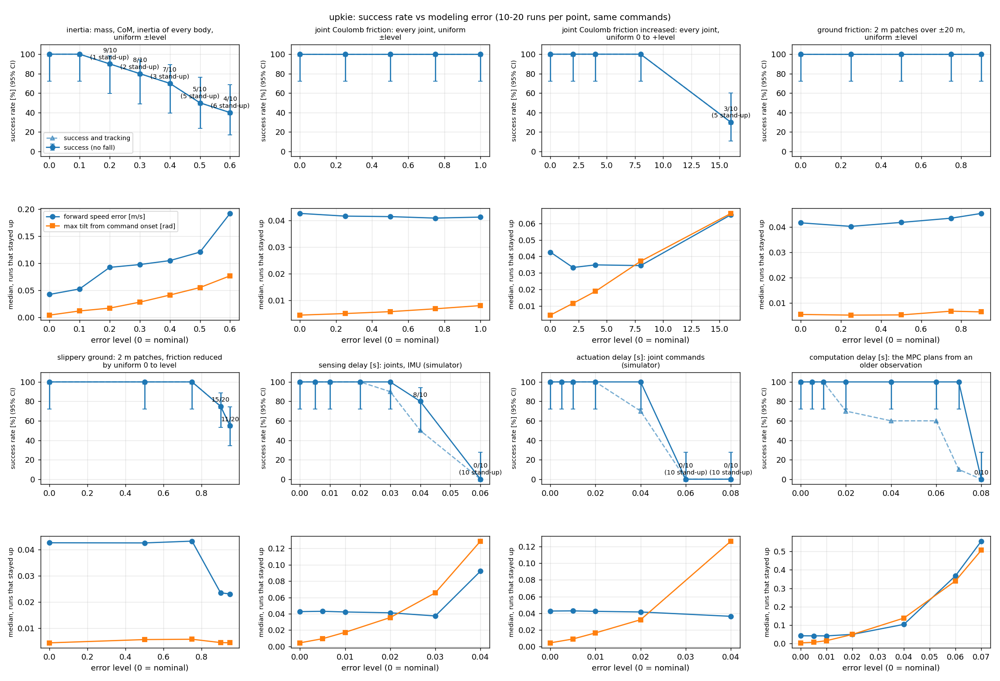
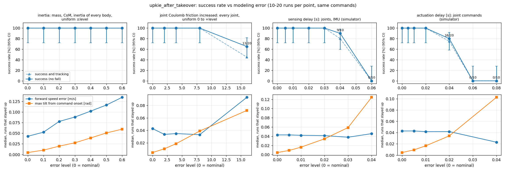

# MPC Robustness to Modeling Errors

This study measures how well the WB-ID MPC tolerates a plant that differs from its model, following Khazoom et al.,
[Tailoring Solution Accuracy for Fast Whole-body Model Predictive Control of Legged Robots](https://arxiv.org/abs/2407.10789)
(MIT Humanoid).
That paper randomizes the simulated robot's link masses, CoM locations and inertias by ±10-40 % while the controller
keeps its nominal model, also varies the MPC time step and adds computation delay, and reports success counts over 500
six-second runs with random constant commands; a run succeeds if the robot neither falls nor self-collides.
It does not vary joint or ground friction; this study adds both.
The tooling is robot-agnostic; the first results are for Upkie with 80 mm wheels, OCS2 MPC only.

## Design

The modeling error lives in the simulated plant, not in the controller's model:

| | MuJoCo plant (used) | URDF / controller YAML |
| --- | --- | --- |
| Meaning | The robot differs from what the MPC believes: a modeling error | Would change what the MPC believes |
| Side effects | None on the controller | The state estimator and RViz read the same URDF |
| Cost per variant | Applied at load, in memory | The URDF is compiled into the CppAD libraries |

No perturbed model files are written.
The simulator (`mujoco_ros2_control`, `include/mujoco_ros2_control/model_error.hpp`) loads the one nominal MJCF, then
applies a YAML `model_error` map to the compiled model in memory before the simulation starts, and recomputes the
derived constants (`mj_setConst`).
Each value is a number (a fixed relative change, x -> x (1 + value)), `{uniform: [lo, hi]}` (a relative change drawn per
element from the seed) or `{value: v}` (an absolute value):

```yaml
model_error:
  seed: 0                                   # the launch argument modelErrorSeed overrides it when >= 0
  inertia:                                  # every body but the world; optional bodies: [...] or exclude: [...]
    mass: {uniform: [-0.2, 0.2]}
    com: {uniform: [-0.2, 0.2]}             # CoM shift per axis, relative to the body's radius of gyration
    inertia: {uniform: [-0.2, 0.2]}         # each principal moment; the largest is clipped to keep A + B >= C
  joint_friction:                           # every non-free joint; optional joints: [...]
    frictionloss: 1.0                       # Coulomb friction x 2
    damping: {value: 0.05}
    armature: 0.0
  contact_friction: -0.5                    # sliding friction of every geom (a contact uses the larger of the two)
  ground_regions:                           # the flat floor as a grid of patches, each with its own friction
    size: 2.0                               # [m] patch edge
    extent: 20.0                            # [m] the patches cover [-extent, extent]^2
    friction: {uniform: [-0.5, 0.5]}        # per patch, relative to the floor's
```

Delays are plant timing, not geometry: `delay: {sensing: s, actuation: s}` in the same file (seconds, fixed or
`{uniform: [lo, hi]}` drawn once per run) makes the hardware plugin report joints, IMU, force-torque and body states
`sensing` seconds late, and apply the controller's commands (positions, velocities, feedforward, servo gains)
`actuation` seconds late; the joint servo itself keeps the live state, as a motor driver does, and the ground-truth
odometry used for scoring is not delayed.
Computation delay belongs to the controller: `ocs2.mpc.testObservationDelay` (seconds; default 0) makes the MPC plan
from an observation that old, while the policy is still evaluated at the current time, OCS2's own compensation of a
real solve time; the sweep sets it with `set:`.

Ground patches are the one error that changes geometry, so they are added while loading: the simulator parses the MJCF
with MuJoCo's model-editing API (`mjSpec`), stops the floor plane colliding (it stays visible), adds flush box patches
with the floor's friction and compiles; each patch then draws its friction and is tinted by it (darker = slipperier).
The patches get a higher geom priority than the robot, because MuJoCo otherwise uses the larger of the two geoms'
friction coefficients for a contact.

The error can also start later: with `onset: request` and `ramp: <s>` in the map the simulation starts on the nominal
plant (patches at the floor's friction, no delays) and the simulator's `~/apply_model_error` service switches it on,
blending masses, CoM, inertias, frictions and delays in over the ramp (a blend of two valid inertias is valid; the
derived constants are recomputed every step of the blend). `wb_id_walk_test.py --model-error-onset` calls it at the MPC
takeover, so a start-up the study is not about (Upkie's open-loop planned stand-up) always runs on the nominal plant.

Launch arguments of `robot.launch.py`: `modelErrorFile` (the YAML; empty = nominal plant), `modelErrorSeed` and
`modelErrorReport` (a JSON of every realized value: per-body mass, CoM and inertia before and after, per-joint friction,
contact friction range, total mass).
Each quantity draws from its own random stream, so enabling one error does not change the draws of another.

## Sweep

`tests/robustness_sweep.py` runs one sweep YAML (`config/robustness/<robot>.yaml`):

- one constant command per run, uniform within normalized ranges times the robot's command limits from its
  `ros2_controllers.yaml`; the command set (seed + run index) is the same for every setting, as in the paper;
- each run is one `tests/wb_id_walk_test.py` launch on its own ROS domain: start (Upkie: kneeling, then the planned
  stand-up), `start` seconds standing after the MPC takeover, the command for `hold` seconds, `stop` seconds at zero;
- `settings` are fixed variants (`set` for controller parameters, `launch_args`, `harness_args`, `model_error`);
  `sources` generate one setting per level from a template with `$level`, so a whole success-vs-error curve is one entry;
- a run succeeds if the robot does not fall, the paper's measure (the harness's `FALL`: base below `--minimum-height`,
  or roll or pitch beyond 0.8 rad, for 0.15 s; or, before the takeover, the bring-up's tilt fault during the planned
  stand-up, labelled "stand-up": on Upkie it fires before the knees clear, so before the MPC runs);
- a successful run also tracks if, over the hold, the mean speed on every commanded axis is within half the command
  plus a floor (0.1 m/s, 0.2 rad/s; `TRACKING` in the script, overridable with `tracking:` in the sweep YAML); an axis
  the sweep never commands is not checked (Upkie's base sits off the wheel axle, so it drifts sideways in a turn);
  this catches a robot that stays up but stops following the command, which the no-fall measure does not;
- per run: verdict, fall before takeover, forward/lateral speed and yaw-rate tracking errors over the hold (|mean -
  command|, after a `transient`), maximum tilt and minimum height from the command onset (the stand-up handover's
  transient is the same in every run of a setting, so it is left out), mean achieved MPC rate and the realized model
  error;
- per setting: success and tracking rates with Wilson 95 % intervals, failure types, tracking and tilt percentiles of the
  runs that stayed up; results in `demo_videos/robustness/<sweep>/` (`summary.json`, `summary.md`, one folder per
  setting);
- finished runs are kept and skipped on a restart; `--jobs N` runs N launches in parallel;
- `extends: <sweep>.yaml` takes another sweep and overrides some of its keys (maps merge, the rest replaces), so a
  variant of a protocol is a few lines; `select:` (or `--settings`) names settings or whole sources;
  `model_error_onset: {ramp: s}` switches every plant error on at the MPC takeover;
- `--widen W` afterwards gives every point whose 95 % interval is wider than W (a point with partial failures; 8/10 is
  0.45 wide) twice the runs (`--widen-runs`); runs are seeded per index, so added runs extend the same command set;
  the summary covers every setting with results, also the ones not run in that invocation;
- `variants:` crosses the settings with solver (or other) overlays (`set`, `launch_args`, `harness_args`), each into
  `<output>/<variant>/`, and draws `comparison.png` of every variant over a `baseline:` sweep's results.

The whole matrix (every setting and every level of every source, k runs each) is one command; it is meant to run
unattended and leave a compact record, so reading the result is cheap:

```bash
# in ros_jazzy, detached (survives a closed terminal); matrix.done appears when it finishes
R=/root/src/mpc/legged_robot_mpc_controller; O=$R/demo_videos/robustness/upkie
docker exec -d ros_jazzy bash -c "source /root/ocs2_ros2_ws/install/setup.bash; cd /root/ocs2_ros2_ws; \
  python3 $R/tests/robustness_sweep.py $R/config/robustness/upkie.yaml > $O/matrix.out 2>&1; touch $O/matrix.done"
tail -3 $O/progress.log      # one line per run: time, setting, run, verdict, MPC rate, wall time, command
cat $O/summary.md            # when done: one row per setting
```

The runner writes `summary.md` (one row per setting), `summary.json` (also every run's metrics) and
`robustness.png` (success rate vs error, one panel per source) at the end; a harness or launch failure is recorded as
`HARNESS_ERROR` or the like and left out of the success rate (reported as excluded), not counted as a fall; a
stand-up the controller rejects at the handover (`STANDUP_FAULT`) is the robot's failure and counts.
Finished runs are re-scored from their files on every invocation, so a metric change needs no new simulation; delete a
run's `run_NNN.json` to simulate it again.

```bash
# in ros_jazzy, from the workspace (the CppAD cache is relative to it)
cd /root/ocs2_ros2_ws && source install/setup.bash
R=/root/src/mpc/legged_robot_mpc_controller
python3 $R/tests/robustness_sweep.py $R/config/robustness/upkie.yaml --jobs 2           # all settings
python3 $R/tests/robustness_sweep.py $R/config/robustness/upkie.yaml --settings nominal  # one setting
python3 $R/tests/robustness_sweep.py $R/config/robustness/upkie_after_takeover.yaml --widen 0.4  # errors from the takeover
python3 $R/tests/robustness_sweep.py $R/config/robustness/upkie_solver.yaml  # solver variants (milestone 6)
# on the host (numpy, matplotlib): success rate vs error, one panel per source
python3 tests/tuning/plot_robustness.py demo_videos/robustness/upkie/summary.json
```

## Milestones

| | Milestone | Status |
| --- | --- | --- |
| 1 | Sweep harness and nominal baseline | Done: Upkie nominal 10/10 |
| 2 | Simulator model-error loader (YAML, in memory), including ground friction patches | Done: verified against MuJoCo's compiled model |
| 3 | Inertial errors (the paper's study) | Done: Upkie, ±10-60 %; the MPC alone never fell |
| 4 | Joint friction and ground friction patches | Done: Upkie |
| 5 | Delays: sensing and actuation (simulator), computation (MPC) | Done: Upkie, 5-80 ms |
| 6 | Solver effort and time step against error | Running: `upkie_solver.yaml`, 5 variants at the edges of milestones 3-5 |
| 7 | Combined random errors, report | Pending |

## Results: Upkie (80 mm wheels)

Flat scene only (uneven terrain later); OCS2 MPC at 200 Hz requested (186-188 Hz achieved at every point), the
wheel-aware linear KF in control; every run starts kneeling and includes the planned stand-up; each run's command is
drawn within ±1 m/s and ±3.14 rad/s, held 16 s, then 2 s at zero. k = 10 runs per point, 20 where the first 10 had
partial failures (`--widen 0.4`). The runs are not bit-for-bit repeatable (ROS timing), so a point at the edge can
differ by a run or two between sweeps (2026-11-25).

### Errors from the start (`upkie.yaml`)

The plant error is present from the simulation's start, so it also acts on the open-loop planned stand-up; 2 s standing
after the takeover, then the command. 43 points, 450 runs; `demo_videos/robustness/upkie/summary.md` has every row.



| Source | Range | No fall (MPC falls) | Success and tracking | Where it breaks |
| --- | --- | --- | --- | --- |
| nominal | - | 10/10 | 10/10 | forward error p50 0.043 m/s, tilt 0.004 rad |
| Inertia (mass, CoM, inertia, every body) | ±10-60 % | 10, 9, 8, 7, 5, 4 /10 (0) | same as no fall | every fall is in the planned stand-up, before the MPC runs; with the error switched on at the takeover the MPC holds every level (below) |
| Joint Coulomb friction | ±25-100 % (0-0.2 N m) | 10/10 (0) | 10/10 | no effect: the nominal 0.1 N m is small for Upkie |
| Joint friction increased | 0 to +2, 4, 8, 16 x (up to 0.3-1.7 N m) | 10/10 to 8 x; 3/10 at 16 x (2) | same | up to 0.9 N m no fall; at up to 1.7 N m (the wheel torque limit) 5 stand-up falls, 2 of the 5 MPC runs fell |
| Ground friction patches | ±25-90 % (μ 0.08-1.52) | 10/10 (0) | 10/10 | no effect |
| Slippery ground (every patch reduced) | 0 to -50, 75, 90, 95 % | 10/10, 10/10, 15/20, 11/20 (all MPC) | same | μ down to 0.04: falls 0.7-1.5 s after the command onset or 1.0-1.3 s into the stop (braking), one while standing |
| Sensing delay | 5-60 ms | 10/10 to 30 ms; 8/10 at 40 ms (2); 0/10 at 60 ms | 9/10 at 30 ms, 5/10 at 40 ms | at 60 ms the stand-up handover is rejected (robot not on its wheels) |
| Actuation delay | 5-80 ms | 10/10 to 40 ms (0); 0/10 at 60, 80 ms | 7/10 at 40 ms | 60 ms and more: the stand-up fails; at 40 ms one run reached 0.78 rad pitch (the fall limit is 0.8) |
| Computation delay | 5-80 ms | 10/10 to 70 ms (0); 0/10 at 80 ms (10) | 7/10 at 20 ms, 6/10 at 40-60 ms, 1/10 at 70 ms | yaw tracking degrades first (yaw-rate error p50 0.22 -> 0.70 rad/s at 20 ms); at 70 ms the robot stays up but sways (tilt p50 0.51 rad, forward error 0.56 m/s); at 80 ms every run falls 0.6-2.7 s after the command onset |

Slippery ground and computation delay never failed in the stand-up, so these rows already measure the MPC alone.

### Errors switched on at the MPC takeover (`upkie_after_takeover.yaml`)

The stand-up runs on the nominal plant; the simulator blends the error in over 1 s from the takeover
(`model_error_onset`), then 2 s standing and the command, so every failure is the MPC's. Only the sources where the
stand-up failed first above. 23 points, 250 runs; `demo_videos/robustness/upkie_after_takeover/summary.md`.



| Source | Range | No fall | Success and tracking | Where it breaks |
| --- | --- | --- | --- | --- |
| nominal | - | 10/10 | 10/10 | as above |
| Inertia (mass, CoM, inertia, every body) | ±10-60 % | 10/10 at every level | 10/10 | never falls; forward error p50 0.043 -> 0.135 m/s and tilt p50 0.005 -> 0.060 rad, both about linear in the level |
| Joint friction increased | 0 to +2, 4, 8, 16 x | 10/10 to 8 x; 13/20 at 16 x | 9/20 at 16 x | falls 1.0-4.4 s into the command, one while standing: at 16 x the wheels' friction (up to 1.7 N m) reaches their torque limit |
| Sensing delay | 5-60 ms | 10/10 to 30 ms; 9/10 at 40 ms; 0/10 at 60 ms | 10/10 at 30 ms, 8/10 at 40 ms | 40 ms: one fall 1.7 s into the stop; 60 ms: falls 0.7-12.7 s into the command |
| Actuation delay | 5-80 ms | 10/10 to 20 ms; 16/20 at 40 ms; 0/10 at 60, 80 ms | 15/20 at 40 ms | 40 ms: every fall 1.4-1.9 s into the stop, after a forward command of 0.78-0.92 m/s; 60 ms: 7 of 10 falls within 3 s of the command onset; 80 ms: all, one while standing |

At 40 ms of actuation delay the two sweeps give 10/10 and 16/20; both are the same marginal point (26/30 pooled).

Readings:

- The MPC alone tolerates every inertial error tested, ±60 % of mass, CoM and inertia on every body (the paper went
  to ±40 %): it never fell, and the forward tracking error and the tilt grow about linearly with the level. With the
  error present from the start, the open-loop planned stand-up is what fails: from ±20 % it tips over (trunk tilt over
  1.2 rad) before the knees clear.
- Friction is not where Upkie's MPC is fragile on flat ground: joint friction needs 16 x the nominal, where the wheels'
  friction reaches their torque limit, and the ground needs patches far below the MPC's friction cone (μ 0.6), down to
  μ 0.08, before anything falls.
- Delays are the sensitive axis, and those in the plant more than in the MPC: sensing and actuation delay hold to 30
  and 20 ms, are marginal at 40 ms and fail every run at 60 ms, while a 70 ms computation delay keeps every run up
  (badly tracked) and 80 ms fails every run. Sensing and actuation delay act on the whole loop; a computation delay only
  ages the observation the MPC plans from, while the controller loop and the joint servo run on the current state.
- At the edges the hardest moment is braking: at 40 ms of sensing or actuation delay and on slippery ground most falls
  come 1-2 s after a fast command (|vx| 0.56-0.92 m/s) steps to zero, most of the rest at the command onset.
- The nominal controller turns about 0.2 rad/s slower than commanded at every yaw command, steady over the hold
  (e.g. -0.40 rad/s for -0.56); it predates this study.

Open items: milestone 6, solver effort and time step at these edges (`upkie_solver.yaml`, running); milestone 7,
combined random errors; the planned stand-up's sensitivity to inertia (outside the MPC).

Injection checks (one run each, `demo_videos/robustness/smoke_delay`):

| Check | Result |
| --- | --- |
| Model-error report against MuJoCo's compiled nominal model | equal to 4e-12; ±20 % draws, CoM shift within 0.2 radius of gyration, A + B >= C |
| Ground patches, ±50 % | 400 patches over ±20 m, friction 0.40-1.20 around the floor's 0.8; the robot crossed 7 patches |
| Sensing delay, ground-truth base source | the controller's observed yaw lags ground truth by -0.5 ms without delay, 20.0 ms with 20 ms |
| Actuation delay | the applied knee torque trails the command by 1 ms (one control period) without delay, 21 ms with 20 ms |
| Computation delay | the parameter reaches the controller (`testObservationDelay: 0.02` in the run's configuration) |

