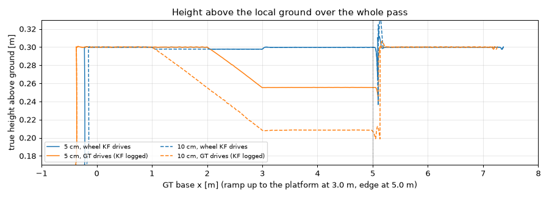
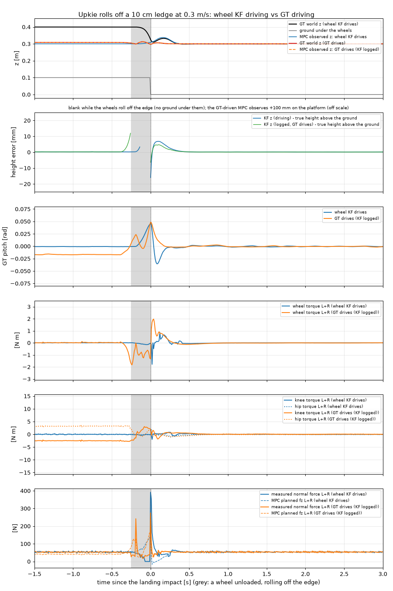
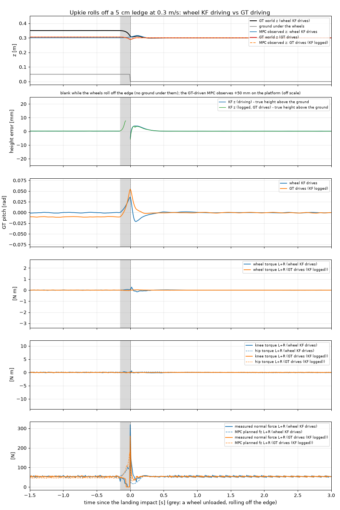

# Upkie Ledge Drop: Wheel KF Driving vs Ground Truth

Simulation result on `feat/wheeled_biped`, 2026-11-15.
It measures what the [wheel-aware linear KF](../wheeled_biped_state_estimation.md) reports when the robot drives off a ledge, and what that costs the MPC, against the same run with ground truth (GT) driving.
The question behind it: a sudden drop moves the base in world z while the legs do not change, so the estimate has a transient, and the MPC plans from it for that time.
Does the transient grow through the estimate-to-plan loop, or decay as the [filter analysis](../wheeled_biped_state_estimation.md#8-correction-and-what-the-gains-amount-to) predicts?


## Setup

| | |
| --- | --- |
| Terrain | a 2.9-degree ramp up to a platform 5 cm or 10 cm high, 2 m of platform, then a full-width sharp edge at x = 5.0 m down to the floor ([ledge_05](../../config/terrains/upkie/ledge_05_params.yaml), [ledge_10](../../config/terrains/upkie/ledge_10_params.yaml)) |
| Start | kneeling idle and planned stand-up; the estimator initialises at the idle |
| Command | from 4 s after the MPC takes over, 0.3 m/s forward at height 0.30 m, yaw rate from a line hold on the driving source's own pose; stop at 30 s |
| Runs | for each height: the wheel KF driving the MPC (`est`), and GT driving with the KF logged alongside (`gt`) |
| Recorded | GT base pose and joints, the KF estimate, and the controller's 100 Hz tracking log (observed and planned base, commanded torques, planned wrenches, measured contacts) |

One run per cell, with the noise-free simulated sensors of every Upkie estimator result.

GT is not a perfect-estimation baseline on raised ground.
The MPC models flat ground at z = 0, so on the platform GT tells it the wheels are 5 or 10 cm above the ground; GT is the world truth fed to a flat-ground model, not the state that model expects.
"True height above the ground" below is the GT base z minus the surface under the wheels: the platform until the landing impact, the floor after it, undefined while the wheels roll off the edge.


## Results

All four runs passed.
Times are relative to the landing impact (the peak measured wheel normal force past the edge).

| | 5 cm, KF drives | 5 cm, GT drives | 10 cm, KF drives | 10 cm, GT drives |
| --- | --- | --- | --- | --- |
| height above the platform before the edge | 0.300 m | 0.256 m | 0.300 m | 0.208 m |
| base world z drop at the edge | 51 mm | 17 mm | 101 mm | 11 mm |
| a wheel unloaded before the impact | 0.15 s | 0.06 s | 0.13 s | 0.25 s |
| KF error after the impact (driving / logged) | -4.8 to +3.9 mm | -5.8 to +3.9 mm | -16.0 to +6.9 mm | -6.4 to +4.7 mm |
| KF back within 5 mm | at once | at once | 0.17 s | at once |
| true height after the impact | 0.298-0.312 m | 0.289-0.301 m | 0.299-0.332 m | 0.297-0.306 m |
| back within 5 mm of 0.30 m | 0.18 s | 0.03 s | 0.31 s | 0.12 s |
| peak normal force (both wheels) | 319 N | 261 N | 392 N | 275 N |
| peak wheel / knee torque | 1.10 / 2.60 N m | 0.57 / 2.76 N m | 1.70 / 5.73 N m | 1.19 / 4.40 N m |
| max pitch after the impact | 0.036 rad | 0.055 rad | 0.046 rad | 0.049 rad |







Numbers: [upkie_ledge_summary.json](assets/upkie_ledge_summary.json).


## Insights

**1. The drop is almost invisible to the MPC when the KF drives.**
The observed height stays at the leg height above the wheels (blue, top panels) while the base falls 5 or 10 cm in world z.
The KF's error against the true height above the ground is at most -5/+4 mm (5 cm) and -16/+7 mm (10 cm) around the impact, and is back within 5 mm in 0.17 s at most.
That is the roughly 0.1 s decay the filter equations predict ([Section 8](../wheeled_biped_state_estimation.md#8-correction-and-what-the-gains-amount-to)).

**2. No sign of the estimate-to-plan loop amplifying the error.**
The KF's error has the same shape and decay whether it drives the MPC (blue, second panels) or is only logged while GT drives (green).
The larger 10 cm peak in the KF-driven run comes from its harder landing: its base falls the full 10 cm with the wheels (392 N against 275 N), not from feedback growth; the error then decays at the same rate as the logged one.
This matches the structure of the filter: its error dynamics contain no control input, so a bad plan can only enter through a broken assumption, such as a wheel off the ground while the schedule says it is down.

**3. That broken assumption occurs here, and is harmless at these heights.**
While the wheels roll off the edge (grey, 0.13-0.25 s), the schedule still says both wheels are down, so the KF's rows keep asserting "on the ground"; its height follows the legs, not the fall.
It costs a few millimetres for a tenth of a second at 5 and 10 cm.
Measured contacts (`contact.source: sensor`) would instead hand those 0.1-0.2 s to the IMU alone.

**4. With GT driving, the MPC crouches on high ground and reaches down at the edge.**
On the platform the GT-driven MPC observes the base 5 or 10 cm higher than its flat-ground model expects, and lowers it to 0.30 m in world z: 0.256 m and 0.208 m above the platform (overview plot), with hip and knee torque spent holding that crouch.
At the edge it extends the legs to keep world z at 0.30 m, so its base drops only 11-17 mm.
This is the "duck on high ground" behaviour that the KF's local-ground height avoids.

**5. The KF's way costs a harder landing, and balance is the same.**
Riding the drop with fixed legs raises the peak normal force by 22 % (5 cm) and 43 % (10 cm), and the wheel torque reaches its 1.7 N m limit for an instant at 10 cm.
The body rebounds 12 mm (5 cm) and 32 mm (10 cm) and is back within 5 mm of 0.30 m in 0.18 s and 0.31 s.
Pitch after the impact is no worse than with GT driving (0.036-0.046 against 0.049-0.055 rad).

Neither behaviour is "right" in general: the KF keeps the MPC consistent with its local flat-ground model; GT gives world height to a model that cannot use it.
Larger drops, faster approaches, edges met by one wheel, and noisy sensors are not covered by these four runs.


## Reproduce

In the container, then on any machine with numpy, matplotlib and pyyaml:

```bash
src/legged_robot_mpc_controller/tests/tuning/upkie_ledge_drop.sh /tmp/upkie_ledge        # 4 runs, about 15 min
python3 tests/tuning/plot_upkie_ledge_drop.py /tmp/upkie_ledge --out docs/results/assets
```
