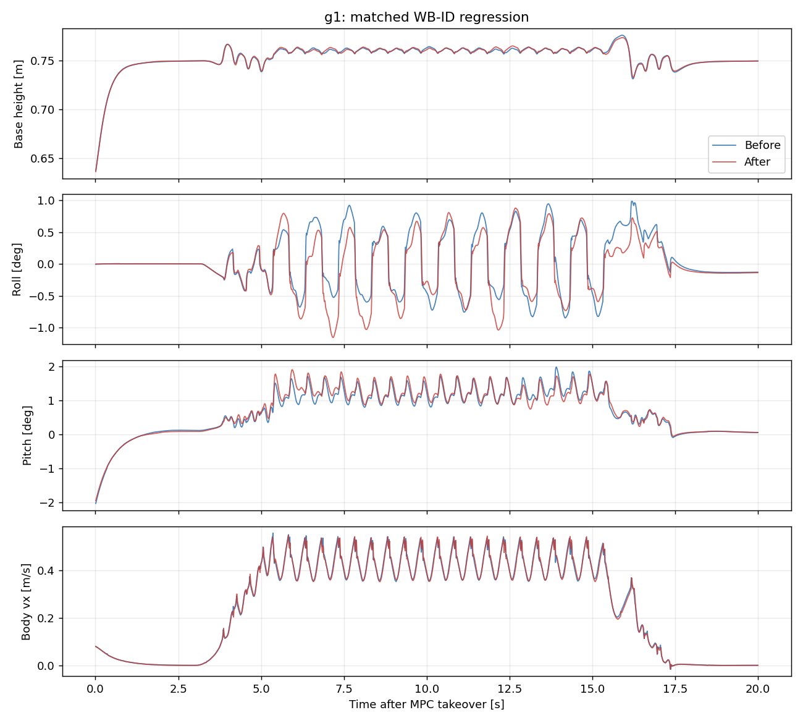
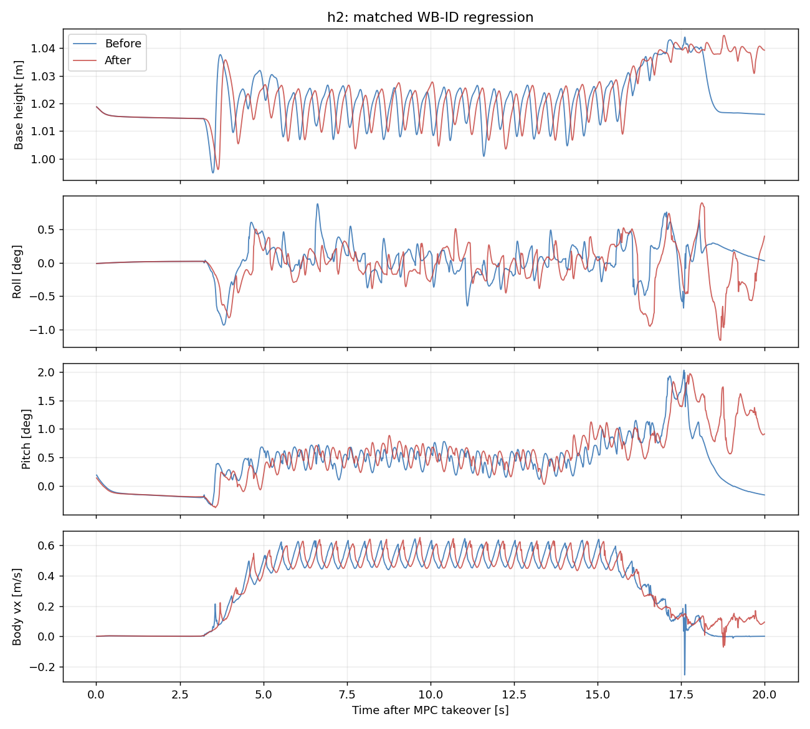
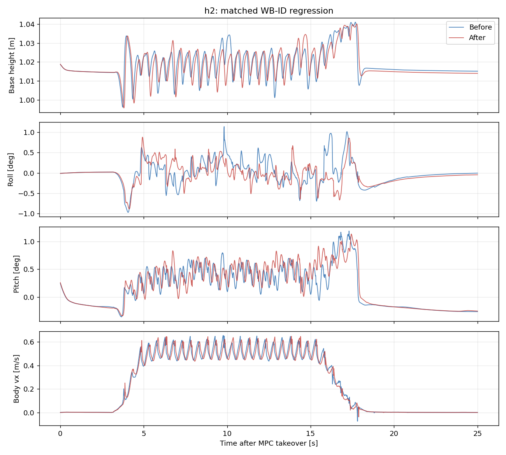
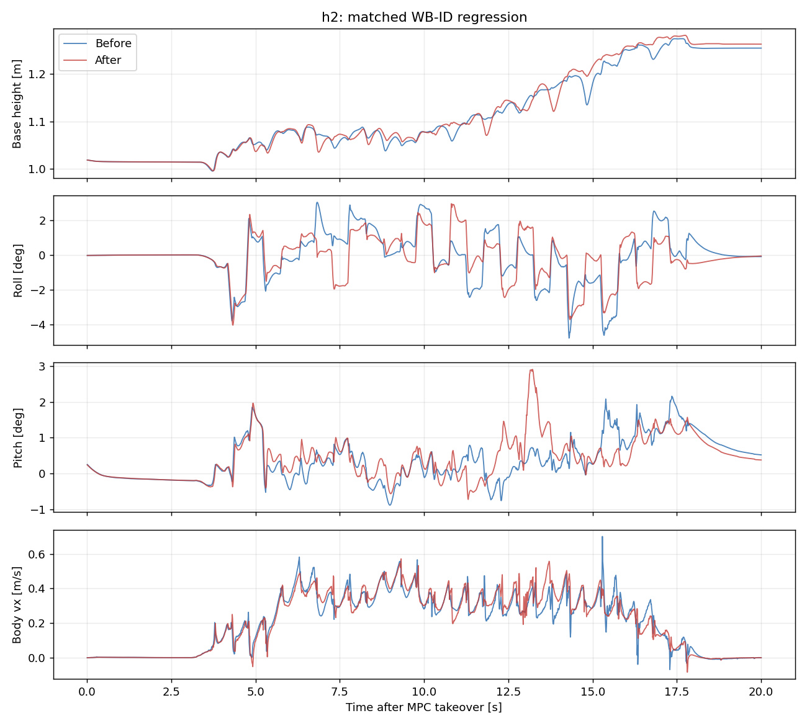
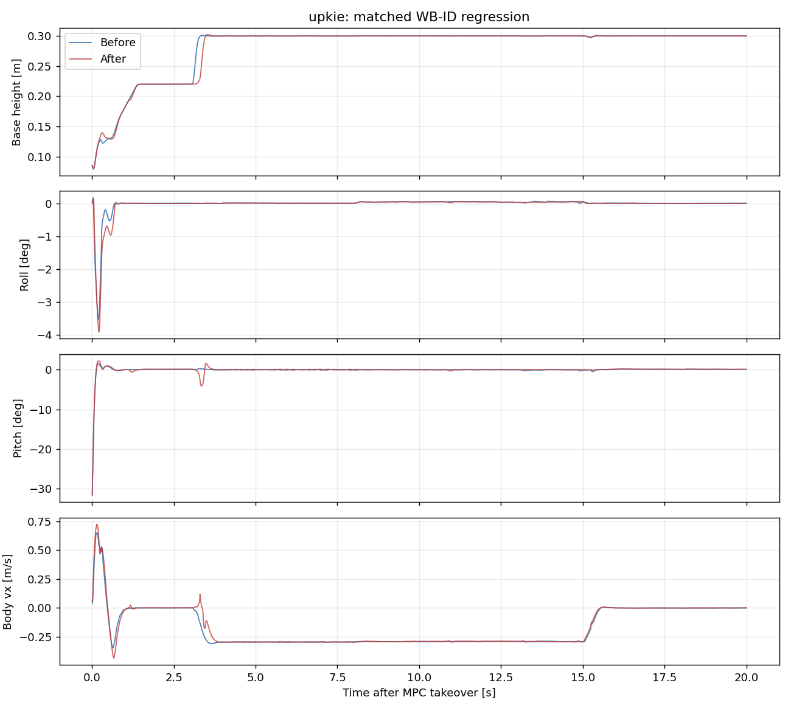

# WB-ID Package Layout Regression

Validation date: 2026-11-20, `jazzy`, against the installed `691fd44` controller.
The package now has a single public include root and mirrored `controller`, `common`, `mpc`, and `visualization` modules.
All WB-ID controller settings and estimator settings for G1, H2, and Upkie are unchanged, verified by structured YAML comparison.
The retained foot task-space cost has the same equations and generated-library names; it now lives in `mpc/common/cost/EndEffectorFootCost`.
No tuning, physics, estimator, or OCS2 changes were made for this refactor.


## Build and Static Tests

- Release build completed in the existing `ros_jazzy` container and `/root/ocs2_ros2_ws` workspace, using two build jobs and `BUILD_TESTING=ON`.
- Seven native CTest regressions passed: wheel model consistency, wheel contact kinematics, arm/body collision, swing flight, gait swing height, running transitions, and torque window.
- Python suites passed 129 checks, with 10 optional checks skipped because the Python MuJoCo module is unavailable.
- The standalone WB-ID parameter-contract script also passed.
- Local package includes, plugin registrations, launch/config contracts, and repository-relative Markdown file links were checked.
- Retired installed libraries and generated headers were removed from the active package installation.

Native wheel-model validation exercises the compiled RNEA and rolling-contact values/Jacobians, including generated libraries.
The real MuJoCo simulator was used for the motion tests below, despite the optional Python-module skips.
The seven native tests were run explicitly; this is not a claim that every ament lint target passed.


## Matched Motion Tests

Each test used the shared Linear KF, identical before/after WB-ID YAML, no RViz/GUI, 1000 Hz MRT, and 100 Hz tracking diagnostics.
Tests ran sequentially with `OPENBLAS_NUM_THREADS=1 OMP_NUM_THREADS=1` and no concurrent build.
Each run lasted 20 simulated seconds after MPC takeover, including 3 seconds settling, 2 seconds ramp-in, 10 seconds motion, 2 seconds ramp-out, and 3 seconds rest.
The H2 terrain test used its unchanged default `scene.xml`, with ramp and uneven terrain.
Upkie used its existing stand-up, forward drive, yaw, and stop sequence, with commanded height 0.30 m.

| Case | Requested MPC | Mean body vx, before / after | Steady worker Hz, before / after | Motion checks |
| --- | --- | --- | --- | --- |
| G1 flat, command 0.50 m/s | 80 Hz | 0.4368 / 0.4365 m/s | 78.17 / 78.52 | Passed |
| H2 flat, command 0.50 m/s | 80 Hz | 0.5211 / 0.5206 m/s | 75.40 / 75.75 | Passed |
| H2 ramp/uneven, command 0.35 m/s | 80 Hz | 0.3341 / 0.3505 m/s | 71.06 / 78.60 | Passed |
| Upkie flat drive/turn/stop | 200 Hz | -0.2922 / -0.2925 m/s | 168.95 / 191.38 | Passed |

Worker rate is the median of the controller's two-second `MPC_TIMING actual` windows after excluding the first two initialization windows.
It is not the tracking-topic publication rate or the reciprocal of the median solve duration.
Observed rate improvements are not attributed to the refactor; VM scheduling and closed-loop trajectory differences affect these measurements.
Upkie's negative body-frame vx is consistent with its configured command-frame rotation, not reversed execution of the drive command.
Its motion sequence overrides the scalar speed argument, so the existing harness's `SUCCESS` alone is a survival check, not a strict path-tracking check.
The separate comparison also checks its before/after mean vx, vy, yaw rate, minimum base height, and peak tilt.
Its large initial pitch and low minimum height include the intended stand-up maneuver.

All twelve valid runs, including the G1 repeats and extended H2 stop test below, completed without falling or solver exceptions.
H2 and Upkie had zero torque-window overruns before and after.
H2 flat, H2 terrain, and Upkie passed every strict comparison check.

The comparator requires identical controller settings and scenario arguments, successful completion, and survival in both runs.
Allowed peak roll/pitch increase is 0.05 rad, allowed minimum-height decrease is 0.03 m, and each mean velocity difference must be within the larger of 0.05 and 15% of its baseline magnitude, in m/s or rad/s as appropriate.
The steady worker rate must remain at least 85% of baseline, and neither cumulative solver exceptions nor torque-window overrun ticks may increase.
These are explicit regression tolerances, not safety limits or a statistical equivalence proof.

An additional matched H2 pair extended rest from 3 to 8 seconds after the short new-build trial was visibly slower to settle.
Both extended trials stopped successfully, with final body-forward speeds of 0.00015 / -0.00013 m/s old/new and final pitch of -0.00461 / -0.00443 rad.
This pair passed every strict comparison check at 78.75 / 78.34 Hz, with no solver exceptions or torque-window overruns.
The 3-second stop transient is not claimed to match pointwise.


## G1 Timing Caveat

G1 passed all motion, balance, configuration, solver-exception, and steady-rate checks in three paired runs.
However, the new build had more torque-window overrun ticks in every pair, so the stricter full comparison remains failed for G1.
This is preserved in the JSON results rather than hidden by a relaxed threshold or parameter change.

| G1 pair | Worker Hz, before / after | Walking median advance, before / after | Overrun ticks, before / after |
| --- | --- | --- | --- |
| Initial | 78.17 / 78.52 | 9.76 / 10.01 ms | 50 / 212 |
| Repeat 1 | 76.86 / 76.22 | 10.16 / 10.14 ms | 327 / 392 |
| Repeat 2 | 78.49 / 76.13 | 9.99 / 10.09 ms | 28 / 394 |

The existing G1 torque window is 0.05 seconds, and its runtime fallback remains unchanged.
Warning counts are cumulative MRT ticks outside that window, not counts of falls or solver exceptions.
The old build also overruns, but the larger new-build counts mean identical tail-latency behavior is not established.
Observed walking maximum advance ranged from 19.84 to 75.74 ms in the old runs and 99.13 to 141.21 ms in the new runs.
The cause of that tail difference is unresolved; do not dismiss it as proven VM noise or claim complete timing parity.
Mean achieved G1 forward speed remained 0.4346-0.4369 m/s across all six runs.
The next timing investigation should isolate scheduling from computation under matched CPU load before changing any gains or torque-window values.

For old-build repeats the whole installed package was selected together, then the new package was restored automatically.
Process memory maps confirmed matching controller/core libraries in the valid repeated tests.
An exploratory `LD_LIBRARY_PATH`-only attempt mixed library versions, was stopped, and is excluded from all results.


## Curves and Results

The overlays show height, roll, pitch, and body-frame forward velocity after MPC takeover.
Small phase/terrain-path differences are expected in closed-loop asynchronous trials; these are not bitwise trajectory comparisons.

### G1 Flat



[Initial comparison](assets/wb_id_layout_g1_flat.json), [repeat 1](assets/wb_id_layout_g1_flat_repeat.json), [repeat 2](assets/wb_id_layout_g1_flat_repeat2.json).


### H2 Flat



[Comparison](assets/wb_id_layout_h2_flat.json).

The extended stop check is shown separately:



[Extended stop comparison](assets/wb_id_layout_h2_stop.json).


### H2 Ramp and Uneven Terrain



[Comparison](assets/wb_id_layout_h2_terrain.json).


### Upkie Drive, Turn, and Stop



[Comparison](assets/wb_id_layout_upkie_turn.json).


## Reproduction

From the sourced workspace, run the existing harness with unchanged parameters:

```bash
cd /root/src/mpc/legged_robot_mpc_controller
export OPENBLAS_NUM_THREADS=1 OMP_NUM_THREADS=1

python3 tests/wb_id_walk_test.py \
  --robot-name h2 --source state_estimator --estimator humanoid_linear_kf \
  --mpc-rate 80 --speed 0.5 --hold 10 --ramp 2 --settle 3 --rest 3 \
  --record-joints --record-tracking --prefix /tmp/wb_id_h2_flat
```

Use `--robot-name g1` for G1 flat, or add `--scene scene.xml --speed 0.35` for H2's default terrain.
Upkie's sequence is:

```bash
python3 tests/wb_id_walk_test.py \
  --robot-name upkie --source state_estimator --estimator humanoid_linear_kf \
  --mpc-rate 200 --minimum-height 0.05 --speed 0 \
  --hold 10 --ramp 2 --settle 3 --rest 3 \
  --command-sequence '[[3,0.3,0,0.3],[8,0.3,0.5,0.3],[15,0,0,0.3]]' \
  --record-joints --record-tracking --prefix /tmp/wb_id_upkie_turn
```

The comparison utility consumes the `.json`, `.yaml`, `.log`, and `.csv` files from two harness prefixes:

```bash
python3 tests/compare_wb_id_runs.py /tmp/before /tmp/after \
  --output /tmp/comparison.json --plot /tmp/comparison.png
```

The saved session prefixes inside `ros_jazzy` are `/tmp/codex_wbid_layout_{before,after}_{g1_flat,h2_flat,h2_terrain,upkie_turn}`.
Valid G1 repeat prefixes append `_repeat_valid` to the first old repeat, `_repeat` to its new repeat, and `_repeat2` to both second repeats.
The extended H2 pair uses `/tmp/codex_wbid_layout_{before,after}_h2_stop` with `--rest 8`.
Raw `/tmp` artifacts are temporary; the comparison JSON and plots linked above are kept in the repository.
These short regressions do not validate every gait, push recovery, high-speed terrain case, GUI path, or hard real-time deadline.
