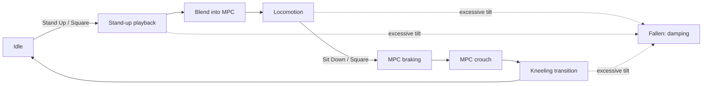

# Upkie Posture Control

Upkie starts kneeling in idle and waits for the operator.
Its MPC balance weights, rolling-contact model and 200 Hz default recommendation are unchanged.
The 80 mm wheels use a 3.9 s contact-aware stand-up with both knees and both wheels modeled offline.
The [stand-up optimization note](upkie_stand_up_optimization.md) gives the equations, references, feedback/handover guards, regeneration commands and measured comparison.


## GUI

```bash
ros2 launch legged_robot_mpc_controller robot.launch.py \
  robotName:=upkie mpcFreq:=200 baseCommandDevice:=gui
```

Press **Stand Up**, wait for **locomotion**, then drive.
Press **Sit Down** to brake, lower and kneel.
The controls become available again in idle; another Stand Up repeats the cycle.
Buttons are disabled during a transition or after a fall/fault.


## Joystick

```bash
ros2 launch legged_robot_mpc_controller robot.launch.py \
  robotName:=upkie mpcFreq:=200 baseCommandDevice:=joystick
```

Release L2, center both sticks, release L1/D-pad, and press **Square** to stand up.
After handover, release and press L2 with centered sticks to enable driving.
Release L2 and press Square again to sit down.
Square is edge-triggered: holding it does not repeat the request, and a press blocked by L2 or another interlock is never queued.
Square held while connecting is ignored until released and pressed again.
Circle is unassigned and reserved for future use; release L2 to stop driving.
The Square mapping is `button_posture: 2` in the teleop adapter (SDL's standardized X / west face button).
R1 no longer requests stand-up or sit-down with the default mapping.
The adapter enables this feature from the selected controller YAML only when a stand-up trajectory is configured.


## State Machine



The tilt check also applies during braking, lowering and blending.
Any active planned posture phase with invalid joint state or trunk orientation enters a latched fault.
No automatic fallen-to-idle or fallen-to-stand-up transition exists.
Reset the controller only after manually restoring a supported kneeling pose, or restart the simulator.

The controller owns the state machine; GUI and joystick only request transitions.
Stand Up is accepted only in idle; Sit Down only in locomotion; toggle only in either of those states.
Requests in intermediate states are refused rather than queued.
Operator twist, pose and gait commands are ignored outside locomotion.

| Parameter | Meaning |
| --- | --- |
| `bringUp.autoStart` | False by default; true automatically starts only the first planned cycle |
| `bringUp.idleSeconds` | Minimum supported-idle dwell before stand-up, currently 3 s |
| `bringUp.sitDownBrakeSeconds` | Minimum MPC braking interval, currently 1 s |
| `bringUp.sitDownVelocityMax` | Maximum horizontal speed before lowering, currently 0.1 m/s |
| `bringUp.sitDownHeight` | Internal balanced-crouch height, currently 0.125 m; must lie within the posture table |
| `bringUp.sitDownSeconds` | Smooth leg-joint transition from crouch to supported kneeling, currently 3 s |
| `bringUp.tiltLimit` | Maximum trunk tilt before latching Fallen, currently 1.2 rad |

Braking also requires angular-rate norm below 0.3 rad/s.
Lowering hands over to kneeling only within 0.02 m of the crouch target and with trunk tilt below 0.3 rad.
The final joint interpolation uses $s=\operatorname{clip}(t/T,0,1)$ and $\alpha=3s^2-2s^3$.
Idle arrival requires controlled-joint error below 0.15 rad and joint-speed norm below 1 rad/s.
Braking, lowering and kneeling have timeouts which latch a fault instead of starting the next phase blindly.
The MPC worker is paused before old policies are cleared, so repeated stand-up never intentionally reuses the previous cycle's plan.
During the contact-aware stand-up, it starts only after the planned wheel-only interval and sustained kinematic knee clearance, not while the knees support the robot.


## Services and State

```bash
CTRL=/humanoid_whole_body_inverse_dynamics_mpc_controller
ros2 service call "$CTRL/stand_up" std_srvs/srv/Trigger '{}'
ros2 service call "$CTRL/sit_down" std_srvs/srv/Trigger '{}'
ros2 service call "$CTRL/toggle_stand" std_srvs/srv/Trigger '{}'
ros2 topic echo "$CTRL/motion_state" --qos-reliability best_effort
```

The state topic is best effort, depth 1, at 10 Hz, published outside the control-update thread.
The joystick adapter stops accepting driving inputs when this heartbeat is lost for 0.5 s.
Service responses report request acceptance, not physical completion; use the state topic to observe completion.


## Automated Simulation

Run from the sourced workspace, with no other robot using the same ROS domain.
The script owns its launch process group and stops it after the trial.

```bash
ROS_DOMAIN_ID=169 python3 src/legged_robot_mpc_controller/tests/upkie_posture_cycle_test.py \
  --cycles 3 --joystick --fall-test --prefix /tmp/upkie_posture_test
```

Synthetic Joy exercises the real teleop adapter and Square service path; a physical gamepad is not required.
The trial drives between cycles and checks transition refusals, persistent idle and a deliberately induced latched fall.
Remove `--joystick` to test direct controller service requests.
Add `--yaw-command .2` to turn between cycles and check re-anchoring at another heading.
Use `--trajectory /path/to/candidate.yaml` to validate an offline candidate without replacing the default.
Use `--source ground_truth_state` for a simulator-state comparison; normal operation uses the wheel-aware linear KF.
Reports, pose/joint replays and launch logs share the requested prefix.
These posture transitions are intended for flat, supported ground; sit-down on slopes, obstacles, asymmetric support and physical hardware requires separate validation.
Before attempting a physical deployment, read the [real hardware validation handoff](./design_notes/wheeled_biped/upkie_hardware_validation_handoff.md), including the missing hardware backend, stop semantics and measured transition guards.

## Posture Table

The MPC's hip/knee posture reference depends on the target base height.
It is interpolated from `config/upkie/posture_table.yaml`, which `ocs2.reference.postureTableFile` points at in the same way `bringUp.standUpTrajectoryFile` points at the stand-up plan.
Target heights are clamped to the table's first and last height, so the table must cover `minBaseHeight`, `maxBaseHeight` and `bringUp.sitDownHeight`; the controller rejects a file whose `joint_names` differ from `robot.jointNames`, and inline `postureHeights`/`postureJointStates` next to the file.

`config/upkie/compute_posture_table.py` generates the table offline from the MuJoCo model (`upkie.xml`).
The heights are a fixed grid, 0.125-0.355 m in 0.01 m steps; for each height $h$ it solves two equations in the left hip and knee angles by Newton iteration:

$$
z_{\mathrm{tire}}(h,q_{\mathrm{hip}},q_{\mathrm{knee}})=r,
\qquad
x_{\mathrm{tire}}(h,q_{\mathrm{hip}},q_{\mathrm{knee}})=x_{\mathrm{CoM}}(h,q_{\mathrm{hip}},q_{\mathrm{knee}}),
$$

with the trunk level at $(0,0,h)$, the right leg mirroring the left, wheel angles zero and $r=0.08$ m.
The first equation puts both tires on flat ground; the second puts the whole-robot CoM above the tire center along the heading.
On flat ground the contact is directly below the tire center, so the CoM projects onto the line through both wheel contacts: a static balance point of the wheeled inverted pendulum, needing no wheel torque.
Only this fore/aft condition is imposed; laterally the mirror symmetry keeps the CoM near the midpoint between the wheels, and the two wheels support it anywhere between them.
Each height starts the Newton iteration from the previous height's solution, beginning at the 0.325 m `defaultJointState`, which the solver reproduces within 4e-6 rad.
The lowest height, 0.125 m, is the sit-down crouch and the start of the stand-up catch: its 2.43 rad knee bend is about the deepest fold at which the 0.080 m tire clears the femur.

Regenerate it in the `ros_jazzy` container with the same script and environment as the [stand-up optimization](upkie_stand_up_optimization.md#tuning-the-duration-and-regenerating):

```bash
ssh parallels@10.211.55.17
docker exec -it ros_jazzy bash
S=/root/src/mpc/legged_robot_mpc_controller/config/upkie/regenerate.sh
bash $S setup              # once per container (shared with the stand-up TO), about 3.5 min
bash $S posture            # demo_videos/upkie_posture_table/candidate.yaml; defaults reproduce the shipped table
bash $S check-posture      # course demo with the candidate table, about 1.5 min
bash $S install-posture    # only after check-posture prints SUCCESS; then restart the launch
```

`posture MIN MAX STEP` changes the grid, for example `bash $S posture 0.125 0.345 0.005`, and prints how much the candidate differs from the shipped table.
Regenerate after changing the wheel, leg or mass model; widen the grid before widening `minBaseHeight`/`maxBaseHeight`.
`check-posture` runs `tests/upkie_demo.py course` with `--set ocs2.reference.postureTableFile=...` for that launch only: the planned stand-up, then the standing height test (maximum, minimum and default height, 2 s each), the ramps, the uneven field and height steps while driving.
It prints the demo verdict, then, at the end of each height-test plateau, the measured base height and the measured left hip/knee minus the table posture, for example (shipped table):

```text
verdict: SUCCESS  min z 0.175 m  max pitch/roll 0.080/0.002 rad (includes the stand-up)
height test 0.355 m: measured 0.355 m, hip/knee - table +0.004/-0.000 rad
height test 0.225 m: measured 0.225 m, hip/knee - table +0.001/-0.002 rad
height test 0.245 m: measured 0.245 m, hip/knee - table -0.002/+0.002 rad
```

Measured joints within a few milliradians of the table while standing still mean the table is balanced: the MPC holds the CoM over the wheels, and the posture cost agrees with it.
`install-posture` refuses unless that check succeeded (`FORCE=1` overrides) and then copies the candidate to `config/upkie/posture_table.yaml`.
The Jazzy workspace uses `--symlink-install`, so restarting the launch picks the new file up; undo with `git checkout config/upkie/posture_table.yaml`.
On the host, `python3 -m pytest tests/test_upkie_posture_table.py` checks the file's coverage and symmetry and, with Python MuJoCo installed, that the generator reproduces it.
