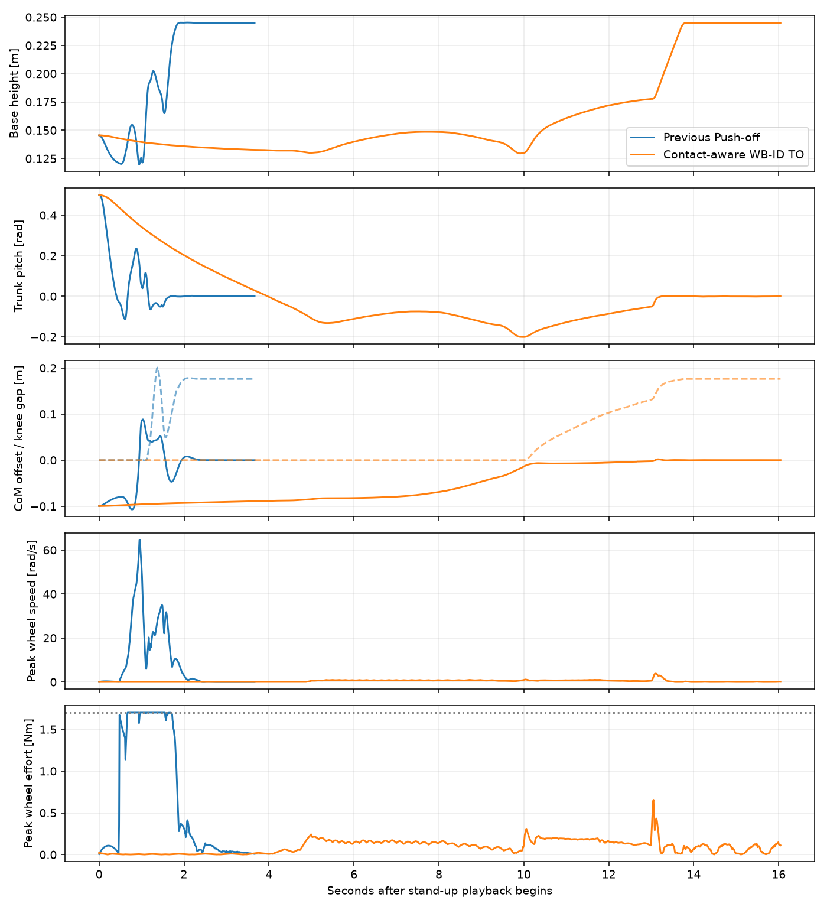
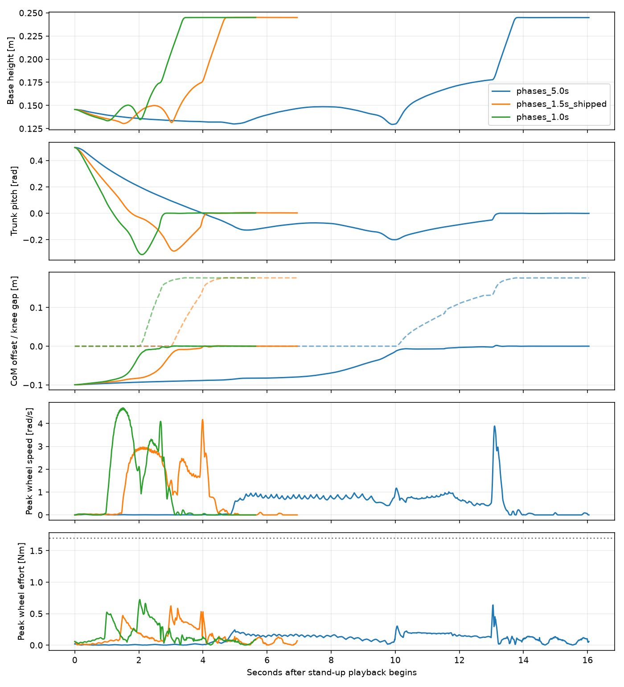

# Upkie Contact-Aware Stand-Up

The 80 mm-wheel example uses an offline whole-body inverse-dynamics trajectory and a stand-up-only finite-horizon feedback tracker.
It models both knee motor housings and both wheels, rather than applying the wheel-only locomotion MPC while the knees support the robot.
The locomotion MPC model, costs, constraints, servo parameters and 200 Hz recommendation are unchanged.
Use the normal [GUI or joystick commands](upkie_posture_control.md); no optimizer runs during a stand-up request.

## Contact Sequence

| Phase | Supported contacts | Purpose |
| --- | --- | --- |
| 1 | Both wheels and both knees | Shift load off the left knee |
| 2 | Both wheels and the right knee | Raise/reconfigure the left leg and unload the right knee |
| 3 | Both wheels | Raise and align the body before handing over to MPC |

The sequence is prescribed, but the configurations, velocities, accelerations, contact forces, actuator torques and phase durations are optimized.
This is a full 3D optimization, not a prescribed CoM path or a sagittal-only model.
The selected solution has three 1.5 s phases; execution transfers to MPC at 3.9 s, before the optimizer's terminal 4.5 s pose.
The stand-up tracker is not intended to replace the MPC as a permanent balancing controller.

Contact-aware phases are motivated by Klemm et al., [Nonsmooth Trajectory Optimization for Wheeled Balancing Robots With Contact Switches and Impacts](https://marco-tognon-robotics.com/content/non-smooth-trajectory-optimization-wheeled-balancing-robots-contact-switches-and-impacts).
This implementation does not reproduce that paper's nonsmooth optimizer or solve for an arbitrary contact sequence.
Ascento's [Section IV-C](https://arxiv.org/html/2005.11435v1) also separates getting up from balancing; its dynamic stand-up is not the gentle trajectory implemented here.

## Optimization Model

Let $\eta=[p_B^W;\psi;\theta;\phi;q_j]\in\mathbb R^{12}$ contain base position, Euler-ZYX angles and six joint angles.
Pinocchio internally uses a free-flyer quaternion configuration $q_P(\eta)$ and body-coordinate base velocity:

$$
v_P=T(\eta)\dot\eta,
\qquad
a_P=T(\eta)\ddot\eta+\dot T(\eta,\dot\eta)\dot\eta.
$$

The decision variables at each node are $\eta,\dot\eta,\ddot\eta$, six actuator torques $\tau_j$, and four world-frame point forces $f_i\in\mathbb R^3$.
The complete inverse-dynamics equality is enforced at every node:

$$
T^\top\left[
f_{\mathrm{RNEA}}(q_P,v_P,a_P)
+S_j^\top\tau_f
-\sum_i J_{c,i}^{\top}f_i
-S_j^\top\tau_j
\right]=0.
$$

The armature is $0.005\ \mathrm{kg\,m^2}$ per joint, and $\tau_f=0.1\tanh(\dot q_j/0.05)\ \mathrm{Nm}$ matches the current simulator/MPC approximation.
These numbers come from the local robot model, not from a stand-up paper or hardware identification.
Unlike the locomotion MPC's optional near-term torque window, the offline problem enforces all joint inverse-dynamics rows throughout its horizon.
This inverse-dynamics formulation follows the same principle as [Molnar et al., Section IV-B1, Eq. (5)](https://arxiv.org/html/2511.19709v1#S4.SS2.SSS1), but uses offline IPOPT rather than their MPC solver.

Each interval uses trapezoidal integration:

$$
\eta_{k+1}=\eta_k+\frac{\Delta t_k}{2}(\dot\eta_k+\dot\eta_{k+1}),
\qquad
\dot\eta_{k+1}=\dot\eta_k+\frac{\Delta t_k}{2}(\ddot\eta_k+\ddot\eta_{k+1}).
$$

There are 16, 16 and 28 intervals in the three phases.
Each phase duration is bounded by `plan.py --phase-seconds MIN MAX` (default 0.5 and 1.5 s).
The running cost is integrated over time, so the same path traversed more slowly always costs less; the optimum therefore sits on MAX, which sets the stand-up speed.
With the earlier 1-5 s bounds every phase took 5 s (13 s to handover) while using at most 26% of the velocity bounds and 35% of the actuator bounds.
With 1.5 s phases the TO's acceleration bounds become active at the second knee release; actuator use stays at or below 34% (legs) and 57% (wheels).
Joint-position, velocity, acceleration and actuator bounds are hard constraints in this offline problem.
Leg torque bounds are 12 Nm and wheel bounds 1.2 Nm, leaving feedback reserve below the simulator's 16/1.7 Nm limits.
The knee-angle magnitude is limited to 2.38 rad to leave margin before tire/femur contact.
The objective penalizes angular motion, joint motion, acceleration, actuator effort, force changes and unnecessary translation; it does not require a running CoM reference trajectory.

### Contact Geometry

Each wheel uses radius $r=0.08\ \mathrm m$ and axial half-width $h=0.022\ \mathrm m$.
The two housings at each knee are approximated by their combined cylinder: radius $0.05\ \mathrm m$, half-width $0.02685\ \mathrm m$, center $[0,-0.17015,0.0700987]^\top$ in the corresponding femur frame.
For world axle $e_i$, upward normal $n=[0,0,1]^\top$, and center $p_i$, the optimizer uses a smooth finite-width support point:

$$
w_i=n-(e_i^\top n)e_i,
\qquad
\rho_i=-r_i\frac{w_i}{\|w_i\|}
-h_i\frac{e_i^\top n}{\sqrt{(e_i^\top n)^2+\epsilon^2}}e_i,
\qquad
\epsilon=0.02.
$$

The second term accounts approximately for the lower axial edge under roll; a thin disk misses this effect.
This remains a smooth approximation to the collision shapes, not an exact contact-patch model.
The material-point velocity is $v_{c,i}=v_i+\omega_i\times\rho_i$, not the derivative of the moving geometric lowest point.
Active contacts have zero normal gap and zero tangential material velocity at interior nodes.
Released knees have zero force and increasing clearance; their clearance lower bound reaches 15 mm.
Support forces obey $f_z\geq0$, $|f_x|\leq0.7f_z$ and $|f_y|\leq0.7f_z$.
These componentwise bounds are a friction pyramid, not a circular cone of radius $0.7f_z$.
Knee normal-force bounds decrease before each release, and force-change costs discourage abrupt unloading.

Pinocchio evaluates RNEA/FK and CasADi differentiates the expressions, including the contact geometry and constrained tracking model.
The C++ scalar conversion follows [Pinocchio's official CasADi RNEA example](https://github.com/stack-of-tasks/pinocchio/blob/devel/examples/casadi/casadi-rnea.cpp); NLP construction uses [CasADi Opti/IPOPT](https://web.casadi.org/docs/#opti-stack).
No finite-difference RNEA gradients or new handwritten rigid-body engine are used.
The generator checks inverse dynamics and CoM against MuJoCo at five perturbed 3D states before optimization.

## Tracking and Handover

The offline tool linearizes contact-constrained dynamics and computes finite-horizon Riccati gains, following the [finite-horizon/trajectory-tracking LQR formulation](https://underactuated.mit.edu/lqr.html).
The contact solve uses a $10^{-5}$ regularization for redundant contact rows.
Existing joint PD feedback is included when computing the additional tracking gains.
At runtime the controller applies

$$
\tau_{\mathrm{ff}}(t)=\tau^\star(t)-K(t)\bigl(\hat x(t)-x^\star(t)\bigr),
\qquad
x=[\eta;\dot\eta].
$$

The normal low-level joint PD servo still runs at the simulator physics rate; the extra state-feedback correction runs in the controller update.
It uses the configured floating-base estimate and joint feedback, not simulator ground truth.
The trajectory is anchored to the current XY position, heading and unwrapped free-wheel angles on every cycle.
The stand-up gains are separate from OCS2's `useFeedbackPolicy` option.

The selected plan starts wheel-only MPC warm-up at 3.3 s and transfers at 3.9 s ($D_1+D_2+0.2D_3$ and $\sum D-0.4D_3$).
Before starting or applying MPC, a forward-kinematics guard requires both knees at least 15 mm above the inferred wheel support plane for 50 ms; the two wheel support heights must agree within 10 mm.
The guard uses exact finite-cylinder lower-height formulas rather than the optimizer's smoothing.
This is a flat-ground geometric check: it does not measure normal loads or prove that a tire is carrying force.
During warm-up the reference height is held near the measured height; at handover the normal height ramp restarts there.
Position, velocity, feedforward and servo gains blend into MPC over the unchanged 50 ms interval.
Missing state, a failed clearance check at handover, an unavailable MPC policy or excessive tilt rejects the transition and latches the existing damping fault/fall state.
Sit-down returns to the original activation idle servo targets, avoiding another sag from holding already-deflected measured angles.

## Recorded Acceptance

The first estimated-state ROS comparison, made with the earlier 5 s phases, uses playback plus the first 3 s of MPC; the durations therefore include the blend.
Torque RMS is averaged over different-duration motions, so it is not an equal-time energy comparison.

| Measurement | Previous push-off | Contact-aware, 5 s phases |
| --- | ---: | ---: |
| Playback including blend | 0.67 s | 13.05 s |
| Peak wheel speed | 64.5 rad/s | 3.8 rad/s |
| Wheel torque RMS | 0.914 Nm | 0.098 Nm |
| Wheel-torque saturation samples | 15.0% | 0% |
| Wheel-center X range | 0.70 m | 0.092 m |
| Maximum wheel clearance | 148 mm | 0.083 mm |
| Knee clearance at locomotion entry | approximately 0 mm | 135 mm |
| Reconstructed tire/femur penetration | 6.3 mm | none detected |

Three further estimated-state synthetic-joystick stand/drive/sit cycles passed, with maximum locomotion tilt 0.0091 rad.
Regenerating from the saved source and seed, then repeating three cycles with turning between stands, also passed; maximum locomotion tilt was 0.0139 rad.
The installed default then passed a normal 0.2 m/s drive/stop trial, tracking approximately 0.189 m/s without retuning locomotion.
A direct-service cycle followed by another stand and an injected fall also passed: Fallen remained latched and all three posture services refused further motion requests.
Visual inspection confirms sequential knee unloading and a slow rise without the original wheel lift or catching lunge.
These results validate this simulation checkpoint, not all disturbances, slopes, contact friction values or real hardware.



Solid CoM-offset and dashed minimum-knee-clearance curves share each run's color in the middle panel.
The [recorded metrics](results/assets/upkie_r80_stand_up.json) and `tests/tuning/analyze_upkie_stand_up.py` preserve the measurement definitions.

### Shorter Phases

The shipped plan uses 1.5 s phases (`--phase-seconds 0.5 1.5`); the model, contact sequence, bounds and cost are otherwise unchanged.
The same measurements over playback plus the first 3 s of MPC, estimated state, one run each (two runs per plan overlap in the plot):

| Measurement | 5 s phases | 1.5 s phases (shipped) | 1.0 s phases |
| --- | ---: | ---: | ---: |
| Playback including blend | 13.05 s | 3.95 s | 2.65 s |
| Peak wheel speed | 3.9 rad/s | 4.2 rad/s | 4.7 rad/s |
| Peak wheel effort | 0.64 Nm | 0.63 Nm | 0.72 Nm |
| Wheel torque RMS | 0.098 Nm | 0.160 Nm | 0.190 Nm |
| Wheel-torque saturation samples | 0% | 0% | 0% |
| Wheel-center X range | 0.092 m | 0.090 m | 0.087 m |
| Maximum wheel clearance | 0.1 mm | 0.4 mm | 0.8 mm |
| Knee clearance at locomotion entry | 135 mm | 137 mm | 138 mm |
| Reconstructed tire/femur penetration | none | none | none |
| Most forward pitch (second knee release) | -0.20 rad | -0.29 rad | -0.31 rad |
| Tilt in the first 1 s of MPC, regular cycles | 0.009-0.011 rad | 0.013-0.024 rad | 0.016-0.025 rad |
| Mean MPC rate | 190 Hz | 191 Hz | 189 Hz |

The shipped 1.5 s plan then passed five synthetic-joystick stand/drive/sit cycles plus the forced-fall latch, three cycles with turning between stands (maximum locomotion tilt 0.017 rad), and two full course runs.
Locomotion tilt after the first second of MPC is unchanged (0.003-0.005 rad in every plan).
The 1.0 s plan also passed three cycles plus the fall latch and two stand-ups, but with less margin: the TO's acceleration bounds are active on most joints, wheel effort is higher, and measured pitch varied between runs (0.085-0.134 rad), so it is not the default.
With a 2.0 s cap the final IPOPT iterate exceeded the $10^{-5}$ export threshold, also when warm-started from the 1.5 s solution; `plan.py` now retains an earlier feasible iterate in that case (see [Tuning the Duration and Regenerating](#tuning-the-duration-and-regenerating)).



[Recorded metrics](results/assets/upkie_r80_stand_up_speed.json).

## Tuning the Duration and Regenerating

The shipped trajectory needs no Python optimizer dependencies to run.
Regeneration is optional and specific to the current 80 mm wheel geometry; a radius/width mismatch is rejected.
The stand-up speed is set by one option, `plan.py --phase-seconds MIN MAX`: each of the three contact phases lasts MAX seconds, because the time-integrated cost always pushes the durations to the upper bound.
MIN is a lower bound the optimum does not reach; keep 0.5 (it must stay below MAX).
The export then derives both MPC times from the last phase:

| Phase cap MAX | MPC warm-up start, $2.2\,\mathrm{MAX}$ | Handover to MPC, $2.6\,\mathrm{MAX}$ | Status |
| ---: | ---: | ---: | --- |
| 1.0 s | 2.2 s | 2.6 s | Passed MuJoCo cycles, with less margin (see [Shorter Phases](#shorter-phases)) |
| 1.2 s | 2.64 s | 3.12 s | Exports (retained iteration 82); not yet run in MuJoCo |
| 1.5 s | 3.3 s | 3.9 s | Shipped default |
| 2.0 s | 4.4 s | 5.2 s | Exports (retained iteration 43); not yet run in MuJoCo |
| 5.0 s | 11 s | 13 s | Previous default; with the old seed (below) it reproduces the `a86b26d` YAML within $2\times10^{-6}$ |

Solution-level comparison (TO limits, before any simulation):

| MAX | Cost | Peak pitch-rate use | Peak wheel effort use | Nodes at an acceleration bound | Peak torque rate |
| ---: | ---: | ---: | ---: | ---: | ---: |
| 1.0 s | 39.2 | 71% | 67% | 30 | 30.5 Nm/s |
| 1.2 s | 29.9 | 71% | 60% | 11 | 23.9 Nm/s |
| 1.5 s | 24.0 | 57% | 57% | 8 | 20.3 Nm/s |
| 2.0 s | 17.1 | 50% | 47% | 1 | 14.9 Nm/s |

Every plan reaches the pitch-acceleration bound at the second knee release (node 32); shorter plans use more of every limit.

The steps below run on the host (macOS or Linux) from the repository root; they were checked on macOS with Homebrew Python 3.12, CMake and Apple Clang.
The MuJoCo validation runs in the ROS container, which sees the same repository through its mount.

### 1. One-Time Environment and Model Build

```bash
cd ~/src/mpc/legged_robot_mpc_controller
export WORK=/tmp/upkie_stand_up
mkdir -p "$WORK"
python3.12 -m venv "$WORK/env"
source "$WORK/env/bin/activate"
pip install mujoco==3.13.0 casadi pin cmeel-eigen numpy scipy pyyaml matplotlib
PREFIX=$(python -c 'import site; print(site.getsitepackages()[0])')
cmake -S config/upkie/stand_up_to -B "$WORK/build" \
  -DCMAKE_BUILD_TYPE=Release \
  -DCMAKE_PREFIX_PATH="$PREFIX/cmeel.prefix;$PREFIX/casadi"
cmake --build "$WORK/build" -j4
"$WORK/build/upkie_stand_up_model" \
  description/urdf/robots/upkie/upkie.urdf "$WORK/upkie"
python config/upkie/stand_up_to/plan.py --models "$WORK/upkie" --check-model-only
```

The last command must print `Pinocchio/CasADi and MuJoCo dynamics/CoM parity passed (5 states).`
`upkie_stand_up_model` writes `$WORK/upkie_rnea.casadi` and `$WORK/upkie_fk.casadi`; rebuild them only when the URDF changes.
`/tmp` does not survive a reboot; pick another `WORK` to keep the environment.
In a new shell, only `cd` to the repository, `export WORK=/tmp/upkie_stand_up` and `source "$WORK/env/bin/activate"` are needed.

### 2. Generate a Candidate

```bash
MAX=1.2
python config/upkie/stand_up_to/plan.py --models "$WORK/upkie" \
  --phase-seconds 0.5 $MAX \
  --solution "$WORK/solution_$MAX.json" \
  --output "$PWD/demo_videos/upkie_stand_up_tune/candidate_$MAX.yaml"
grep -E "^  (handover_time|mpc_start_time):" demo_videos/upkie_stand_up_tune/candidate_$MAX.yaml
```

Always pass `--output`: its default overwrites the shipped `config/upkie/stand_up_trajectory.yaml`.
A run takes about 75 s on an M-series Mac: about 55 s of IPOPT (it stops at its 1000-iteration limit), then the feedback gains and export.
The run prints `NLP status: ... constraint violation: ...`, then `exported ... N samples`.
`Maximum_Iterations_Exceeded` is normal: IPOPT does not converge on this problem, and near the limit its iterates oscillate between feasible (about $10^{-7}$ violation) and infeasible (up to $10^{-3}$).
If the final iterate violates the constraints by more than $10^{-5}$, `plan.py` exports the lowest-cost iterate with at most $10^{-6}$ violation instead and prints `final iterate infeasible; retaining iteration N`; the solution JSON records it as `retained_iteration` (null when the final iterate is used).
The export is refused (`stand-up optimization is infeasible; refusing trajectory export`) only if no iterate qualifies.
Either way the result is a feasible point, not a certified optimum, so the MuJoCo check below is required.
`demo_videos/` is ignored by Git and visible inside the container.

The default `seed.json` is the shipped 1.5 s solution; its velocities and accelerations are rescaled to MAX.
To return to the slow 5 s plan, warm-start from the original seed:

```bash
git show a86b26d:config/upkie/stand_up_to/seed.json > "$WORK/seed_5s.json"
python config/upkie/stand_up_to/plan.py --models "$WORK/upkie" \
  --phase-seconds 1 5 --seed "$WORK/seed_5s.json" \
  --solution "$WORK/solution_5.json" \
  --output "$PWD/demo_videos/upkie_stand_up_tune/candidate_5.yaml"
```

### 3. Validate in MuJoCo

From the Mac, open a shell in the ROS container and run three synthetic-joystick stand/drive/sit cycles plus a forced fall with the candidate:

```bash
ssh parallels@10.211.55.17
docker exec -it ros_jazzy bash
source /opt/ros/jazzy/setup.bash && source /root/ocs2_ros2_ws/install/setup.bash
cd /root/ocs2_ros2_ws
R=/root/src/mpc/legged_robot_mpc_controller
O=$R/demo_videos/upkie_stand_up_tune
MAX=1.2
ROS_DOMAIN_ID=169 python3 $R/tests/upkie_posture_cycle_test.py \
  --cycles 3 --joystick --fall-test \
  --trajectory $O/candidate_$MAX.yaml --prefix $O/cycles_$MAX
python3 -c "import json; d = json.load(open('$O/cycles_$MAX.json')); \
print(d['verdict'], d['cycles'], 'cycles, fall latched', d.get('fall_latched'), 'max tilt', d.get('max_locomotion_tilt'))"
```

Run the tests from `/root/ocs2_ros2_ws`: the controller's CppAD library cache (`auto_generated/upkie`) is relative to the working directory, and another directory regenerates it from scratch.

Accept a candidate only with `SUCCESS`, all cycles, the fall latched and locomotion tilt near the shipped values.
`--trajectory` overrides `bringUp.standUpTrajectoryFile` for this launch only; the shipped file is untouched.
The test takes about 1 to 2 minutes per cycle; add `--yaw-command 0.5` in a second run to turn between stands.

### 4. Install

On the host, with the environment active:

```bash
cp demo_videos/upkie_stand_up_tune/candidate_$MAX.yaml config/upkie/stand_up_trajectory.yaml
python -c "import json, sys; d = json.load(open(sys.argv[1])); \
json.dump({k: d[k] for k in ('x', 'v', 'a', 'force', 'torque', 'duration')}, open(sys.argv[2], 'w'))" \
  "$WORK/solution_$MAX.json" config/upkie/stand_up_to/seed.json
```

The second command makes the new solution the seed, so a later default regeneration starts from the installed plan.
Change the default of `--phase-seconds` in `plan.py` to the same MAX, so that a plain regeneration reproduces it.
The Jazzy workspace uses `--symlink-install`, so the installed YAML points at the source file: restart the launch, no `colcon build` needed.
Restore the shipped plan with `git checkout config/upkie/stand_up_trajectory.yaml config/upkie/stand_up_to/seed.json`.
The 3.9 s handover is also quoted in `config/upkie/ros2_controllers.yaml`, `README.md` and the Upkie docs; update those when shipping a different MAX.

### 5. Inspect the Motion

With the candidate installed, record one stand-up in the container, then plot it on the host:

```bash
# container: same shell as step 3 (ROS sourced, in /root/ocs2_ros2_ws, R, O and MAX set)
ROS_DOMAIN_ID=169 python3 $R/tests/upkie_demo.py standup --prefix $O/standup_$MAX
# host: repository root, environment active, MAX set
python tests/tuning/analyze_upkie_stand_up.py \
  demo_videos/upkie_stand_up_tune/standup_$MAX \
  --output demo_videos/upkie_stand_up_tune/standup_${MAX}_report
```

The demo prints a verdict, minimum height and maximum pitch/roll; the report PNG shows height, pitch, CoM offset with knee clearance, wheel speed and wheel effort, and the JSON holds the same metrics as the [Shorter Phases](#shorter-phases) table.
Pass several prefixes (and `--labels`) to overlay plans.
For a video of the full course, use `tests/upkie_demo_video.sh record NAME` in the container and `tests/upkie_demo_video.sh render NAME` on the host; its header lists the display and Python requirements.
The normal GUI or joystick launch also uses the installed file.

The geometry/model generation and NLP are offline only; no CasADi, IPOPT or Python Pinocchio dependency was added to the MPC controller.
The wheel-only locomotion OCP still cannot plan knee-supported motion.
Unknown terrain stand-up, unexpected contact switches, online replanning and physical hardware validation remain future work.
