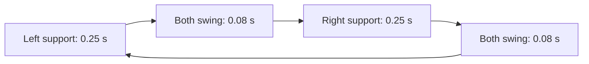

# WB-ID Running Checkpoint


## Contact Schedule

Running uses the existing WB-ID model, foot-motion equalities and swing-foot zero-wrench constraints.
G1 has no foothold reference: the optimizer selects its joint motion and horizontal foot placement.
H2 adds a soft swing-foot target for running up to 2 m/s; see [H2 to 2 m/s](#h2-to-2-ms).
Unlike supported walking, the running template contains intervals with neither foot in contact:



The diagram shows G1's 0.66 s cycle; H2 uses the same pattern with 0.26 s support and 0.04 s flight, giving a 0.60 s cycle.
`LF` means left support, `RF` means right support and `FLY` means both feet are scheduled to swing.
In `FLY`, both contact wrenches are zero and both feet follow their respective vertical swing equalities.
The unactuated inverse-dynamics equations still apply, so the optimizer cannot use a fictitious ground force to support the body.
For ideal flight, the whole-robot CoM obeys $\ddot p_G^W=g^W$; the pelvis need not follow that exact trajectory because the joints can move relative to the CoM.

The current experimental ladder for both G1 and H2 is `stance -> walk -> trot -> run`.
The earlier running results below used `stance -> slow_walk -> walk -> run`; H2's revised sequence was exercised by every ramp in [H2 to 2 m/s](#h2-to-2-ms), G1's has not been simulation-tested.
Supported walking remains selected for pure yaw commands; running is requested when the conditioned planar speed command reaches 0.75 m/s and the measured-speed guard is satisfied.
The run-to-trot threshold is 0.70 m/s, providing hysteresis; dwell time and the future insertion delay also apply.
The inclusive speed comparison allows 1e-9 m/s numerical tolerance for recursive command-filter roundoff.

| Gait | G1 linear band [m/s] | H2 linear band [m/s] |
| --- | --- | --- |
| stance | [-0.10, 0.03] | [-0.10, 0.03] |
| slow_walk | Not selected | Not selected |
| walk | [0.02, 0.45] | [0.02, 0.45] |
| slow_trot | Not selected | Not selected |
| trot | [0.40, 0.75] | [0.40, 0.75] |
| run | [0.70, 10.0] | [0.70, 10.0] |

The current gait's upper boundary requests a faster gait, while its lower boundary requests a slower one; these are hysteresis bands, not disjoint speed bins.
Both robots' walking yaw bands start at 0.05 rad/s, below stance's 0.10 rad/s upper boundary, preserving yaw hysteresis when switching directly between stance and walking.
Commands of 0.75-1.0 m/s therefore request running after acceleration, rather than switching immediately when a GUI marker moves.
Commands above 1.0 m/s also remain assigned to `run` if the configured command maximum permits them, but higher speeds are untested.


## Necessary Fixes

One foot's running swing crosses several global contact modes, including the other foot's support period.
All those modes now use one complete lift-off-to-touchdown spline, avoiding changes in requested height, velocity and impact weighting at internal mode boundaries.
Ordinary single-mode walking swings retain the same spline construction.

An independent OCS2 warm-start defect caused allocator crashes during some run-to-walk or walk-to-stance changes.
`TrajectorySpreading::adjustTrajectory` now preserves source samples before truncating the old trajectory, writes only the retained interval and truncates last.
This fix lives in the separate `ocs2_ros2` repository and must accompany the controller changes.
The standalone 200-phase AddressSanitizer reproduction failed before the fix and passed afterward; the dependency's 19 trajectory-spreading tests also passed.


## Per-Gait Swing Height

Set `ocs2.gait.templates.<name>.swingHeight` to choose a nominal clearance for each gait, in meters.
Omit it or use -1 to inherit `ocs2.gait.swingTrajectory.swingHeight`; zero means zero additional clearance, not fallback.
The selected ladders now have these overrides:

| Robot | Gait | Nominal height [m] | Steady swing duration [s] | Scaled reference clearance [m] |
| --- | --- | --- | --- | --- |
| G1 | walk | 0.08 | 0.30 | 0.06 |
| G1 | trot | 0.09 | 0.50 | 0.09 |
| G1 | run | 0.10 | 0.41 | 0.10 |
| H2 | walk | 0.10 | 0.30 | 0.075 |
| H2 | trot | 0.15 | 0.50 | 0.15 |
| H2 | run | 0.20 | 0.40 | 0.20 |

The existing duration scaling remains $\min(1,T_{\mathrm{swing}}/0.4)$, and clearance is measured above the higher lift-off/touchdown endpoint.
The schedule carries the height alongside each mode, so previously scheduled walking swings retain their height when future running phases are inserted.
Every mode within one complete swing uses the height selected at lift-off, preserving spline continuity across flight boundaries.
Other G1/H2 templates retain their respective 0.08/0.10 m defaults.
The shared parser supports the optional property in both controller schemas without changing centroidal YAML values.
The new G1/H2 trot/run heights are user-requested starting values, not performance-validated tuning; all running results below used the previous universal G1/H2 heights of 0.08/0.10 m.
The Jazzy Release build and both native AddressSanitizer regressions passed, including 100 schedule-transition cycles; these checks do not establish locomotion robustness.
Higher swings demand faster leg motion and can increase torque, joint-limit and collision pressure; do not assume that doubling clearance preserves the previous robustness.


## Tuning and Validation

Both saved source configurations passed 1.0 m/s-command trials with 30 s holds and complete stops, plus final timestamp-paired flight checks.
Tests use the flat scene, estimated feedback from `humanoid_linear_kf`, requested MPC90/MRT1000, headless MuJoCo, no RViz and no command GUI.
Each initial successful G1 trial includes a 12 s speed hold, 3 s command ramps, initial settling and 6 s rest after stopping.

| Change | Reason |
| --- | --- |
| Shorter supported-walking rhythm | Bridge walking and running without an excessively long recovery step |
| Running support 0.25 s / flight 0.08 s | Shorter strides with a positive flight window |
| Swing height 0.08 m | Moderate clearance instead of exaggerated lifting |
| G1 lateral separation 0.09 m | Discourage airborne crossover that 3D sphere distance alone can allow |
| G1 collision mu 3000 / delta 0.02 | Keep separation without the overly strong original near-contact penalty |
| H2 support 0.28 s / flight 0.06 s | More support time than the copied G1 rhythm, which caused knee collapse |
| H2 height weight 50->300 | Discourage the progressively deeper crouch seen in failed trials |
| H2 forward-velocity weight 60->30 / vertical-velocity weight 5->1 | Favor balance and allow vertical motion instead of demanding precise twist tracking |

| Robot and command | Pose-derived forward speed | Complete run and stop | Sampled physical flight | Sampled foot self-contact |
| --- | --- | --- | --- | --- |
| G1 0.75 m/s | 0.656 m/s | Passed 28 s | 36 bouts, longest 50 ms | None |
| G1 1.0 m/s | 0.870 m/s | Passed 28 s | 19 bouts, longest 20 ms | None |
| G1 1.0 m/s, saved-value repeat | 0.875 m/s | Passed 46 s | 34 bouts, longest 30 ms | None |
| H2 0.75 m/s | 0.762 m/s | Passed 28 s | 30 bouts, longest 30 ms | None |
| H2 1.0 m/s, saved-value repeat | 1.026 m/s | Passed 46 s | 53 bouts, longest 40 ms | None |
| G1 1.0 m/s, timestamp-paired repeat | 0.868 m/s | Passed 28 s | 12 bouts, longest 30 ms | None |
| H2 1.0 m/s, timestamp-paired repeat | 1.052 m/s | Passed 28 s | 22 bouts, longest 20 ms | None |

Speeds above are pose-derived world-x averages; H2's long run had heading drift of0.461 rad and 8.14 m lateral displacement, so it is not accurate straight-line tracking.
Prescribed flight and achieved flight are different: airborne intervals were substantially shorter than the scheduled 80/60 ms windows, especially at 1.0 m/s.
This is a conservative jogging result, not evidence of a human-identical running pattern or stable high-speed sprinting.
Measured-pose replay reconstructs active foot collision geometry and checks both feet above 2 mm with no sampled floor contact; it does not measure contact forces or guarantee continuous-time clearance.
The final recorder retains joint timestamps and matches recent out-of-order messages; when timestamps are available, the flight check requires base/joint timestamps within 2 ms.
The table's earlier replay counts use latest-sample pairing without saved joint timestamps and must be interpreted as weaker geometric evidence.
In the timestamp-paired repeat,100% of G1's hold samples and 99.92% of H2's hold samples meet the2 ms bound; unmatched samples are excluded from flight detection.
The replay also checks sampled foot self-contacts and opposite-leg overlap, and renders front/side sequences to inspect crossover, posture and excessive lifting.
The OCP still uses leg collision proxies, not a complete full-body mesh collision constraint or a formal no-kicking guarantee.


## H2 to 2 m/s

Before this change H2 fell at a 2.0 m/s command 1.6 s after reaching it, and a slow 0-2 m/s ramp fell at about 1.75 m/s.
Below about 1.5 m/s its run was regular; above it the steps alternated long and short and the body pitched forward until it fell.
Same harness and settings as above (flat scene, `humanoid_linear_kf` feedback, MPC 90 / MRT 1000, headless), with a 4 s ramp (0.5 m/s², the command slew limit) and a 12 s hold unless noted.
Running is grounded: the run template still schedules 40 ms flight windows, but sampled physical flight is at most 10 ms.

| Setting (`config/h2/ros2_controllers.yaml`) | Before | Now | Measured reason |
| --- | --- | --- | --- |
| `reference.maxDisplacementVelocityX` | 1.0 | 2.0 | Commands are normalized by it, so 2 m/s could not be requested; full GUI stick is now 2 m/s |
| `gait.templates.run` | 0.28 s support + 0.06 s flight | 0.26 + 0.04 (0.30 s steps) | With 0.32-0.34 s steps, step length alternates above 1.5 m/s (length CV 0.39-0.51); with 0.30 s steps it stays regular (CV 0.02-0.06). Removing it: fell |
| `constraints.inverseDynamics.torqueConstraintNodes` | 3 | 10 | With 0.06 s of torque rows the plan asked the ankle-pitch actuator for 78-125 Nm (limit 66.9) and the hip for 356-423 Nm (limit 360) above 1.5 m/s, and the actuators clipped. Removing it: fell |
| `constraints.jointTorqueLimits` `mu` / `delta` | 0.1 / 5.0 | 0.5 / 1.0 | Curvature past the limit `mu/delta²` 0.004 -> 0.5, while the interior gradient `mu/h` stays small; `mu` 5 / `delta` 5 starved the walking start of ankle torque. Removing it: passed, but with twice the lean, a 0.84 m base dip and 6.5 m drift |
| `costs.captureFootPlacement` | (not available to WB-ID) | on: `stanceTimeGain` 0.5, `trackingWeight` 50, `stepWidth` 0.26 | See below. Removing it: fell. Weight 100 gave a near-fall; 20 fell while decelerating |

Why the foothold target was needed: constant-speed running needs the foot to land about as far ahead of the CoM as it leaves behind.
Without a target, even the regular 0.30 s gait landed the foot only 0.10-0.15 m ahead of the CoM, with the knee still bent 0.9-1.1 rad, while lift-off was 0.28-0.44 m behind.
Every stance therefore netted propulsion (planned forward force +0.09 mg at 2.1 m/s), the robot sped past the command and fell within about 3 s.
The swing hip was not at its torque limit (p95 242-263 of 360 Nm), so the short landings were the optimizer's choice, not a hardware limit.
Sixty YAML-only trials (cost weights, torque window and barrier, cadence, swing height, height, friction, arm swing) could not fix this.
The shared reference manager already had a capture-point foothold for the centroidal MPC; the WB-ID builder forced it off.
The WB-ID now exposes it (`ocs2.costs.captureFootPlacement`, off by default), and the reference manager gained three things it needed for running:

- each airborne foot's own touchdown time, so in flight the foot that just lifted off is not aimed at the other foot's landing;
- `stanceTimeGain`: land `stanceTimeGain * v * T_stance` ahead of the predicted base (Raibert neutral point at 0.5), using the landing foot's own stance time;
- `currentSwingOnly`: apply the target only until that foot's touchdown, not to its later swings in the 1 s horizon.

With the target the touchdown moves to +0.20-0.23 m and lift-off to about -0.31 m.
`gain` is 0 because the capture point is a stopping placement; at 2 m/s it would saturate `maxAdjustment` on every step.

| Command (final settings) | Result | Hold speed (pose-derived) | Max roll / pitch [rad] | Hold step period / length CV | Notes |
| --- | --- | --- | --- | --- | --- |
| 2.0 m/s, 30 s hold | Passed 48 s | 1.87 m/s | 0.12 / 0.05 | 0.03 / 0.03 | max roll is the walk-to-trot transient; hold roll RMS 0.010; heading drift 0.40 rad, 16.9 m sideways over 64 m |
| 2.0 m/s, 4 runs | Passed 4/4 | 1.92 / 1.95 / 1.92 / 1.92 m/s | ≤ 0.07 / ≤ 0.07 | 0.01-0.07 / 0.02-0.06 | |
| 2.0 m/s, 12 s ramp | Passed | 1.93 m/s | 0.02 / 0.04 | 0.03 / 0.03 | |
| 1.5 m/s | Passed | 1.45 m/s | 0.02 / 0.06 | 0.05 / 0.06 | |
| 1.0 m/s, 2 runs | Passed 2/2 | 0.99 / 0.99 m/s | ≤ 0.04 / ≤ 0.05 | | |
| 0.75 m/s | Passed | 0.76 m/s | 0.05 / 0.06 | | one 0.87 m base dip at the trot/run boundary |
| 0.3 m/s, vy ±0.3 m/s, yaw 0.5 rad/s | Passed 4/4 | | ≤ 0.02 / ≤ 0.02 | | lateral 3.4 of 3.6 m; turn 5.5 of 6.0 rad |

No sampled foot crossing, opposite-leg overlap or foot self-contact occurred at 2 m/s; minimum signed foot width was 0.093 m.
The MPC ran at 82 Hz on average (minimum logged 72 Hz).

Limitations:

- grounded running, not an aerial run (see above);
- held speed is 3-7% under a 2.0 m/s command;
- heading drifts 0.1-0.4 rad per run; yaw is a gauge state and only its rate is tracked;
- the walk-to-trot switch near 0.5 m/s can still produce a transient: 1 of 10 final-settings ramps dipped to 0.85 m with 0.12 rad roll and a 12° heading jump (configurations without these changes dipped to 0.81-0.89 m in 5 of 9 ramps);
- the arms hang still; arm swing was tried and did not help stability;
- G1 is unchanged and was not re-tested; only the flat scene in simulation was tested.


## Repeat the Test

Build the OCS2 dependency fix before rebuilding the controller.
Run from the sourced ROS workspace:

```bash
python3 src/legged_robot_mpc_controller/tests/wb_id_walk_test.py \
  --robot-name g1 --scene scene_flat.xml \
  --source state_estimator --estimator humanoid_linear_kf \
  --axis vx --speed 1.0 --mpc-rate 90 \
  --settle 4 --ramp 3 --hold 12 --rest 6 \
  --record-joints --record-tracking --prefix /tmp/g1_running
```

The harness always disables RViz and the command GUI and uses headless MuJoCo.
It saves the effective YAML, measured base/joint replay, planned-mode/wrench trace, controller log and numerical verdict.
On a machine with Python MuJoCo, NumPy, Matplotlib, PyYAML and Pillow, inspect flight and body clearance:

```bash
python3 tests/tuning/analyze_running.py /tmp/g1_running --robot-name g1 --render
python3 tests/tuning/analyze_leg_clearance.py /tmp/g1_running --robot-name g1 --render
```

Use `--robot-name h2` for H2.
For the H2 2 m/s check, use `--robot-name h2 --speed 2.0 --ramp 4`, then add the gait-regularity analysis (step timing and length per touchdown, left/right symmetry, touchdown and lift-off position relative to the CoM, speed bins, saturation, MPC rate) and a stride sheet:

```bash
python3 tests/tuning/analyze_gait_regularity.py /tmp/h2_running --robot-name h2 --bins --frames auto
```

Raw trial prefixes and rejected changes are recorded in [Codex.md](../Codex.md#running-with-flight-2026-10-25-latest).
