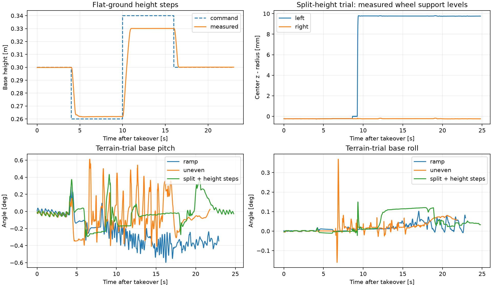

# Wheeled-Biped Whole-Body Inverse Dynamics MPC

This note describes the Upkie implementation in `feat/wheeled_biped`, inspected on 2026-11-14.
It complements the [humanoid formulation](humanoid_whole_body_inverse_dynamics_mpc.md) with the wheel-contact model and the actual Upkie costs, constraints and execution path.
The current configuration is [config/upkie/ros2_controllers.yaml](../config/upkie/ros2_controllers.yaml).
Build commands, manual tests, measured results and outstanding work are in the [wheeled-biped handoff](wheeled_biped_handoff.md).
The [initial checklist](design_notes/wheeled_biped/wheeled_biped_first_step.md) and [survey](design_notes/wheeled_biped/wheeled_biped_wb_id_mpc_survey.md) are preserved under `docs/design_notes/wheeled_biped/` and describe the motivation, not the current validation status.
References below identify the supporting method and its exact location, not a claim that this branch reproduces each paper or takes its numerical gains.
The [traceability table](#9-design-traceability-and-parameter-selection) separates published principles, library conventions, simulator parameters and local adaptations.

## 1. Architecture and Model

Upkie has a floating base and six actuators, ordered as follows:

$$
q_j=\begin{bmatrix}
q_{L,h}&q_{L,k}&q_{L,w}&q_{R,h}&q_{R,k}&q_{R,w}
\end{bmatrix}^{\mathsf T}.
$$

Each side has a hip, knee and driven wheel, with no hip-roll actuator.
The simulation-reference mass is $m=5.4605\ \mathrm{kg}$ and tire radius is $r=0.055\ \mathrm{m}$.
The MPC URDF is generated from the MuJoCo model to match link frames, joint axes, inertias and tire geometry; see [model provenance](../description/urdf/robots/upkie/MODEL_SOURCE.md).
The optimizer uses Pinocchio kinematics and inverse dynamics, CppAD-generated constraint derivatives, and OCS2 SQP with HPIPM.
The asynchronous MPC worker publishes a policy that the ros2_control thread evaluates at the MRT frequency, followed by an `effort_pd` joint servo.
There is no centroidal-momentum state, reduced cart-pendulum prediction model, or separate whole-body-control QP in this path.
Feedback comes from the wheel-aware linear Kalman filter of Section 7.5 (IMU attitude, rate and acceleration plus leg and wheel encoders), started from the kneeling idle of Section 7.4.
Simulator ground truth is only logged alongside as a benchmark, or used for GT-driven tuning runs; it is not available for real-world deployment.

## 2. State, Input and Initial Observation

### 2.1 Generalized coordinates

The base frame $B$ is the URDF/MJCF `base` link, whose $+x$ points toward the knees: that is Upkie's back.
The model, the costs, the constraints and the estimator all use $B$; only commands use the forward-facing control frame `base_forward`, $B$ turned by $\pi$ about $z$ (Section 5.5).
Pitch and roll below are therefore about $B$'s axes: positive pitch tilts the trunk toward the knees (backward), and the joints named `left_*` are on the robot's right when it faces its front.
The robot spawns turned by $\pi$, so its front faces world $+x$.

The base is Pinocchio's Translation + SphericalZYX composite joint:

$$
q=\begin{bmatrix}p_{WB}^{W}\\\eta\\q_j\end{bmatrix}\in\mathbb R^{12},
\qquad
\eta=\begin{bmatrix}\psi&\theta&\phi\end{bmatrix}^{\mathsf T},
\qquad
R_{WB}=R_z(\psi)R_y(\theta)R_x(\phi).
$$

Yaw, pitch and roll are ordered ZYX, and the generalized velocity is:

$$
v=\dot q=\begin{bmatrix}v_{WB}^{W}\\\dot\eta\\\dot q_j\end{bmatrix}\in\mathbb R^{12},
\qquad
x=\begin{bmatrix}q\\v\end{bmatrix}\in\mathbb R^{24}.
$$

The angular entries are Euler rates, not body or world angular velocity.
The wheel angles are scalar, unwrapped revolute coordinates, not periodic posture targets.
They remain in the dynamics but are excluded from joint-position limits and position tracking.
The current branch does not use tangent-space orientation integration or quaternion decision variables, and the Euler pitch singularity remains.

### 2.2 Input

$$
u=\begin{bmatrix}W_L\\W_R\\a\\\tau_j\end{bmatrix}\in\mathbb R^{30},
\qquad
W_i=\begin{bmatrix}f_i\\m_i\end{bmatrix}\in\mathbb R^6,
\qquad
a=\dot v\in\mathbb R^{12},
\qquad
\tau_j\in\mathbb R^6.
$$

Each wrench is expressed in world-aligned axes about the tire-center frame, not about a fixed ground point.
This is Pinocchio `LOCAL_WORLD_ALIGNED`, not a body-axis wrench and not Pinocchio `WORLD`, whose origin is the world origin.
The six wrench components per wheel are retained for compatibility, but three moment equalities restrict the wrench to a point force at the instantaneous tread contact.
The tire-center frames are `left_tire_center` and `right_tire_center`, attached to the wheel joints with local translation $[0,0,-0.0312]^{\mathsf T}\ \mathrm{m}$.
Their orientations spin with the wheels, while their centers do not move merely because of wheel spin.

### 2.3 Wrench coordinates: source and rationale

The coordinate convention follows the existing controller and [Pinocchio's force-reference transformations](https://gepettoweb.laas.fr/doc/stack-of-tasks/pinocchio/devel/doxygen-html/algorithm_2utils_2force_8hpp_source.html), rather than a paper requirement to use body-frame forces.
The [RNEA implementation](../src/core/humanoid_wb_id_mpc/src/constraint/WbIdRneaConstraintCppAd.cpp#L88) explicitly requests the matching world-aligned Jacobian.
At the same tire-center origin, a body-axis wrench $W_i^{h_i}$ and the implemented wrench $W_i^W$ are related by:

$$
W_i^W=\mathcal R_iW_i^{h_i},
\qquad
\mathcal R_i=\begin{bmatrix}R_{Wh,i}&0\\0&R_{Wh,i}\end{bmatrix},
\qquad
J_i^W=\mathcal R_iJ_i^{h_i},
$$

$$
(J_i^W)^{\mathsf T}W_i^W=(J_i^{h_i})^{\mathsf T}W_i^{h_i}.
$$

Thus either basis can represent the same generalized force if every quantity is transformed consistently; there is no established performance advantage from this basis choice alone.
World-aligned axes simplify comparison with world-frame gravity, normals and force costs, without making force components rotate merely because the tire spins.
Changing the reference origin is different from changing axes: the moment about the world origin would be $m_O^W=m_{h,i}^W+p_{h,i}^W\times f_i^W$.
For the corresponding wrench-translation and power-invariance principles, see [Lynch and Park, Modern Robotics, Section 3.4](https://modernrobotics.northwestern.edu/nu-gm-book-resource/3-4-wrenches/).
That reference orders moment before force, whereas this code orders force before moment; comparisons must account for this permutation.
Retaining six wrench entries and constraining $m=\rho\times f$ is a local compatibility choice, not a claim that the cited wheel papers optimize six independent contact-force/moment entries.

### 2.4 Observation

At each control update, the initial state combines the floating-base observation with measured joint positions and velocities:

$$
q_0=\begin{bmatrix}\hat p_{WB}^{W}\\\operatorname{EulerZYX}(\hat R_{WB})\\q_{j,\mathrm{meas}}\end{bmatrix},
\qquad
v_0=\begin{bmatrix}\hat v_{WB}^{W}\\E_{\mathrm{ZYX}}(\eta_0)\hat\omega_{WB}^{B}\\\dot q_{j,\mathrm{meas}}\end{bmatrix}.
$$

$E_{\mathrm{ZYX}}$ converts body angular velocity to Euler rates, and the observation builder unwraps yaw.
The Upkie YAML disables observation-velocity filtering with `observationVelocityFilterCutoffHz: 0.0`.
The observation input is zero-initialized; measured joint velocities already belong to the state and are not inserted into the acceleration/torque input slots.

## 3. Dynamics and Optimal Control Problem

### 3.1 Kinematic propagation

The shooting dynamics are the same double integrator as the humanoid WB-ID controller:

$$
\dot x=\begin{bmatrix}v\\a\end{bmatrix}.
$$

For constant input on an interval of duration $\Delta t_k$, the exact solution is:

$$
q_{k+1}=q_k+\Delta t_kv_k+\frac12\Delta t_k^2a_k,
\qquad
v_{k+1}=v_k+\Delta t_ka_k.
$$

The configured RK4 discretization reproduces this constant-input flow.
Rigid-body dynamics are imposed as path equalities, rather than used as forward-dynamics state propagation.
For this separation, see [Molnar et al., Section IV-B1, Eqs. (4)-(5)](https://arxiv.org/html/2511.19709v1#S4.SS2.SSS1); that paper uses a tangent increment and explicit Euler, not this branch's absolute Euler-ZYX coordinates and RK4.

### 3.2 Full-body inverse dynamics

Let $S_j=[0_{6\times6}\ I_6]$ select the actuated coordinates, and let $J_{h,i}$ be the world-aligned six-dimensional Jacobian at tire center $i$.
Define the armature-augmented mass matrix and smoothed joint friction:

$$
M_A(q)=M_{\mathrm{rigid}}(q)+S_j^{\mathsf T}A_jS_j,
\qquad
A_j=\operatorname{diag}(0.005,0.005,0.005,0.005,0.005,0.005),
$$

$$
\tau_{f,j}(v)=f_{c,j}\tanh\left(\frac{\dot q_j}{v_s}\right),
\qquad
f_{c,j}=0.1\ \mathrm{Nm},
\qquad
v_s=0.05\ \mathrm{rad/s}.
$$

The armature entries have units $\mathrm{kg\,m^2}$ and are set in the Pinocchio model before generating the inverse-dynamics libraries.
The complete equality is:

$$
M_A(q)a+b(q,v)+S_j^{\mathsf T}\tau_f(v)
-\sum_{i\in\{L,R\}}J_{h,i}(q)^{\mathsf T}W_i
-S_j^{\mathsf T}\tau_j=0.
$$

The six floating-base rows and six joint rows are registered separately, but both remain active throughout Upkie's horizon because `torqueConstraintNodes: 0`.
This differs from H2 configurations that keep joint RNEA and torque penalties only inside a near-term torque window.
The joint friction is an additional torque in the actuated rows, not a base friction force or wheel-ground friction coefficient.
The smooth model satisfies $\tau_f(0)=0$, so it does not reproduce MuJoCo's set-valued static friction exactly.
The motivation is consistent with [Molnar et al., Section VI-D](https://arxiv.org/html/2511.19709v1#S6.SS4), which identifies omitted motor friction and rotor inertia as model discrepancies; that paper does not supply this branch's tanh law or its parameter values.
For an explicit differentiable joint-friction model, see [Pyrhonen, Mikkola and Naets, Section 2.1, Eq. (10)](https://link.springer.com/article/10.1007/s11044-024-10017-1#Equ10).
Their law contains Coulomb and viscous terms and uses $\tanh(4\dot q/v_s^{\mathrm{paper}})$; the present Coulomb-only law corresponds to $v_s^{\mathrm{paper}}=4v_s^{\mathrm{here}}$, not the same numerical transition parameter.
They write the opposing physical friction torque, whereas the positive $\tau_f$ on the left of our inverse-dynamics residual is the extra motor torque required to compensate it.
See [parameter provenance](#92-friction-and-armature-parameter-provenance) for which values come from the MJCF and which are local numerical choices.

### 3.3 Optimization problem

$$
\begin{aligned}
\min_{x(\cdot),u(\cdot)}\quad&
\Phi(x(t_f))+\int_{t_0}^{t_f}\big[\ell_{\mathrm{track}}(x,u,t)+\ell_{\mathrm{soft}}(x,u,t)\big]\,dt\\
\text{subject to}\quad&x(t_0)=\hat x_0,\\
&\dot q=v,\qquad\dot v=a,\\
&r_{\mathrm{ID}}(q,v,a,W,\tau_j)=0,\\
&g_{\mathrm{wheel}}(q,v,a,W,t)=0,\\
&W_i=0\quad\text{when wheel }i\text{ is scheduled in swing}.
\end{aligned}
$$

Friction and joint limits enter $\ell_{\mathrm{soft}}$, not additional hard inequalities in this Upkie configuration.
Current settings are a $1.0\ \mathrm{s}$ horizon, nominal $\Delta t=0.02\ \mathrm{s}$, one SQP iteration, four solver threads, equality projection enabled, and no feedback-gain policy.
`timeGrid.activate: false` selects the uniform grid with the solver's normal event handling; the configured coarse-tail parameters are inactive.
Requested MPC and MRT frequencies are $100\ \mathrm{Hz}$ and $1000\ \mathrm{Hz}$, not guaranteed measured rates.

## 4. Rolling-Wheel Geometry and Equalities

### 4.1 Instantaneous contact point

For wheel $i$, let $p_{h,i}$ be the tire center, $e_i$ its unit axle in world coordinates, and $n$ the unit ground normal.
The configured axle is local $[0,0,1]^{\mathsf T}$, transformed through the spinning contact frame:

$$
e_i=R_{Wh,i}e_{\mathrm{local}},
\qquad
w_i=n-(e_i^{\mathsf T}n)e_i,
\qquad
\rho_i=-r\frac{w_i}{\|w_i\|},
\qquad
p_{c,i}=p_{h,i}+\rho_i.
$$

This is the lowest point of a rigid thin disk, not a finite-width tire contact-patch model.
The closest wheel-geometry reference is [Xin and Vijayakumar, Section IV-B3, Fig. 5 and the paragraph after Eq. (20), PDF page 5](https://arxiv.org/pdf/2003.03678#page=5), which constructs the contact direction from the wheel axle and ground normal.
The normalized projection used here is a local geometric derivation, implemented in [contactOffset](../include/humanoid_wb_id_mpc/common/WheelContactKinematics.h#L43):

$$
\rho_i=\underset{\|\rho\|=r,\ e_i^{\mathsf T}\rho=0}{\operatorname{arg\,min}}\ n^{\mathsf T}\rho.
$$

Projecting $n$ into the disk plane and taking the opposite normalized direction solves this problem, preserving $\|\rho_i\|=r$ for a tilted axle.
The flat-ground checkpoint uses $n=[0,0,1]^{\mathsf T}$ and ground height zero.
The implementation divides by $\|w_i\|$, so an axle parallel to the ground normal is outside its valid geometry.
No special fallback is implemented for a wheel lying flat on its side.

### 4.2 Tread slip and acceleration

Let $\omega_i$ and $\alpha_i$ be the wheel link's full world-frame angular velocity and acceleration, including wheel spin.
The material velocity of the tread point currently touching the plane is:

$$
v_{c,i}=v_{h,i}+\omega_i\times\rho_i.
$$

This is not the velocity of the moving geometric contact location:

$$
\frac{d p_{c,i}}{dt}=v_{h,i}+\dot\rho_i.
$$

Under ideal rolling, the tread material velocity vanishes while the geometric contact location advances along the floor.
The offset derivative and the acceleration used in the constraint are:

$$
\dot e_i=\omega_i\times e_i,
\qquad
\dot w_i=-(\dot e_i^{\mathsf T}n)e_i-(e_i^{\mathsf T}n)\dot e_i,
$$

$$
\dot\rho_i=-r\left(\frac{\dot w_i}{\|w_i\|}-\frac{w_i(w_i^{\mathsf T}\dot w_i)}{\|w_i\|^3}\right),
\qquad
a_{c,i}=a_{h,i}+\alpha_i\times\rho_i+\omega_i\times\dot\rho_i.
$$

Here $a_{c,i}=d v_{c,i}(q,v)/dt$ follows the instantaneous contact evaluation, rather than the acceleration of one permanently marked tread particle.
This derivative assumes a fixed ground normal; there is no $\dot n$ term.
Pinocchio supplies the center's classical acceleration in world-aligned axes.
For wheel-center/contact velocity, see [Xin and Vijayakumar, Section IV-B3, Eqs. (16)-(17), PDF page 5](https://arxiv.org/pdf/2003.03678#page=5).
Their acceleration development continues in Eqs. (18)-(20), but this implementation is not a literal copy: it differentiates the currently selected lowest-point offset using [contactOffsetRate](../include/humanoid_wb_id_mpc/common/WheelContactKinematics.h#L50), then forms [aContact](../src/core/humanoid_wb_id_mpc/src/constraint/WbIdWheelContactConstraintCppAd.cpp#L205).
In particular, $\dot\rho$ is not generally $\omega\times\rho$; wheel spin leaves the selected lowest point unchanged for an upright wheel.
This distinction must be checked through kinematic differentiation, not by assuming that the paper's acceleration expression and the code have identical meanings.

### 4.3 Five rolling rows per supporting wheel

Define the in-plane lateral and longitudinal directions:

$$
l_i=\frac{e_i-(e_i^{\mathsf T}n)n}{\|e_i-(e_i^{\mathsf T}n)n\|},
\qquad
t_i=n\times l_i,
\qquad
g_i=n^{\mathsf T}p_{c,i}-z_i^d.
$$

For each scheduled supporting wheel, the implementation enforces:

$$
\begin{aligned}
0&=k_{a,t}\left(t_i^{\mathsf T}a_{c,i}+\dot t_i^{\mathsf T}v_{c,i}\right)+k_{v,t}\,t_i^{\mathsf T}v_{c,i},\\
0&=k_{a,n}\,n^{\mathsf T}a_{c,i}+k_{v,n}\,n^{\mathsf T}v_{c,i}+k_{p,n}\,g_i,\\
0_3&=m_i-\rho_i\times f_i.
\end{aligned}
$$

The current values are $k_{a,t}=k_{a,n}=1$, $k_{v,t}=k_{v,n}=50$ and $k_{p,n}=50$.
The first row damps longitudinal slip, the second corrects contact gap and normal slip, and the final three restrict the wheel-center moment.
These gains belong to equality constraints, not soft objective weights.
Finite gains correct nonzero slip/gap over time; they do not impose the separate algebraic conditions $v_c=0$ and $g=0$ at every state.
The normal row reads the swing planner's position reference, but does not subtract desired normal velocity or acceleration in its rolling branch.
Those desired derivatives are zero for the present flat, fixed-support checkpoint.
The gap position/velocity feedback is a Baumgarte-style stabilization choice; see [Baumgarte, 1972](https://doi.org/10.1016/0045-7825(72)90018-7) for the constraint-drift stabilization principle, not for these gains.
For constant ground height and normal, the normal row has the form $k_{a,n}\ddot g+k_{v,n}\dot g+k_{p,n}g=0$.
The values $50,50,1$ are local settings, not values taken from the wheel papers.
For a rotating rolling direction, note the distinction:

$$
\frac{d}{dt}(t_i^{\mathsf T}v_{c,i})=t_i^{\mathsf T}a_{c,i}+\dot t_i^{\mathsf T}v_{c,i}.
$$

The implementation includes the $\dot t_i^{\mathsf T}v_c$ term, which vanishes at exact zero tread slip but need not vanish during recovery.
For a fixed normal, it computes $\dot l_i=(I-l_i l_i^{\mathsf T})(I-nn^{\mathsf T})\dot e_i/\|(I-nn^{\mathsf T})e_i\|$ and $\dot t_i=n\times\dot l_i$.
Earlier `_v1` generated wheel functions omitted this term; `_v2` functions include it and the common-basis lateral fix below.

The moment relation makes the retained six-dimensional wrench equivalent to a point force:

$$
J_{c,i}=J_{v,h,i}-[\rho_i]_\times J_{\omega,i},
\qquad
J_{h,i}^{\mathsf T}\begin{bmatrix}f_i\\\rho_i\times f_i\end{bmatrix}=J_{c,i}^{\mathsf T}f_i.
$$

Unlike a planted humanoid sole, this model cannot choose an independent wheel-center couple or a center of pressure inside a rectangle.
The moment-shift identity is standard spatial-force algebra; see [Modern Robotics, Section 3.4](https://modernrobotics.northwestern.edu/nu-gm-book-resource/3-4-wrenches/).

### 4.4 One shared lateral row

Let $\gamma_i\in\{0,1\}$ be the scheduled contact flag and $N_s=\gamma_L+\gamma_R$.
When at least one wheel supports the robot, a single additional equality is:

$$
0=\sum_i\frac{\gamma_i}{N_s}
\left[k_{a,t}\left(l_{\mathrm{ref}}^{\mathsf T}a_{c,i}+\dot l_{\mathrm{ref}}^{\mathsf T}v_{c,i}\right)
+k_{v,t}\,l_{\mathrm{ref}}^{\mathsf T}v_{c,i}\right].
$$

The code uses the ground normal of the first scheduled supporting wheel for this shared calculation.
The shared row was introduced to avoid redundant lateral rows in the symmetric double-support projection.
The common direction $l_{\mathrm{ref}}$ and its derivative come from the first configured wheel, so every supporting wheel contributes in the same basis even when axle signs are mirrored.
Using each wheel's signed axis directly caused near-total cancellation at Upkie's symmetric standing pose, with an acceleration Jacobian norm of approximately $1.52\times10^{-14}$ instead of $1.04$ in a common basis.
The fix avoids this artificial cancellation, but still constrains mean lateral slip, not each tire's slip independently.
Individual wheel lateral slip and the projected equality rank therefore still require inspection, especially with asymmetric axles, single support or different contact normals.
There are eleven wheel-contact equality rows in double support: five per wheel and one shared lateral row, in addition to the twelve RNEA rows.
No cited paper is evidence for this shared mean-slip replacement; it is a local projection/rank workaround with the limitations above, not an established equivalent of two per-wheel no-slip constraints.

### 4.5 Swing and flight support

For a scheduled swing wheel, the rolling rows are disabled and all six wrench entries are set to zero.
A vertical equality follows the swing planner:

$$
0=k_{a,n}(a_{h,i,z}-\ddot z_i^d)
+k_{v,n}(v_{h,i,z}-\dot z_i^d)
+k_{p,n}(p_{h,i,z}-r-z_i^d).
$$

This branch approximates tire-bottom height as center height minus radius, rather than using the tilted disk's full $\rho_i$ geometry.
It does not prescribe swing-wheel XY position or touchdown wheel spin.
During flight both wrenches are zero and the shared lateral row is inactive, but full-body inverse dynamics remains active.
The shipped gait library uses them in `jump` (both wheels in flight) and in `walk` and `trot` (one wheel at a time); Section 7.1 lists the templates and their validation.
For moving-wheel support and zero-force/vertical-motion swing constraints, compare [Bjelonic et al., Section III-A4, Eqs. (5)-(6), PDF page 4](https://arxiv.org/pdf/2010.06322#page=4).
Their optimizer uses a fixed wheel angle and moving contact with kinodynamic prediction; this branch instead retains wheel spin and full-body inverse dynamics, so the state and constraint formulas are not interchangeable.

## 5. Tracking Costs and References

### 5.1 Base-motion objective

In `base_twist` mode, the horizontal position and yaw-angle errors are deliberately zero:

$$
e_{B,p}=\begin{bmatrix}0&0&z-z_d&0&\operatorname{wrap}(\theta-\theta_d)&\operatorname{wrap}(\phi-\phi_d)\end{bmatrix}^{\mathsf T}.
$$

Let $R_2(\psi)$ be the planar yaw rotation.
The base-velocity residual is:

$$
e_{B,v}=\begin{bmatrix}
R_2(\psi)^{\mathsf T}v_{B,xy}^{W}-R_2(\psi_d)^{\mathsf T}v_{B,d,xy}^{W}\\
v_{B,z}^{W}-v_{B,d,z}^{W}\\
\dot\eta-\dot\eta_d
\end{bmatrix},
\qquad
\ell_B=\frac12\|e_{B,p}\|_{Q_p}^2+\frac12\|e_{B,v}\|_{Q_v}^2.
$$

The current diagonal entries are:

$$
\operatorname{diag}Q_p=[0,0,3000,0,500,2000],
\qquad
\operatorname{diag}Q_v=[20,20,1,10,1,1].
$$

The tracked height is the base origin's height, not the whole-body CoM height, and the linear velocity is base velocity despite legacy accessor names containing `Com`.
Pitch and roll are softly stabilized while yaw rate is tracked without restoring a fixed yaw angle.
The tuning priority is avoiding falls and controlling pitch/roll, not exact height, symmetric leg lengths, yaw accuracy or XY position.
For scale, a 5-degree pitch error costs about 1.90 and the same roll error about 7.62, versus 0.60 for a 2 cm height error in the running base cost.
These are weighted soft preferences, not a strict task hierarchy or a stability guarantee; the optimizer may accept height and motion error to remain balanced.
Returning the forward command to zero asks the robot to stop moving, not to return to a particular XY position.
There is no separate CoM-position, capture-point, centroidal-momentum or integral drift-rejection objective in this configuration.

### 5.2 Joint posture and motion

$$
\ell_j=\frac12\|q_j-q_j^d\|_{Q_j}^2+\frac12\|\dot q_j-\dot q_j^d\|_{Q_{\dot j}}^2,
$$

$$
q_j^d=[-0.6021397,-0.9655142,0,0.6021397,0.9655142,0]^{\mathsf T},
\qquad
\dot q_j^d=0,
$$

$$
\operatorname{diag}Q_j=[1,1,0,1,1,0],
\qquad
\operatorname{diag}Q_{\dot j}=[0.01,0.01,0,0.01,0.01,0].
$$

The wheel angles and spin speeds have zero tracking weights, allowing wheel rotation to emerge from base-motion tracking and rolling physics.
Wheel spin speeds still have soft velocity limits.
The original hip/knee posture weights are retained: reducing them too far improved static height accuracy but allowed the opposite knee-bending branch and severely degraded turning in regression tests.
These posture costs do not require equal leg heights and do not forbid a different bend when dynamics and the other costs justify it.
Upkie has no tracked arm joints, so the shared dedicated arm-position evaluator contributes no arm objective.

### 5.3 Input regularization

$$
\ell_u=\frac12\|u-u_d\|_R^2,
\qquad
R=10^{-3}\operatorname{diag}(R_W,R_{a_B},R_{a_j},R_\tau).
$$

The listed vectors are the unscaled diagonal entries:

| Block | Current entries |
| --- | --- |
| Each wheel wrench $[f_x,f_y,f_z,m_x,m_y,m_z]$ | $[0.01,0.01,0.001,0.001,0.001,0.001]$ |
| Base accelerations | Six entries of $0.005$ |
| Joint accelerations | Six entries of $0.005$ |
| Joint torques | $[0.01,0.01,0.1,0.01,0.01,0.1]$ |

The running input-cost evaluator constructs a weight-supporting reference independently of the zero input arrays stored in the target trajectory:

$$
f_i^d=\frac{\gamma_i}{N_s}\begin{bmatrix}0\\0\\mg\end{bmatrix}\quad(N_s>0),
\qquad
m_i^d=0,\qquad a_d=0,\qquad\tau_j^d=0.
$$

In flight, all nominal wrenches are zero.
The nominal wheel normal load in double support is approximately $26.8\ \mathrm{N}$ per wheel.
These are soft references, so the optimizer may shift loads and generate nonzero contact moments as required by $m_i=\rho_i\times f_i$.
The torque regularizer is on motor torque magnitude, not on torque changes between solves.
No first-node torque-rate or previous-torque matching cost is registered here.

### 5.4 Terminal cost and inactive additions

The terminal objective repeats the base, joint-position and joint-velocity residuals with Qf and no terminal input cost.
Qf has the same base and joint-velocity weights as Q, but joint-position weights $[2,2,0,2,2,0]$.
`qScaling` and `terminalCostScaling` are both $1$, while `rScaling` is $0.001$.
The builder partitions Q/Qf among base and generic evaluators without double counting.
Soft path-limit penalties are running terms; no separate terminal joint-limit barrier is registered by this setup.
Foot task-space tracking, named torso tracking, gravity-relative torso tilt, capture-foot placement, external leg-load regularization and arm swing are disabled or absent in the current Upkie YAML.
They are not hidden additions to the equations above.
The state/velocity/contact-force tracking principle is comparable to [Khazoom et al., Section II-B2, Eq. (3)](https://arxiv.org/html/2407.10789v1#S2.SS2.SSS2), but the Upkie weights, base-frame residuals and acceleration/torque regularizers are implementation choices rather than copied paper parameters.

### 5.5 Command conditioning

Topic/GUI commands are given in the control frame `base_forward` (`target.commandFrame`), the base turned by $\beta=$ `target.commandFrameYaw` $=\pi$ about $z$, so positive $c_x$ drives away from the knees.
Their planar part is rotated into the base frame where they enter the controller,

$$
\begin{bmatrix}c_x\\c_y\end{bmatrix}_B=R_z(\beta)\begin{bmatrix}c_x\\c_y\end{bmatrix}_{\mathrm{cmd}},
$$

the yaw rate and the height are unchanged, and a base-pose command gives the control frame's orientation, so the base target is $R_{W\,\mathrm{cmd}}R_z(-\beta)$.
The launch publishes `base_forward` as a static TF child of `base`.
Planning and estimation need no change: a fixed turn about the vertical leaves the height and the zero pitch/roll references, the joint-space posture table and stand-up plan, the frame-free wheel equalities and the base-frame estimator as they are.

Normalized commands $c_x,c_y,c_\psi\in[-1,1]$ (in the base frame after that rotation) are scaled to:

$$
v_x^{\mathrm{cmd}}=1.0c_x,
\qquad
v_y^{\mathrm{cmd}}=0.1c_y,
\qquad
\dot\psi^{\mathrm{cmd}}=1.5c_\psi.
$$

Units are $\mathrm{m/s}$ for translation and $\mathrm{rad/s}$ for yaw rate; the height command is absolute, with nominal $z_d=0.30\ \mathrm{m}$.
The shared command filter and slew limiter condition the references, with rate limits $[0.5,0.5,0.1,2.0]$ for $[v_x,v_y,z,\dot\psi]$.
At each solve, the target trajectory re-anchors to the current base pose and integrates the conditioned command, with knots at $t_0$, $t_0+0.7T$ and $t_0+T$.
The velocity references have zero world vertical velocity and zero pitch/roll rates, even while a changing height command moves the height reference between solves.
Upkie supports forward driving, differential turning and leg-length height adjustment in principle, not independent sideways translation.
The GUI still accepts a nonzero lateral command without a wheel-specific rejection, so keep $c_y=0$.
The GUI's absolute height slider and outgoing height clamp use `minBaseHeight`/`maxBaseHeight` from the selected controller YAML, with the reset mark at `defaultBaseHeight`.
For Upkie this is $[0.22,0.33]\ \mathrm{m}$ with the reset at $0.30\ \mathrm{m}$; the endpoint labels show the same range, which the posture table must cover.
Changing `refBaseHeight` moves the reset value only, and the launch rejects a value outside the range.
Configured command maxima are not validated stability limits.

## 6. Soft Inequalities and Barrier Penalties

### 6.1 Ground-force cone

For a supporting wheel on the flat plane, the actual implemented residual is:

$$
h_{\mu,i}=\mu_f f_{i,z}-\sqrt{f_{i,x}^2+f_{i,y}^2+\varepsilon_f}\geq0,
\qquad
\mu_f=0.6,\qquad\varepsilon_f=25\ \mathrm{N^2}.
$$

The regularization is the shared class default, not an extra Upkie YAML setting, and the gripper-force offset is zero.
It implies $f_z\geq\sqrt{25}/0.6\approx8.33\ \mathrm{N}$ for a nonnegative residual at zero tangential force, rather than allowing exactly zero normal load in an active contact.
There is no separately registered hard unilateral-force row; nonnegative normal load is encouraged through this soft cone residual.
The penalty uses `frictionCone.mu: 0.1` and `delta: 1.0`, distinct from the physical cone coefficient $\mu_f$.
This optimizer coefficient is also distinct from MuJoCo floor friction, currently $[0.8,0.1,0.001]$ for sliding, torsional and rolling friction.
The thin-disk MPC does not explicitly reproduce all finite-patch and frictional-moment effects of the MuJoCo tire model.

### 6.2 Joint bounds

The residual convention is $h\geq0$:

$$
h_{q,j}^{-}=q_j-q_j^{\min},\qquad h_{q,j}^{+}=q_j^{\max}-q_j,
$$

$$
h_{v,j}^{\pm}=v_j^{\max}\pm\dot q_j,
\qquad
h_{\tau,j}^{\pm}=\tau_j^{\max}\pm\tau_j.
$$

Position, velocity and effort bounds are read from the generated URDF, with optional torque-array overrides and configured velocity/torque scaling.
Both scalings are $1.0$ in the current Upkie YAML.
The effective bounds are:

| Joint type | Position | Speed | Motor torque |
| --- | --- | --- | --- |
| Hip | $\pm3.05433\ \mathrm{rad}$ | $28.8\ \mathrm{rad/s}$ | $16\ \mathrm{Nm}$ |
| Knee | $\pm2.70526034\ \mathrm{rad}$ | $28.8\ \mathrm{rad/s}$ | $16\ \mathrm{Nm}$ |
| Wheel | Unbounded in the MPC | $111\ \mathrm{rad/s}$ | $1.7\ \mathrm{Nm}$ |

The URDF's placeholder wheel-position bounds $\pm10^4$ are replaced by infinities before constructing the position penalty.
The builder requires both running and terminal wheel-position weights to be zero, and controller configuration rejects a nonzero wheel position-servo gain.

### 6.3 Actual penalty functions

Friction, velocity and torque residuals use the relaxed logarithmic barrier:

$$
B_{\mu,\delta}(h)=\begin{cases}
-\mu\log h,&h>\delta,\\
\mu\left[-\log\delta+\dfrac12\left(\dfrac{h-2\delta}{\delta}\right)^2-\dfrac12\right],&h\leq\delta.
\end{cases}
$$

Joint-position residuals use the piecewise polynomial penalty:

$$
P_{\mu,\delta}(h)=\mu\begin{cases}
\dfrac12h^2-\dfrac\delta2h+\dfrac{\delta^2}{6},&h\leq0,\\
\dfrac{(\delta-h)^3}{6\delta},&0<h<\delta,\\
0,&h\geq\delta.
\end{cases}
$$

The running soft objective sums these penalties over the active residuals:

$$
\ell_{\mathrm{soft}}=
\sum_{i:\gamma_i=1}B_{0.1,1.0}(h_{\mu,i})
+\sum_{j\in\mathrm{hip,knee}}\left[P_{1200,0.1}(h_{q,j}^{-})+P_{1200,0.1}(h_{q,j}^{+})\right]
+\sum_{j=1}^{6}\sum_{\sigma\in\{-,+\}}\left[B_{0.1,1.0}(h_{v,j}^{\sigma})+B_{0.05,0.2}(h_{\tau,j}^{\sigma})\right].
$$

These per-term penalty scales are not multiplied by `rScaling` or `qScaling`.
Both functions remain finite outside the feasible region, so they steer the optimizer but do not guarantee bounded torques, bounded speeds or collision-free execution.
There are no active arm/leg self-collision costs, environment-avoidance terms, humanoid sole CoP bounds, or hard torque inequalities in the current Upkie setup.
The hard bounds in [Molnar et al., Section IV-B4, Eq. (8)](https://arxiv.org/html/2511.19709v1#S4.SS2.SSS4) must not be confused with this branch's finite soft penalties.

## 7. Gait, Initialization and Execution

### 7.1 Gaits and support schedule

Upkie's gait templates (`ocs2.gait.templates`) switch only the support flags $\gamma_L,\gamma_R$ and the swing references; the optimal control problem is the same in every phase.
Modes: `STANCE` both wheels support, `RF` only the right wheel, `LF` only the left, `FLY` neither.

| Gait | Mode sequence (durations) | Swing height |
| --- | --- | --- |
| `wheel_drive` | `STANCE` | - |
| `jump` | `STANCE` 0.4 s, `FLY` 0.15 s | 0.03 m |
| `walk` | `STANCE` 0.45 s, `RF` 0.15 s, `STANCE` 0.45 s, `LF` 0.15 s | 0.02 m |
| `trot` | `RF` 0.15 s, `STANCE` 0.05 s, `LF` 0.15 s, `STANCE` 0.05 s | 0.02 m |

`wheel_drive` is continuous rolling support,

$$
\gamma_L(t)=\gamma_R(t)=1,
$$

not a planted or motionless wheel; no gait switch is needed to accelerate, brake or turn.
It is the first rung of `ocs2.gait.transitions.ladder`, so it runs whenever no other gait is requested.
`jump`, `walk` and `trot` are requested by name on the `/humanoid/gait_command` string topic and held while requested; an empty string returns to `wheel_drive`.
A request is spliced into the schedule about 0.3 of the 1 s horizon ahead, so a single jump needs the request held for about 0.9 s.
Scheduled contact flags activate optimizer terms and are written to the estimator; measured contact sensors provide diagnostics only.
With no hip roll, a lifted wheel lets the body tip toward it (the CoM is about 0.15 m inside the remaining wheel), so single-support phases are 0.15 s; a 0.3 s lift reached 0.073 rad roll.

Validated with the estimator driving the MPC, each run from the kneeling stand-up (wheel off the ground per the simulated contact sensors):

| Gait | Runs | Wheel(s) off the ground | Clearance | Max pitch / roll |
| --- | --- | --- | --- | --- |
| `jump` | 4 in place, 1 rolling at 0.2 m/s | 0.15-0.18 s | 10 mm | 0.037 / 0.014 rad |
| `walk` | at rest and at 0.2 m/s, 5 lifts each | 0.13-0.15 s | 6.5 mm | 0.016 / 0.021 rad |
| `trot` | 13 lifts at rest, 15 at 0.2 m/s | 0.12-0.16 s | 6.5-6.9 mm | 0.015 / 0.032 rad |

Jump landings peak at 2-4.5 body weights per wheel; torque limits are reached in under 1% of samples.

### 7.2 Initial policy seed

The initializer seeds weight-supporting wrenches and estimates joint torques from inverse dynamics at zero generalized acceleration:

$$
\tau_{j,\mathrm{seed}}=S_j\left[\operatorname{RNEA}(q,v,0)-\sum_iJ_{h,i}^{\mathsf T}W_i^d\right]+\tau_f(v),
\qquad m_i^d=\rho_i\times f_i^d.
$$

It holds the seed state unchanged for its next-state output.
The seed includes the configured smoothed joint friction and the tire-center moment from the support force, using each wheel's contact normal and current axle orientation.
This makes its joint inverse-dynamics and tire-moment rows consistent, including at nonzero joint velocity.
This is an initialization guess, not a separately solved feasible equilibrium: floating-base balance and rolling-acceleration equalities are not projected, and the unchanged next state is not a dynamically integrated trajectory.
For G1/H2 with wheel contacts disabled and no configured joint friction, the existing initializer behavior is unchanged.
The default spawn is the balanced crouch at base height $0.3005\ \mathrm{m}$, approximately $0.5\ \mathrm{mm}$ above the flat contact pose.
With GT feedback and an empty `standUpTrajectoryFile`, startup uses this standing spawn instead of the planned kneeling stand-up.

### 7.3 Low-level joint servo and torque clipping

With `feedforward: policy_torque`, the controller evaluates planned joint positions, velocities and torques and clips the feedforward to the configured effort bounds.
The simulator executes:

$$
\tau_{\mathrm{ff}}=\operatorname{clip}(\tau_j^*,-\tau^{\max},\tau^{\max}),
$$

$$
\tau_{\mathrm{motor}}=\operatorname{clip}\left[
\tau_{\mathrm{ff}}+K_p(q_j^*-q_{j,\mathrm{meas}})+K_d(\dot q_j^*-\dot q_{j,\mathrm{meas}}),
-\tau_{\mathrm{motor}}^{\max},\tau_{\mathrm{motor}}^{\max}\right].
$$

The final clipping in this expression is supplied by the current unit-gear MuJoCo motors with the actuator effort mode, not by the soft OCP barrier.
The configured gains are:

$$
\operatorname{diag}K_p=[15,15,0,15,15,0],
\qquad
\operatorname{diag}K_d=[0.5,0.5,0.05,0.5,0.5,0.05].
$$

Wheel feedback tracks planned spin speed with zero angle stiffness; hips and knees track both position and velocity.
This inner servo is distinct from the optional SQP feedback policy, which is disabled here.
For the feedforward-plus-PD architecture, see [Khazoom et al., Section II-D3, Eq. (15)](https://arxiv.org/html/2407.10789v1#S2.SS4.SSS3); their hardware rates and gains are not the Upkie values.
The scene uses a $0.0005\ \mathrm{s}$ physics step and `implicitfast`, so the hardware PD is evaluated at $2\ \mathrm{kHz}$ while controller targets update at $1\ \mathrm{kHz}$.
The simulator calls hardware `write()` every physics step, outside the rate-limited controller-manager `read()`/`update()` block, and the PD reads live MuJoCo positions and velocities on each call.
Between MRT ticks, the targets, feedforward and gains are held, but the feedback torque is recomputed; this is the same `effort_pd` path used by H2.
MuJoCo joint friction acts in the simulation after the motor command, while the MPC's smooth friction model anticipates its torque demand.
A model-based feedforward fallback also adds the configured smoothed joint friction.
Changing to direct `qfrc_applied` bypass would invalidate the actuator-clipping interpretation above.

### 7.4 Optional planned stand-up

An optional trajectory-file path implements idle hold, planned stand-up playback, policy handover, blend and locomotion.
The height command filter resets to the measured base height at handover rather than stepping immediately to the nominal $0.30\ \mathrm{m}$ height.
This playback is not a stand-up trajectory optimized online by the MPC.
It passes in the complete stack with ground truth and with the estimator; the default configuration leaves it disabled (standing spawn), and estimator runs must enable it because an unbalanced wheeled robot cannot stand still while the filter initialises.
Kneeling, the knees rest on the floor behind the wheels and the trunk leans back (pitch $+0.42$ rad); the push pivots the trunk forward over the axles while the robot rolls about 6 cm backward.
At the handover the body is at about 0.09 m with the trunk leaning 0.70 rad forward (pitch $-0.70$ rad), rolling backward; the posture table starts at 0.10 m so the posture reference matches the height ramp.
The catch straightens the trunk while rolling backward with both wheel torques saturated, and the MPC swings one leg forward and the other back for about 0.7 s, a catching step in which one wheel leaves the ground briefly, before the legs rejoin; forbidding that split with a cost made every catch fall.
The exporter includes the actual post-step knee-lift sample, so the current $0.6965\ \mathrm{s}$ handover lies within the exported time range.
Trajectory loading rejects nonfinite samples and timestamps that are not strictly increasing.
When using ground-truth feedback, the bring-up tilt check and gravity-compensating hold use the base-link orientation, not the orientation of the rotated IMU site.
With the estimator, `floatingBase.imuFrame` removes the IMU mounting rotation from the attitude used by the tilt check, and the estimator removes it from its own inputs (Section 7.5).

### 7.5 Rolling-contact state estimation

The floating-base estimate comes from the two-stage linear Kalman filter ([`LinearKfFloatingBaseEstimator`](../src/humanoid_state_estimation/linear_kf_floating_base_estimator.cpp)) with `contactModel: rolling_wheel`, run as the `humanoid_linear_kf` controller ahead of the MPC.
A planted-foot model cannot be reused: a wheel centre and its geometric contact point move during driving, even without slip.
What stays at rest is the material tread point currently touching the ground:

$$
0\simeq v_{c,i}^{W}
=v_{h,i}^{W}+\omega_i^{W}\times\rho_i^{W}.
$$

Here $v_{h,i}^{W}$ is the tire-centre velocity, $\omega_i^{W}$ the wheel link's angular velocity including spin, and $\rho_i^{W}$ the centre-to-contact offset of Section 4.1 (the lowest point of the tire circle).
This follows the wheel-aware adaptation of legged filters in [Hosseini, Rodriguez and Behnke, State Estimation for Hybrid Locomotion of Driving-Stepping Quadrupeds, IRC 2022](https://www.ais.uni-bonn.de/~hosseini/se-dsq/IEEE_IRC_22_StateEstimationForDrivingSteppingQuadrupeds.pdf).

**Stage 1, attitude.** The IMU's own attitude, with its mounting removed (`imuExtrinsics: true`, URDF frame `imu`):

$$
R_{WB}=R_{WI}R_{BI}^{\mathsf T},\qquad
\omega_B=R_{BI}\,\omega_I,\qquad
a_B=R_{BI}\,a_I-\omega_B\times(\omega_B\times r_{BI}),
$$

where $(R_{BI},r_{BI})$ is the IMU pose in the base frame; the lever arm's angular-acceleration term is left to the velocity measurements.
Yaw is never corrected, as in any proprioceptive filter.

**Stage 2, position and velocity.** The state is $x=[p_B^W;\,v_B^W]$, propagated with the IMU acceleration:

$$
p^+=p+\Delta t\,v+\tfrac12\Delta t^2(R_{WB}a_B+g),\qquad
v^+=v+\Delta t\,(R_{WB}a_B+g).
$$

Forward kinematics is evaluated with the base at the origin, with attitude $R_{WB}$, rate $\omega_B$ and the joint encoders only, so the measurements do not depend on the state they correct.
Each wheel $i$ then measures, with $p_{h,i}$ and $v_{h,i}$ the tire centre relative to the base:

$$
v_B^W=-\big(v_{h,i}+\omega_i\times\rho_i\big),\qquad
z_B=z_g-\big(p_{h,i}+\rho_i\big)_z,\qquad
\rho_i=r\,\frac{-e_z+(e_z\cdot a_i)\,a_i}{\lVert -e_z+(e_z\cdot a_i)\,a_i\rVert},
$$

with $a_i$ the axle direction, $r=0.055\ \mathrm{m}$ and the ground plane $z_g=0$.
This is the height above the wheels' contact plane, the same proprioceptive convention as the MPC's flat ground model.
A wheel scheduled off the ground keeps its four rows with noise multiplied by `swingNoiseMultiplier`, so the dimensions never change.
The filter initialises at the kneeling idle from these height rows and the IMU attitude, and reports ready after `readiness.minSeconds` (1 s).

| Parameter | Meaning |
| --- | --- |
| `contactModel`, `wheel.radius`, `wheel.centerOffset`, `wheel.axleAxis` | rolling-wheel measurement geometry, matching `contactGeometry.frameTranslation` |
| `imuExtrinsics`, `imuFrame` | remove the IMU mounting |
| `imuProcessNoisePosition/Velocity` | process noise, scaled as in Cheetah 3 |
| `footSensorNoiseVelocity`, `footHeightSensorNoise` | per-wheel velocity and height measurement variances |
| `contact.source: scheduled` | support flags from the MPC's mode schedule |

Accuracy against simulator ground truth (noise-free simulated sensors):

| Run | Height | Roll / pitch | Forward velocity |
| --- | --- | --- | --- |
| rolling at 0.3 m/s and braking | RMS 0.2 mm | below 0.0001 rad | RMS 1 mm/s, max 8 mm/s |
| `walk`, `trot` | RMS 0.7-1.1 mm | RMS below 0.0015 rad | RMS 0.01-0.03 m/s |
| `jump` | RMS 1-1.5 mm, max 12 mm | RMS below 0.003 rad | RMS 0.1 m/s, up to 0.6-0.7 m/s at touchdown |
| kneeling stand-up push | max 11 mm | max 0.036 rad | up to 0.7 m/s while the knees drag |

Driving the MPC, the estimator also passed rolling and braking, yaw at 0.22 m, the pitch pushes, the 20 mm strip, the ramp and the uneven field (handoff).
Not handled yet: sensor noise and biases (the simulator adds none), touchdown slip (a landing wheel that spun in the air slips briefly, which the rolling rows misread), contact detection from sensors, and terrain other than the assumed plane under the wheels.
Proprioception alone does not provide drift-free horizontal position or heading.

The simulator feedback must still obey its advertised frame contract even while using ground truth.
Both the ros2_control body-state interfaces and ground-truth odometry use link-origin pose and link-local twist through MuJoCo's `mjOBJ_XBODY` velocity query.
`mjOBJ_BODY` instead returns velocity at the center of mass in principal-inertia axes when local output is selected; mixing that with `xpos/xquat` caused large angular-feedback errors on Upkie.
For example, pure physical yaw of $0.3\ \mathrm{rad/s}$ appeared approximately as $[0.01125,0.29972,-0.00625]^{\mathsf T}$ before the simulator fix.
See [MuJoCo's implementation of mj_objectVelocity](https://github.com/google-deepmind/mujoco/blob/3.3.2/src/engine/engine_support.c#L1166) for the distinction.
Rebuild `mujoco_ros2_control` as well as this package when adopting the corrected checkpoint.

## 8. Implementation Map and Validation Boundary

| Part | Code |
| --- | --- |
| State/input layout | [WbIdMpcRobotModel.h](../include/humanoid_wb_id_mpc/common/WbIdMpcRobotModel.h) |
| Configuration, weights and wheel-angle masking | [whole_body_inverse_dynamics_mpc_config_builder.cpp](../src/humanoid_whole_body_inverse_dynamics_mpc/whole_body_inverse_dynamics_mpc_config_builder.cpp) |
| OCP registration and activation | [WbIdMpcInterface.cpp](../src/core/humanoid_wb_id_mpc/src/WbIdMpcInterface.cpp) |
| Double-integrator propagation | [WbIdDynamics.cpp](../src/core/humanoid_wb_id_mpc/src/dynamics/WbIdDynamics.cpp) |
| Armature import | [createPinocchioModel.cpp](../src/core/humanoid_common_mpc/src/pinocchio_model/createPinocchioModel.cpp) |
| RNEA and Coulomb friction | [WbIdRneaConstraintCppAd.cpp](../src/core/humanoid_wb_id_mpc/src/constraint/WbIdRneaConstraintCppAd.cpp) |
| Shared disk/contact geometry | [WheelContactKinematics.h](../include/humanoid_wb_id_mpc/common/WheelContactKinematics.h) |
| Rolling, shared lateral and swing equalities | [WbIdWheelContactConstraintCppAd.cpp](../src/core/humanoid_wb_id_mpc/src/constraint/WbIdWheelContactConstraintCppAd.cpp) |
| Relative base-motion residual | [BaseMotionTrackingCost.cpp](../src/core/humanoid_common_mpc/src/cost/BaseMotionTrackingCost.cpp) |
| Input nominal and generic cost | [StateInputQuadraticCost.cpp](../src/core/humanoid_common_mpc/src/cost/StateInputQuadraticCost.cpp) |
| Friction cone and its regularization | [FrictionForceConeConstraint.h](../include/humanoid_common_mpc/constraint/FrictionForceConeConstraint.h), [implementation](../src/core/humanoid_common_mpc/src/constraint/FrictionForceConeConstraint.cpp) |
| Position, friction and terminal cost construction | [HumanoidCostConstraintFactory.cpp](../src/core/humanoid_common_mpc/src/HumanoidCostConstraintFactory.cpp) |
| Command integration and state reference | [WbIdMpcTargetTrajectoriesCalculator.cpp](../src/core/humanoid_wb_id_mpc/src/command/WbIdMpcTargetTrajectoriesCalculator.cpp) |
| Initial state/input seed | [WbIdInitializer.cpp](../src/core/humanoid_wb_id_mpc/src/initialization/WbIdInitializer.cpp) |
| Observation, execution, stand-up and tracking diagnostics | [humanoid_whole_body_inverse_dynamics_mpc_controller.cpp](../src/humanoid_whole_body_inverse_dynamics_mpc/humanoid_whole_body_inverse_dynamics_mpc_controller.cpp) |

The handoff preserves the earlier 100 Hz flat-drive/push checkpoint and records the selected balance-first weights tested at requested MPC 200 Hz.
Use `mpcFreq:=200 mrtFreq:=1000` for the current Upkie examples; measured VM rates are typically about 190-192 Hz, not a guaranteed exact 200 Hz.
The selected weights passed 0.26-0.34 m height steps, a 2-degree ramp, a low uneven field and a 10 mm unequal-wheel-support test while changing height.
At a 0.34 m request, the selected configuration accepts about 9.93 mm of steady height error, versus the original 33.11 mm; a weaker-posture candidate tracked height more accurately but severely undertracked turns and is not retained.
The final 1.5 rad/s turning trial averaged 1.146 rad/s with peak pitch/roll below 0.004 rad.
The final 200 Hz-requested four-pulse push trial recovered all disturbances, with peak pitch 0.07860 rad and final recovery pitch below 0.00410 rad.
In the earlier 100 Hz logs, turning remained balanced for commands +0.3, -0.6 and +1.5 rad/s, but the slow +0.3 rad/s command averaged only +0.145 rad/s and failed the tracking threshold.
The existing +/-1.5 Nm pitch and +/-6 N forward-force pulses were recovered without falls; these results do not establish recovery from arbitrary push directions or magnitudes.
The earlier 100 Hz repository night-scene repeat reached peak pitch $0.1881\ \mathrm{rad}$ and recovered below $0.0041\ \mathrm{rad}$, without actuator saturation; forward driving averaged $0.2015\ \mathrm{m/s}$ for a $0.2\ \mathrm{m/s}$ command.
With the convex-prism tire collision and the posture-by-height reference, the 20 mm one-sided strip (narrow, wide and driving off its end) and the uneven field at 0.15 and 0.3 m/s pass; before those changes the 20 mm entry fell and the slow field entry stalled.
These are 1-5 runs per case, not a general terrain-robustness guarantee.
The kneeling stand-up, jumps, short single and alternating support and estimator-driven control are validated in simulation (Sections 7.1, 7.4, 7.5); ramp descent and drops, terrain turns, sustained single support, sensor noise and hardware remain unvalidated.
Logging includes base motion, planned wrenches, feedforward/applied joint effort, measured wheel contacts/normal forces, contact gaps, tread slip and solver residuals.
The slip/gap diagnostics currently assume a horizontal zero-height plane; they are not a generic arbitrary-terrain contact estimator.
Documented equations describe the implementation, not a guarantee that a one-iteration SQP policy satisfies every equality or that soft limits remain unviolated.
The [native consistency audit](../tests/wheel_model_consistency_test.cpp) compares generated RNEA/rolling residuals and every state/input Jacobian column with direct equations and numerical differentiation at 12 nominal/perturbed states.
The audit's maximum equation error was $1.08\times10^{-10}$, maximum normalized Jacobian error $1.19\times10^{-8}$, and smallest input-equality singular value $0.0716$; its finite-difference calculations are tests only, not production derivatives.
The test also checks tire-center wrench virtual work and the initializer's joint-RNEA/tire-moment consistency.
These checks cover fixed horizontal normals and double support, not all admissible motions or future terrain/flight modes.

The figure uses the final balance-first parameters and measured-state logs; its support-level plot is center height minus tire radius on the horizontal split strip, not a general terrain estimator.
The control still assumes a fixed horizontal support plane; the modest terrain trials test feedback tolerance to that model error rather than a newly implemented terrain observer or planner.

## 9. Design Traceability and Parameter Selection

### 9.1 Source-to-implementation map

This map distinguishes a supporting reference from an exact implementation match.
Paper locations refer to the linked arXiv versions; PDF page numbers are viewer page numbers, with the title page counted as page 1.

| Choice | Primary reference and exact location | Actual implementation and important difference |
| --- | --- | --- |
| Configuration/velocity state and inverse-dynamics path equalities | [Molnar et al., Whole-Body Inverse Dynamics MPC for Legged Loco-Manipulation, IV-B1, Eqs. (4)-(5)](https://arxiv.org/html/2511.19709v1#S4.SS2.SSS1) | [RNEA rows](../src/core/humanoid_wb_id_mpc/src/constraint/WbIdRneaConstraintCppAd.cpp#L81); this branch keeps absolute Euler coordinates, not the paper's tangent increment |
| World-aligned wrench at a moving tire center | [Pinocchio, force reference conversion, LOCAL versus LOCAL_WORLD_ALIGNED](https://gepettoweb.laas.fr/doc/stack-of-tasks/pinocchio/devel/doxygen-html/algorithm_2utils_2force_8hpp_source.html) | [Jacobian/wrench product](../src/core/humanoid_wb_id_mpc/src/constraint/WbIdRneaConstraintCppAd.cpp#L88); a library/interface convention, not a claim of body-axis wrench optimization |
| Six-component wrench restricted to a tire point force | [Lynch and Park, Modern Robotics, Section 3.4, wrench transformations and power](https://modernrobotics.northwestern.edu/nu-gm-book-resource/3-4-wrenches/) | [Moment equality](../src/core/humanoid_wb_id_mpc/src/constraint/WbIdWheelContactConstraintCppAd.cpp#L238); six entries retained locally for compatibility |
| Wheel contact direction and no-slip velocity | [Xin and Vijayakumar, Online Dynamic Motion Planning and Control for Wheeled Biped Robots, IV-B3, Fig. 5, Eqs. (16)-(20), PDF page 5](https://arxiv.org/pdf/2003.03678#page=5) | [Disk geometry](../include/humanoid_wb_id_mpc/common/WheelContactKinematics.h#L43), [slip and its derivative](../src/core/humanoid_wb_id_mpc/src/constraint/WbIdWheelContactConstraintCppAd.cpp#L193); lowest-point normalization and offset differentiation are explicit local derivations |
| Gap/slip error feedback in acceleration constraints | [Baumgarte, Stabilization of constraints and integrals of motion in dynamical systems, 1972, pp. 1-16](https://doi.org/10.1016/0045-7825(72)90018-7) | [Stabilized rows](../src/core/humanoid_wb_id_mpc/src/constraint/WbIdWheelContactConstraintCppAd.cpp#L235); principle only, no paper-sourced gain values |
| One shared lateral equality | No exact reference established | [Common-basis average](../src/core/humanoid_wb_id_mpc/src/constraint/WbIdWheelContactConstraintCppAd.cpp#L212); local workaround requiring rank and per-wheel-slip validation |
| Supporting versus swinging wheels | [Bjelonic et al., Whole-Body MPC and Online Gait Sequence Generation for Wheeled-Legged Robots, III-A4, Eqs. (5)-(6), PDF page 4](https://arxiv.org/pdf/2010.06322#page=4) | [Mode activation](../src/core/humanoid_wb_id_mpc/src/constraint/WbIdWheelContactConstraintCppAd.cpp#L108); full spin dynamics retained here rather than their fixed-angle moving-contact simplification |
| Tracking objective and fast inner servo | [Khazoom et al., Tailoring Solution Accuracy for Fast Whole-body Model Predictive Control of Legged Robots, II-B2 Eq. (3) and II-D3 Eq. (15)](https://arxiv.org/html/2407.10789v1) | [Configured costs/gains](../config/upkie/ros2_controllers.yaml#L36); Upkie weights and servo rates are local, and the QP solver here is HPIPM rather than their OSQP/ADMM |
| Accounting for motor friction and rotor inertia | [Molnar et al., VI-D, sim-to-real discrepancies](https://arxiv.org/html/2511.19709v1#S6.SS4) and [MuJoCo joint armature semantics](https://mujoco.readthedocs.io/en/3.3.2/XMLreference.html#body-joint-armature) | [Model parameters](../config/upkie/ros2_controllers.yaml#L90); amplitudes match the imported simulator model, not identified hardware |
| Differentiable Coulomb friction | [Pyrhonen, Mikkola and Naets, System identification and force estimation of robotic manipulator using semirecursive multibody formulation, Section 2.1 Eq. (10), published online 2024](https://link.springer.com/article/10.1007/s11044-024-10017-1#Equ10) | [CppAD tanh term](../src/core/humanoid_wb_id_mpc/src/constraint/WbIdRneaConstraintCppAd.cpp#L98); no viscous term here and a different transition-scale convention |

### 9.2 Friction and armature parameter provenance

The upstream [mjlab_upkie MJCF at d789578, joint defaults](https://github.com/MarcDcls/mjlab_upkie/blob/d7895789a601943f78b3b9bcdc4def7b444f9913/src/mjlab_upkie/robot/upkie/robot.xml#L13) specifies `frictionloss="0.1"` and `armature="0.005"`.
These values are preserved in the [local MJCF](../description/mujoco/robots/upkie/upkie.xml#L10) and copied into the MPC model parameters.
They are properties of this simulation example, not measured Upkie hardware constants or tuning results from a cited MPC paper.
MuJoCo treats [joint friction loss as a bounded dry-friction constraint](https://mujoco.readthedocs.io/en/3.3.2/computation/#friction-loss), which can resist motion at zero speed; tanh is a differentiable approximation, not the same static-friction law.

| Parameter | Current value | Origin and selection status |
| --- | --- | --- |
| `model.jointArmature` | $0.005\ \mathrm{kg\,m^2}$ per actuator | Copied from MJCF; not swept for balance performance |
| `model.jointFriction` | $0.1\ \mathrm{Nm}$ per actuator | Matches MJCF dry-friction magnitude; not a wheel-ground coefficient |
| `model.jointFrictionVelocity` | $v_s=0.05\ \mathrm{rad/s}$ | Local differentiability/transition-width choice; no completed parameter sweep establishing an optimum is recorded |
| Wheel `jointEffortPd.kd` | $0.05\ \mathrm{Nm\,s/rad}$ | Current light speed feedback; the proposed $0.3$ comparison remains unfinished |

The handoff's motivation was zero-command creep of roughly $0.018\ \mathrm{m/s}$ before compensation, while planned wheel torques near $0.09\ \mathrm{Nm}$ were comparable to the simulator's friction magnitude.
That supported adding the missing model term; it did not identify the best smoothing width or prove elimination of steady drift.
The friction-model-only drive trial completed and its push trial survived the four pulses, but the other proposed friction-versus-damping variants were not completed.
No comparative optimum is claimed for the retained parameters.

The numerical role of the smoothing width follows directly from the implemented law:

$$
\frac{\partial\tau_f}{\partial\dot q}=\frac{f_c}{v_s}\operatorname{sech}^2\left(\frac{\dot q}{v_s}\right),
\qquad
\left.\frac{\partial\tau_f}{\partial\dot q}\right|_{0}=\frac{f_c}{v_s}=2\ \mathrm{Nm\,s/rad}.
$$

Thus the modeled friction behaves like a slope of $2\ \mathrm{Nm\,s/rad}$ near zero velocity, but this is not an additional low-level damping gain.
At $|\dot q|=v_s$, the modeled torque is about $0.7616f_c$; at $2v_s$, it is about $0.9640f_c$.
For a $55\ \mathrm{mm}$ wheel, $rv_s=0.00275\ \mathrm{m/s}$ is the corresponding circumferential speed scale for pure wheel spin, not a guaranteed base-speed deadband.
Smaller $v_s$ approaches the discontinuous sign law more sharply but increases derivatives near zero; larger $v_s$ smooths optimization while undercompensating friction over a broader low-speed range.
The present choice is an engineering compromise, not an identified Stribeck velocity or a published universal constant.

### 9.3 How to calibrate and tune without hiding model error

The following is a recommended future procedure, not an experiment already performed in this branch.
Keep simulator `frictionloss` and armature fixed when assessing the controller, so making the simulated joint artificially frictionless does not count as a compensation improvement.
For hardware, use calibrated motor effort/current and measured joint motion under known loads; do not assume the simulator's $0.1\ \mathrm{Nm}$ matches the real actuator.
Prefer contact-free joint sweeps or reliable contact-force measurements, because unmodeled contact loads, acceleration noise and incorrect inertia can be mistaken for friction.

For a fixed candidate $v_s$, a simple nonnegative fit for each joint is:

$$
y_{j,k}=\tau_{\mathrm{motor},j,k}^{\mathrm{meas}}-\tau_{\mathrm{ID},j,k},
\qquad
\hat f_{c,j}=\underset{f\geq0}{\operatorname{arg\,min}}\sum_k w_k
\left[y_{j,k}-f\tanh\left(\frac{\dot q_{j,k}}{v_s}\right)\right]^2.
$$

Here $\tau_{\mathrm{ID}}$ must already include the chosen armature, gravity, acceleration and known external loads, but exclude the friction term being fitted.
Use actual total motor torque, including servo feedback, rather than only the MPC feedforward command.
Asymmetric residuals or speed-dependent residuals can motivate a richer model, but asymmetry, viscous friction and Stribeck terms are not implemented by the current six-amplitude tanh configuration.
Fit on one set of motions and validate on separate motions; do not absorb a wrong contact or rotor-inertia model into the fitted friction magnitude.

After matching $f_c$, compare a small log-spaced set of $v_s$ values, for example $[0.02,0.05,0.1]\ \mathrm{rad/s}$, with all other settings fixed.
First assess zero-command drift and reversal behavior, then repeated $0.2\ \mathrm{m/s}$ roll/brake tests and the existing pitch-push sequence.
Track per-wheel slip, base pitch, recovery time, torque saturation, planned/applied torque mismatch, equality residuals, solver failures and solve time.
Only after selecting the friction-model width should wheel speed damping be compared, so the contributions of model compensation and feedback remain distinguishable.
The current scalar $v_s$ is shared by all six joints; per-joint widths would require an implementation extension and are not silently supported by YAML arrays.

### 9.4 Other numerical settings are not paper constants

The present Q/Qf/R weights, barrier strengths, $50$ contact-feedback gains and leg/wheel PD gains are local starting settings, not validated transfers from the cited robots.
For the normal-gap equality, the second-order interpretation is:

$$
\omega_n=\sqrt{\frac{k_{p,n}}{k_{a,n}}},
\qquad
\zeta=\frac{k_{v,n}}{2\sqrt{k_{a,n}k_{p,n}}}.
$$

The current $k_{p,n}=50$, $k_{v,n}=50$, $k_{a,n}=1$ gives $\omega_n\approx7.07\ \mathrm{rad/s}$ and $\zeta\approx3.54$, so it is not a critically damped $50\ \mathrm{rad/s}$ controller.
This interpretation explains the gains but does not establish the best discrete-time correction at the configured prediction step.
Increasing equality gains, friction slopes or barrier curvature can make the numerical problem harder; selecting them requires matched repeated tests rather than citing a paper as evidence for their values.
The shared mean lateral-row approximation, thin-disk contact approximation and untested contact transitions remain explicit review items even when a short wheel-drive trial succeeds.
